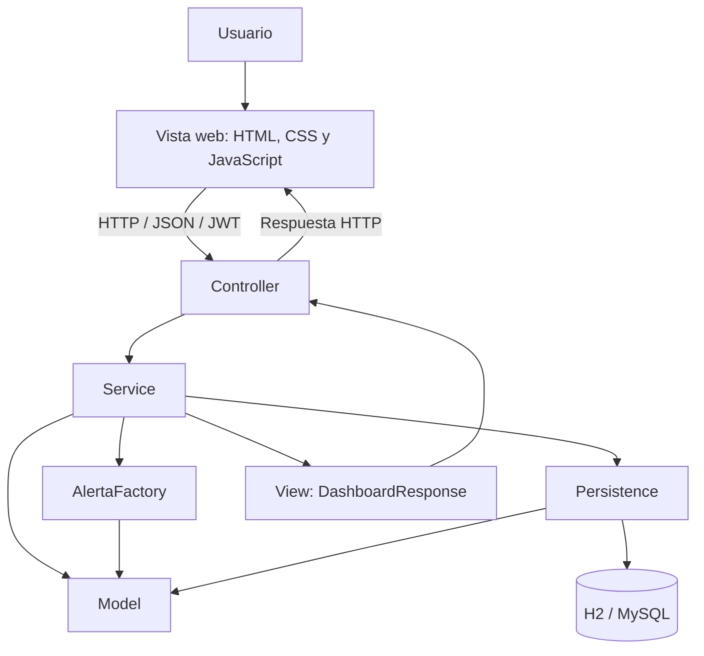
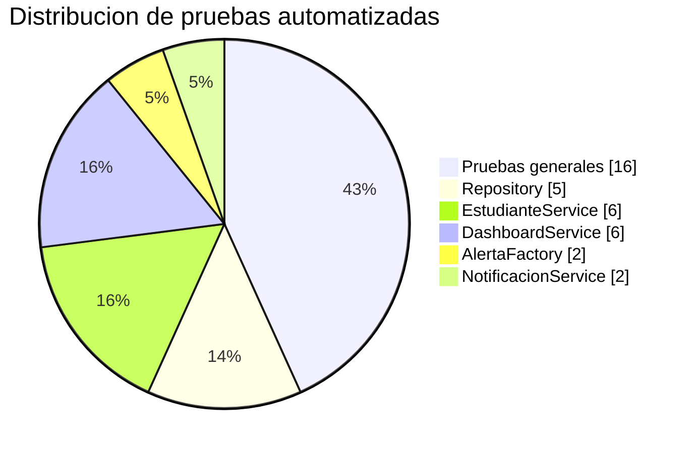

# SATE-UNIAJC

**Sistema de Alertas Tempranas y Acompañamiento Estudiantil**

**Institución:** Institución Universitaria Antonio José Camacho  
**Asignatura:** Ingeniería de Software I  
**Período académico:** 2026-2  
**Metodología:** Scrumban — Scrum y Kanban

---

## Equipo Scrum

| Integrante | Usuario GitHub | Rol |
|---|---|---|
| Darwin Alexander Valencia Flor | @darwinvf2765 | Product Owner (PO) |
| Juan David Rosero Guerrero | @JuanRGuerrero | Scrum Master (SM) |
| Jeremy Andrey Agreda Rosero | @jere1927 | Developer |

## Logo del proyecto


---

## Descripción del proyecto

**SATE-UNIAJC (Sistema de Alertas Tempranas y Acompañamiento Estudiantil)** es una aplicación web orientada al seguimiento y acompañamiento de los estudiantes de la Institución Universitaria Antonio José Camacho.

El sistema permite gestionar información académica, registrar asistencias e identificar condiciones de riesgo mediante alertas tempranas.

Su finalidad es facilitar la identificación de situaciones que puedan afectar el desempeño y la permanencia estudiantil, contribuyendo a brindar un acompañamiento oportuno.

## Visión del producto

Proporcionar una herramienta tecnológica que permita identificar oportunamente factores de riesgo académico y facilitar el acompañamiento de los estudiantes.

El producto busca centralizar información que apoye la toma de decisiones y fortalezca las estrategias de permanencia estudiantil.

## Objetivo general

Desarrollar un sistema web que permita gestionar información estudiantil, detectar posibles situaciones de riesgo académico y apoyar el seguimiento y acompañamiento de los estudiantes.

---

## Tecnologías utilizadas

| Tecnología | Uso |
|---|---|
| Java 25 | Lenguaje del backend |
| Spring Boot 3.4.5 | Framework principal |
| Spring Web | API REST |
| Spring Security | Seguridad y control de acceso |
| JWT | Autenticación mediante tokens |
| Spring Data JPA | Persistencia |
| H2 | Base de datos local en memoria |
| MySQL | Base de datos alternativa |
| Maven | Compilación y dependencias |
| JUnit 5 y Mockito | Pruebas automatizadas |
| HTML, CSS y JavaScript | Interfaz web |
| Git y GitHub | Control de versiones |
| GitHub Projects | Gestión ágil del proyecto |
| GitHub Actions | Integración y entrega continua |
| Mermaid | Documentación de diagramas |

---

## Arquitectura del sistema

SATE-UNIAJC utiliza una arquitectura por capas basada en los principios del patrón MVC (Model-View-Controller).

Durante la Sesión 13 se realizó una reestructuración modular orientada a mejorar la separación de responsabilidades, reducir el acoplamiento y favorecer la mantenibilidad del código.

### Capas arquitectónicas

| Capa | Paquete o ubicación | Responsabilidad |
|---|---|---|
| Modelo | `model` | Representación de entidades y datos del dominio |
| Vista | `view` y `resources/static` | Representación de respuestas y presentación web |
| Controlador | `controller` | Recepción de solicitudes HTTP y entrega de respuestas |
| Servicio | `service` | Coordinación de la lógica de negocio |
| Persistencia | `persistence` | Acceso y almacenamiento de datos |
| Configuración | `config` | Configuración general y seguridad |

La arquitectura contempla las entidades Estudiante, Usuario, Rol, Materia, Asistencia, Alerta y Tutoria.

### Estructura principal del backend

```text
src/main/java/co/uniajc/sate/
├── config/
├── controller/
├── model/
├── persistence/
├── service/
│   ├── evaluacion/
│   ├── factory/
│   └── notificacion/
├── view/
└── SateUniajcApplication.java
```

Se conserva el paquete base `co.uniajc.sate` para mantener la continuidad de la estructura existente y evitar modificaciones de nombres que no aporten directamente a la separación de responsabilidades.

La decisión se encuentra documentada en el ADR-0001.

### Diagrama conceptual de arquitectura



El diagrama representa el flujo arquitectónico general. Algunas operaciones existentes todavía utilizan repositorios directamente desde los controladores.

[Consultar documentación técnica](./docs/DOCUMENTACION_TECNICA.md)

[Consultar diagrama de arquitectura MVC](./docs/diagramas/ARQUITECTURA_MVC.md)

[Consultar ADR-0001](./docs/adr/0001-patron-mvc.md)

---

## Patrones de diseño

### MVC — Model-View-Controller

Permite separar la representación de los datos, la presentación y la recepción de solicitudes.

La incorporación de servicios especializados facilita que los controladores deleguen las operaciones de negocio.

Componentes incorporados durante la reestructuración:

- `EstudianteService`.
- `DashboardService`.
- `DashboardResponse`.

### Repository

Se utiliza para abstraer las operaciones de acceso a datos.

La gestión de estudiantes incorpora los componentes:

- `EstudianteRepository`: contrato de persistencia.
- `EstudianteRepositoryImpl`: implementación del contrato.

La implementación se apoya en Spring Data JPA y permite separar las operaciones de negocio de los detalles de persistencia.

### Factory

La clase `AlertaFactory` centraliza la construcción de las alertas académicas.

Su incorporación permite separar la creación de objetos de las responsabilidades de evaluación, notificación y almacenamiento.

### Evaluación y notificación de alertas

El motor utiliza abstracciones para separar las reglas de evaluación y las operaciones de notificación:

- `EvaluadorAlerta`.
- `EvaluadorInasistencia`.
- `EvaluadorPromedio`.
- `NotificacionService`.
- `NotificacionSistemaService`.

Esta organización favorece la aplicación de los principios SRP, OCP y DIP, así como los principios de diseño ágil YAGNI, KISS y DRY.

---

## Historias de usuario

El seguimiento oficial de las historias de usuario se realiza mediante GitHub Issues y GitHub Projects.

| Historia | Funcionalidad |
|---|---|
| HU-01 | Inicio de sesión |
| HU-02 | Recuperación de contraseña |
| HU-03 | Gestión de roles y permisos |
| HU-04 | Registro de asistencia |
| HU-05 | Registro académico y actualización de promedio |
| HU-06 | Alerta roja por inasistencia |
| HU-07 | Alerta amarilla por promedio bajo |

La existencia de una historia en el tablero no implica por sí sola que todos sus criterios de aceptación estén validados.

### Tablero Kanban

[**Abrir tablero SATE-UNIAJC en GitHub Projects**](https://github.com/users/darwinvf2765/projects/1)

[Consultar Issues del repositorio](https://github.com/darwinvf2765/SATE-UNIAJC/issues)

Los estados, responsables, tareas y criterios de aceptación deben consultarse directamente en las Issues y en el tablero.

---

## Motor de alertas académicas

El sistema incorpora un motor de evaluación para detectar condiciones de riesgo.

### HU-06 — Alerta roja

Se genera una alerta **ROJA** cuando la inasistencia supera el 15 %.

Ejemplos:

- 16 %: genera alerta roja.
- 15 %: no genera alerta roja.
- 10 %: no genera alerta roja.

### HU-07 — Alerta amarilla

Se genera una alerta **AMARILLA** cuando el promedio académico es inferior a 3.0.

Ejemplos:

- 2.8: genera alerta amarilla.
- 3.0: no genera alerta amarilla.
- 3.5: no genera alerta amarilla.

Si un estudiante cumple las dos condiciones, el motor puede registrar una alerta roja y una amarilla independientes.

El servicio de notificaciones evita generar otra alerta pendiente del mismo tipo para el mismo estudiante.

La creación de las alertas se delega a `AlertaFactory`.

---

## Documentación del proyecto

La documentación técnica, Scrum y de calidad se encuentra en la carpeta [`docs`](./docs/).

### Documentos generales

| Documento | Descripción |
|---|---|
| [Acta de constitución](./docs/acta_constitucion.md) | Integrantes y roles Scrum |
| [Índice de documentos](./docs/README_DOCUMENTOS.md) | Organización documental |
| [Documentación técnica](./docs/DOCUMENTACION_TECNICA.md) | Arquitectura y funcionamiento |
| [Plan de pruebas](./docs/PLAN_PRUEBAS.md) | Casos y evidencias de pruebas |
| [Retrospectiva](./docs/RETROSPECTIVA_SPRINT.md) | Resultados y propuestas de mejora |
| [Revisión YAGNI, KISS y DRY](./docs/REVISION_YAGNI_KISS_DRY.md) | Análisis de principios de diseño ágil |
| [ADR-0001](./docs/adr/0001-patron-mvc.md) | Registro de decisiones arquitectónicas |
| [Deuda técnica](./docs/DEUDA_TECNICA.md) | Análisis de deuda técnica y mantenibilidad |

### Diagramas UML y arquitectónicos

| Diagrama | Enlace |
|---|---|
| Arquitectura MVC | [Visualizar](./docs/diagramas/ARQUITECTURA_MVC.md) |
| Clases HU-04 — Asistencia | [Visualizar](./docs/diagramas/CLASES_HU04.md) |
| Clases HU-05 — Registro académico | [Visualizar](./docs/diagramas/CLASES_HU05.md) |
| Secuencia del motor de alertas | [Visualizar](./docs/secuencia.md) |
| Despliegue del sistema | [Visualizar](./docs/despliegue.md) |

Los diagramas utilizan Mermaid y pueden visualizarse directamente desde GitHub.

---

## Entregables de la Sesión 12

La Sesión 12 de Ingeniería de Software I contempla UML dinámico, entrega continua y principios de diseño ágil.

| Entregable | Archivo |
|---|---|
| Diagrama de secuencia | [`docs/secuencia.md`](./docs/secuencia.md) |
| Diagrama de despliegue | [`docs/despliegue.md`](./docs/despliegue.md) |
| Integración continua | [`.github/workflows/ci.yml`](./.github/workflows/ci.yml) |
| Entrega continua | [`.github/workflows/cd.yml`](./.github/workflows/cd.yml) |
| Revisión YAGNI, KISS y DRY | [`docs/REVISION_YAGNI_KISS_DRY.md`](./docs/REVISION_YAGNI_KISS_DRY.md) |

El diagrama de despliegue diferencia el entorno local implementado de la infraestructura de staging propuesta.

El workflow CD empaqueta la aplicación y publica el archivo JAR como artefacto. El despliegue en un servidor externo permanece pendiente de configuración.

---

## Entregables de la Sesión 13

La Sesión 13 aborda arquitectura evolutiva, reestructuración modular, patrón MVC, patrones de diseño, deuda técnica y registros de decisiones arquitectónicas.

### Entregables principales

| Entregable | Evidencia | Estado |
|---|---|---|
| Reestructuración modular MVC | [Código fuente](./src/main/java/co/uniajc/sate/) | Implementado localmente |
| Interfaz e implementación Repository | [Persistencia](./src/main/java/co/uniajc/sate/persistence/) | Implementado localmente |
| Registro de decisión arquitectónica | [ADR-0001](./docs/adr/0001-patron-mvc.md) | Documentado |
| Pruebas automatizadas JUnit 5 | [Pruebas](./src/test/java/co/uniajc/sate/) | 37 pruebas aprobadas localmente |
| Validación CI/CD | [GitHub Actions](https://github.com/darwinvf2765/SATE-UNIAJC/actions) | Pendiente de verificación remota de los cambios |

### Evidencias complementarias

| Actividad | Evidencia |
|---|---|
| Implementación del patrón Factory | [AlertaFactory](./src/main/java/co/uniajc/sate/service/factory/AlertaFactory.java) |
| Separación de responsabilidades | EstudianteService y DashboardService |
| Representación de respuestas | DashboardResponse |
| Análisis de deuda técnica | [DEUDA_TECNICA.md](./docs/DEUDA_TECNICA.md) |
| Análisis de mantenibilidad | Características de calidad de ISO/IEC 25010 |
| Validación funcional básica | Ejecución local de la aplicación |

La reestructuración busca conservar las funcionalidades existentes sin introducir cambios innecesarios en las reglas de negocio.

---

## Deuda técnica y calidad del software

Durante la Sesión 13 se revisaron oportunidades de mejora relacionadas con:

- Separación de responsabilidades.
- Acoplamiento entre controladores y persistencia.
- Organización modular del código.
- Centralización de la creación de alertas.
- Capacidad de realizar pruebas unitarias.
- Mantenibilidad y modificabilidad.
- Reutilización de componentes.

El análisis utiliza como referencia las características de mantenibilidad de ISO/IEC 25010.

La aplicación de estas mejoras no constituye una certificación formal de cumplimiento de la norma.

[Consultar análisis de deuda técnica](./docs/DEUDA_TECNICA.md)

---

## Integración continua y entrega continua

El repositorio utiliza GitHub Actions para automatizar tareas de verificación y empaquetado.

### CI — Integración continua

Archivo: `.github/workflows/ci.yml`

- Configura Java 25.
- Ejecuta Maven.
- Compila el proyecto.
- Ejecuta las pruebas automatizadas.

### CD — Entrega continua

Archivo: `.github/workflows/cd.yml`

- Ejecuta las pruebas automatizadas.
- Empaqueta la aplicación Spring Boot.
- Verifica la generación del archivo JAR.
- Publica el artefacto en GitHub Actions.

La ejecución local exitosa de las pruebas no sustituye la verificación de los workflows en GitHub Actions.

[**Consultar las ejecuciones de GitHub Actions**](https://github.com/darwinvf2765/SATE-UNIAJC/actions)

---

## Ejecución local

### Requisitos

- JDK 25.
- Maven 3.9 o superior.
- Git para clonar el repositorio.

La configuración predeterminada utiliza H2 en memoria, por lo que no es necesario instalar MySQL para la ejecución local básica.

### 1. Clonar el repositorio

```bash
git clone https://github.com/darwinvf2765/SATE-UNIAJC.git
```

### 2. Entrar al proyecto

```bash
cd SATE-UNIAJC
```

### 3. Comprobar Java y Maven

```bash
java -version
mvn -version
```

Ambos deben utilizar un entorno compatible con Java 25.

### 4. Ejecutar las pruebas

```bash
mvn clean test
```

### 5. Iniciar la aplicación

```bash
mvn spring-boot:run
```

### 6. Abrir la interfaz

Desde el navegador:

http://localhost:8080

### 7. Detener la aplicación

Presionar `Ctrl + C` en la terminal.

Los cambios realizados sobre la base de datos H2 en memoria no se conservan después de detener la aplicación.

---

## Resultados de pruebas

En la verificación local del 27 de noviembre de 2026 se ejecutó:

```bash
mvn clean test
```

### Resultados obtenidos

| Indicador | Resultado |
|---|---|
| Total de pruebas | 37 |
| Fallos | 0 |
| Errores | 0 |
| Omitidas | 0 |
| Resultado | BUILD SUCCESS |
| Tiempo total | 9.619 segundos |

### Distribución de pruebas automatizadas

| Clase de pruebas | Cantidad |
|---|---:|
| SateUniajcApplicationTests | 16 |
| EstudianteRepositoryImplTest | 5 |
| EstudianteServiceTest | 6 |
| DashboardServiceTest | 6 |
| AlertaFactoryTest | 2 |
| NotificacionSistemaServiceTest | 2 |
| **Total** | **37** |



### Evolución de las pruebas

| Indicador | Sesión 12 | Sesión 13 |
|---|---:|---:|
| Pruebas automatizadas | 18 | 37 |
| Clases de pruebas | 2 | 6 |
| Fallos | 0 | 0 |
| Errores | 0 | 0 |

Se incorporaron 19 pruebas adicionales, lo que representa un incremento aproximado del 105.6 % en la cantidad de pruebas automatizadas.

Este incremento no equivale a un porcentaje de cobertura del código.

Durante la ejecución se presentaron advertencias relacionadas con Mockito, Byte Buddy y la carga dinámica de agentes Java, sin impedir la ejecución exitosa de las pruebas.

### Validación funcional básica

Después de la reestructuración se inició la aplicación y se verificaron:

- Carga de la pantalla de inicio de sesión.
- Acceso al dashboard.
- Visualización del registro académico.
- Consulta de alertas existentes.
- Ejecución manual del motor de alertas.
- Generación de una nueva alerta amarilla.
- Visualización del portal de acompañamiento y tutorías.

Estas verificaciones proporcionan evidencia favorable sobre la conservación del comportamiento del sistema.

No sustituyen las pruebas de integración completas, la validación de seguridad ni la comprobación de todos los criterios de aceptación.

[Consultar el plan de pruebas](./docs/PLAN_PRUEBAS.md)

---

## Estado del proyecto

El repositorio incluye funcionalidades de autenticación, registro académico, asistencia, alertas, tutorías y dashboard.

Se encuentran configuradas las automatizaciones CI y CD y están disponibles los diagramas solicitados en la Sesión 12.

Durante la Sesión 13 se incorporaron mejoras arquitectónicas relacionadas con:

- Reestructuración modular MVC.
- Patrón Repository.
- Patrón Factory.
- Servicios especializados.
- Representación de respuestas del dashboard.
- Ampliación de las pruebas automatizadas.
- Documentación de decisiones arquitectónicas.
- Gestión de deuda técnica.

El proyecto continúa sujeto a la validación de criterios de aceptación, revisión de seguridad, pruebas de integración, medición de cobertura y configuración futura de un entorno de staging real.

---

## Control de versiones

El equipo utiliza Git y GitHub para mantener el código fuente y la documentación.

La rama principal del repositorio se llama `master`.

Los cambios correspondientes a la Sesión 13 se desarrollan en la rama `Juan-sesion-13`.

Se recomienda ejecutar las pruebas automatizadas y revisar los resultados de GitHub Actions antes de integrar nuevas modificaciones.

La integración de los cambios debe realizarse mediante revisión del código y Pull Request.

**Repositorio oficial:**

https://github.com/darwinvf2765/SATE-UNIAJC