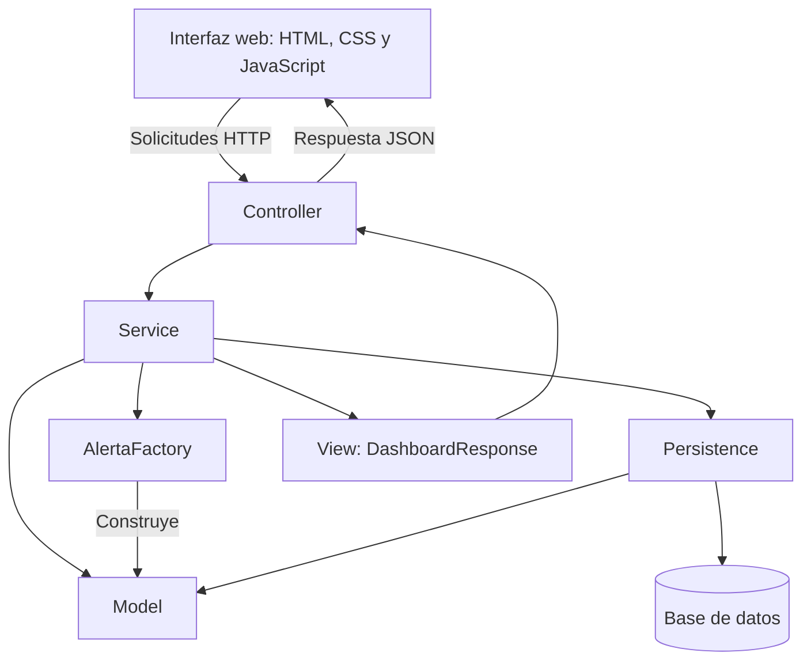
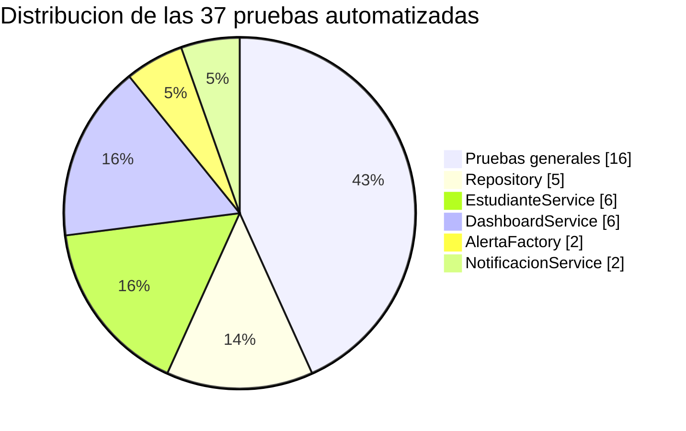
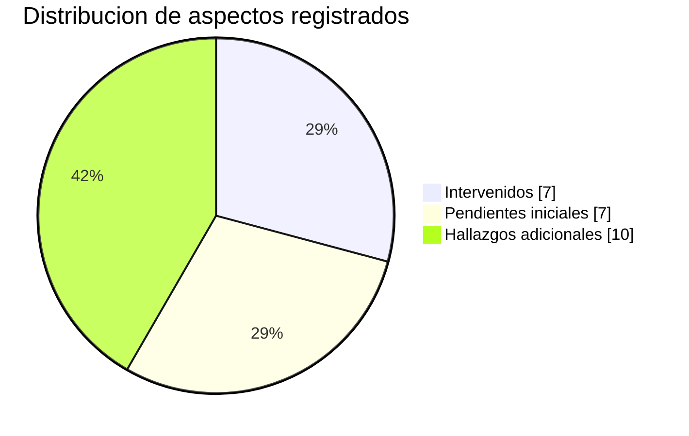

# Análisis y gestión de deuda técnica — SATE-UNIAJC

## Sesión 13 — Ingeniería de Software I

**Proyecto:** SATE-UNIAJC — Sistema de Alertas Tempranas y Acompañamiento Estudiantil

**Institución:** Institución Universitaria Antonio José Camacho

**Asignatura:** Ingeniería de Software I

**Fecha:** 27 de noviembre de 2026

**Rama de trabajo:** `Juan-sesion-13`

**Tema:** Arquitectura evolutiva, reestructuración modular, patrones de diseño y deuda técnica.

---

## 1. Objetivo

Identificar, analizar, documentar y reducir la deuda técnica relacionada con la arquitectura y la organización del código fuente de SATE-UNIAJC mediante la aplicación del patrón MVC, los patrones Repository y Factory, la separación de responsabilidades y el fortalecimiento de las pruebas automatizadas.

Las mejoras buscan incrementar la mantenibilidad del sistema sin modificar intencionalmente las reglas de negocio ni incorporar funcionalidades ajenas al alcance actual del proyecto.

Adicionalmente, se documentan las oportunidades de mejora identificadas durante la revisión de los diagramas de clases, los diagramas de secuencia y el plan de pruebas de la sesión 13.

## 2. Alcance

El análisis se concentra en los siguientes componentes:

- Capa de controladores.
- Capa de servicios.
- Capa de persistencia.
- Modelo de dominio.
- Representación de respuestas del dashboard.
- Creación de alertas académicas.
- Autenticación y recuperación de contraseña.
- Registro de asistencia.
- Actualización de información académica.
- Consistencia de las operaciones de persistencia.
- Pruebas unitarias automatizadas.
- Integración continua y entrega continua.
- Documentación de decisiones arquitectónicas.

Este documento complementa la revisión de los principios YAGNI, KISS y DRY realizada durante la sesión 12.

La revisión no constituye una auditoría exhaustiva de seguridad, rendimiento o calidad de todo el sistema.

Los hallazgos pendientes se registran como oportunidades de mejora, riesgos potenciales o aspectos que requieren validación adicional.

## 3. Concepto de deuda técnica

La deuda técnica representa el esfuerzo adicional que puede ser necesario en el futuro como consecuencia de decisiones de implementación que dificultan el mantenimiento, la evolución o la comprensión de un sistema de software.

No toda deuda técnica implica un error funcional. Un sistema puede funcionar correctamente y presentar oportunidades de mejora en su estructura interna.

En SATE-UNIAJC se aborda la deuda técnica mediante refactorizaciones incrementales, pruebas automatizadas y documentación de las decisiones arquitectónicas.

La gestión de deuda técnica comprende:

- Identificación de oportunidades de mejora.
- Análisis de sus posibles consecuencias.
- Priorización de las intervenciones.
- Refactorización incremental.
- Verificación mediante pruebas.
- Documentación de los cambios.
- Seguimiento de los aspectos pendientes.

La identificación de deuda técnica no implica que todos los aspectos deban resolverse inmediatamente.

Su tratamiento debe considerar el alcance del proyecto, los riesgos, las prioridades del Product Owner y la capacidad del equipo Scrum.

## 4. Deuda técnica identificada

### 4.1. Exceso de responsabilidades en los controladores

Antes de la refactorización, determinados controladores concentraban responsabilidades relacionadas con la atención de solicitudes HTTP, el acceso a datos y el procesamiento de información.

Los principales componentes intervenidos fueron:

- `EstudianteController.java`.
- `DashboardController.java`.

Esta situación dificultaba la separación de responsabilidades y la realización de pruebas unitarias independientes.

**Solución implementada:**

- Creación de `EstudianteService.java`.
- Creación de `DashboardService.java`.
- Delegación de la lógica de negocio a la capa de servicios.
- Conservación de los controladores como componentes encargados de gestionar las solicitudes HTTP.

**Resultado esperado:**

Mayor cohesión, menor acoplamiento entre componentes y mayor facilidad para realizar pruebas independientes.

### 4.2. Acoplamiento con la tecnología de persistencia

El acceso a los datos de estudiantes se encontraba vinculado directamente a una interfaz de Spring Data JPA.

**Solución implementada:**

- Reorganización del paquete `repository` al paquete `persistence`.
- Definición de la interfaz `EstudianteRepository`.
- Creación de `EstudianteJpaRepository`.
- Creación de `EstudianteRepositoryImpl`.
- Incorporación de pruebas unitarias para la implementación del repositorio.

La interfaz permite separar el contrato de acceso a estudiantes de los detalles específicos de persistencia.

Los componentes consumidores utilizan la abstracción `EstudianteRepository`, mientras que su implementación delega las operaciones correspondientes a Spring Data JPA.

**Resultado esperado:**

Mayor independencia respecto a los detalles de almacenamiento y facilidad para sustituir dependencias durante las pruebas.

Esta separación no elimina completamente la dependencia de JPA en el modelo de dominio ni implica que todos los repositorios del proyecto hayan sido refactorizados.

### 4.3. Construcción directa de alertas académicas

El servicio `NotificacionSistemaService` era responsable tanto de verificar la existencia de alertas pendientes como de construir directamente las entidades de alerta y almacenarlas.

Aunque esta implementación era funcional, concentraba responsabilidades diferentes dentro del mismo componente.

**Solución implementada:**

- Creación de `AlertaFactory.java`.
- Centralización de la construcción de objetos `Alerta`.
- Inyección de la fábrica en `NotificacionSistemaService`.
- Conservación de la validación de alertas duplicadas.
- Incorporación de pruebas para alertas rojas y amarillas.

La fábrica recibe el estudiante y el resultado de la evaluación para construir la entidad correspondiente.

Se conserva una única entidad `Alerta`, evitando introducir jerarquías de clases innecesarias.

La solución corresponde a una fábrica simple que centraliza la creación de objetos. No constituye una implementación estricta del patrón GoF Factory Method mediante una jerarquía de creadores.

**Resultado esperado:**

Mayor separación de responsabilidades y facilidad para mantener la construcción de alertas.

### 4.4. Representación de la información del dashboard

El controlador del dashboard concentraba responsabilidades relacionadas con la obtención, procesamiento y representación de indicadores.

**Solución implementada:**

- Creación de `DashboardService`.
- Creación de `DashboardResponse` dentro del paquete `view`.
- Separación del cálculo de indicadores respecto a la gestión de solicitudes HTTP.

`DashboardResponse` actúa como un objeto de transferencia de datos para representar la respuesta del dashboard.

La interfaz gráfica continúa implementada mediante HTML, CSS y JavaScript dentro de `src/main/resources/static`.

El paquete `view` representa la estructura de respuesta del dashboard y no reemplaza la interfaz gráfica del sistema.

**Resultado esperado:**

Mayor claridad en la estructura de las respuestas y facilidad para probar los cálculos de manera independiente.

### 4.5. Capacidad de prueba de los componentes

Antes de la sesión 13, el proyecto contaba con 18 pruebas automatizadas aprobadas.

La reorganización arquitectónica permitió incorporar pruebas específicas para los nuevos componentes y fortalecer las pruebas existentes.

**Solución implementada:**

- Pruebas unitarias del repositorio de estudiantes.
- Pruebas unitarias del servicio de estudiantes.
- Pruebas unitarias del servicio del dashboard.
- Pruebas unitarias de la fábrica de alertas.
- Actualización de las pruebas del servicio de notificaciones.

**Resultado obtenido:**

37 pruebas automatizadas aprobadas localmente durante la ejecución registrada de la sesión 13.

La ejecución final de regresión deberá confirmar nuevamente estos resultados antes de publicar los cambios.

## 5. Matriz de deuda técnica intervenida

| ID | Deuda técnica identificada | Acción realizada | Estado |
|---|---|---|---|
| DT-01 | Exceso de responsabilidades en EstudianteController | Extracción de EstudianteService | Intervenida |
| DT-02 | Exceso de responsabilidades en DashboardController | Extracción de DashboardService | Intervenida |
| DT-03 | Acoplamiento del acceso a estudiantes con Spring Data JPA | Aplicación del patrón Repository | Intervenida |
| DT-04 | Construcción directa de alertas en el servicio de notificaciones | Implementación de AlertaFactory | Intervenida |
| DT-05 | Representación de indicadores dentro del controlador | Creación de DashboardResponse | Intervenida |
| DT-06 | Capacidad de prueba limitada en los componentes intervenidos | Incorporación de pruebas unitarias | Intervenida |
| DT-07 | Falta de registro formal de las decisiones arquitectónicas | Creación del ADR-0001 | Intervenida |

El estado **Intervenida** indica que se realizaron acciones concretas para reducir la deuda identificada.

No implica que se haya eliminado toda la deuda técnica del componente ni que se haya demostrado formalmente la ausencia de defectos.

## 6. Relación con los principios de diseño

### 6.1. SRP — Single Responsibility Principle

El principio de responsabilidad única establece que un componente debe tener una responsabilidad claramente definida y una razón principal para cambiar.

Aplicación en SATE-UNIAJC:

- Los controladores gestionan solicitudes HTTP.
- Los servicios coordinan la lógica de negocio.
- Los repositorios gestionan el acceso a datos.
- La fábrica centraliza la construcción de alertas.
- `DashboardResponse` representa los datos de respuesta del dashboard.

La aplicación de este principio se concentra principalmente en los componentes intervenidos durante la sesión 13.

### 6.2. DIP — Dependency Inversion Principle

El principio de inversión de dependencias promueve la utilización de abstracciones para reducir la dependencia directa de detalles de implementación.

Aplicación en SATE-UNIAJC:

- Los componentes consumidores utilizan la interfaz `EstudianteRepository`.
- `EstudianteRepositoryImpl` implementa el contrato de persistencia.
- La implementación delega las operaciones correspondientes a Spring Data JPA.

Esta separación facilita el uso de dependencias simuladas durante las pruebas unitarias.

### 6.3. OCP — Open/Closed Principle

El principio abierto/cerrado establece que los componentes deben favorecer la extensión sin exigir modificaciones innecesarias de su comportamiento existente.

El motor de alertas conserva la interfaz `EvaluadorAlerta` y sus implementaciones especializadas.

La incorporación de `AlertaFactory` centraliza la construcción de las entidades, facilitando cambios futuros relacionados con su creación.

No se afirma que todos los componentes del sistema cumplan completamente este principio.

### 6.4. KISS — Keep It Simple, Stupid

Se conserva una arquitectura modular sencilla, utilizando los mecanismos existentes de Spring Boot.

No se incorporan microservicios, frameworks adicionales ni estructuras de clases innecesarias.

La implementación de una fábrica simple permite centralizar la creación de alertas sin introducir una jerarquía de productos y creadores que no resulta necesaria para el alcance actual.

### 6.5. DRY — Don't Repeat Yourself

La separación de responsabilidades favorece la reutilización de los servicios, los contratos de persistencia y la construcción centralizada de alertas.

No se ha realizado una medición exhaustiva de duplicación de código.

La existencia de operaciones repetidas de persistencia se registra como una oportunidad de revisión adicional.

### 6.6. YAGNI — You Aren't Gonna Need It

Las modificaciones se concentran en las necesidades arquitectónicas actuales.

No se implementan funcionalidades adicionales que no correspondan al alcance definido para la sesión 13.

Las oportunidades de mejora pendientes se documentan para su evaluación futura, evitando introducir cambios sin una necesidad justificada.

La revisión previa de estos principios se encuentra en:

[Revisión de principios YAGNI, KISS y DRY](REVISION_YAGNI_KISS_DRY.md).

## 7. Relación con ISO/IEC 25010

La norma ISO/IEC 25010 proporciona un modelo de calidad del producto de software.

Las modificaciones realizadas se relacionan principalmente con la característica de mantenibilidad y sus subcaracterísticas.

| Subcaracterística | Aplicación en SATE-UNIAJC | Beneficio esperado |
|---|---|---|
| Modularidad | Separación de controladores, servicios, modelos, persistencia y representación de respuestas | Menor impacto de los cambios entre componentes |
| Reusabilidad | Servicios, contratos de persistencia y fábrica de alertas | Posibilidad de reutilizar componentes |
| Analizabilidad | Responsabilidades diferenciadas y documentación arquitectónica | Mayor facilidad para comprender el código |
| Modificabilidad | Separación de la lógica de negocio y los detalles de persistencia | Mayor facilidad para introducir cambios |
| Capacidad de prueba | Incorporación de pruebas unitarias y dependencias simuladas | Mayor facilidad para verificar componentes de forma independiente |

Los hallazgos adicionales también se relacionan con aspectos de seguridad, fiabilidad y adecuación funcional.

La relación con ISO/IEC 25010 constituye un análisis cualitativo de las mejoras realizadas.

No representa una certificación de cumplimiento de la norma ni una medición formal de todas las características de calidad del producto.

## 8. Evolución de la arquitectura

### 8.1. Organización de los paquetes

La estructura principal del código fuente después de la refactorización es:

```text
src/main/java/co/uniajc/sate/
├── config/
├── controller/
├── model/
├── persistence/
├── service/
│   ├── evaluacion/
│   ├── factory/
│   └── notificacion/
├── view/
└── SateUniajcApplication.java
```

Se conserva el paquete base `co.uniajc.sate` para mantener la compatibilidad con la estructura existente del proyecto.

La justificación de esta decisión se encuentra documentada en el ADR-0001.

### 8.2. Flujo arquitectónico general



El diagrama representa de manera conceptual las responsabilidades y relaciones principales de los componentes intervenidos.

No representa exhaustivamente todas las dependencias del sistema.

Algunos controladores no intervenidos todavía mantienen dependencias directas hacia repositorios, situación documentada en DT-15.

## 9. Evolución de las pruebas automatizadas

### 9.1. Comparación antes y después

| Indicador | Antes de la sesión 13 | Después de la refactorización |
|---|---:|---:|
| Archivos Java de producción compilados | 34 | 40 |
| Clases de pruebas compiladas | 2 | 6 |
| Pruebas ejecutadas | 18 | 37 |
| Pruebas aprobadas | 18 | 37 |
| Fallos | 0 | 0 |
| Errores | 0 | 0 |
| Pruebas omitidas | 0 | 0 |
| Resultado | BUILD SUCCESS | BUILD SUCCESS |

Se incorporaron 19 pruebas automatizadas adicionales, lo que representa un incremento aproximado del 105,6 % respecto a la cantidad inicial.

El cálculo correspondiente es:

```text
Incremento = ((37 - 18) / 18) × 100

Incremento = 105,6 %
```

El incremento en la cantidad de pruebas no equivale a un porcentaje de cobertura de código.

### 9.2. Distribución de las pruebas

| Clase de pruebas | Pruebas aprobadas |
|---|---:|
| SateUniajcApplicationTests | 16 |
| EstudianteRepositoryImplTest | 5 |
| EstudianteServiceTest | 6 |
| DashboardServiceTest | 6 |
| AlertaFactoryTest | 2 |
| NotificacionSistemaServiceTest | 2 |
| **Total** | **37** |

La descripción de los casos individuales, sus escenarios y su trazabilidad se encuentra en:

[Plan de pruebas](PLAN_PRUEBAS.md).

### 9.3. Evidencia de ejecución local

Comando ejecutado:

```bash
mvn clean test
```

Resultado registrado el 27 de noviembre de 2026:

```text
Tests run: 37, Failures: 0, Errors: 0, Skipped: 0

BUILD SUCCESS

Total time: 9.619 s
```

Durante la ejecución se presentaron advertencias relacionadas con Mockito, Byte Buddy y la carga dinámica de agentes en Java.

Estas advertencias no impidieron la compilación ni la ejecución exitosa de las pruebas.

Su revisión se considera una oportunidad de mantenimiento futuro.

La evidencia corresponde a una ejecución local realizada durante la refactorización.

La ejecución final de regresión y la validación remota mediante GitHub Actions permanecen pendientes de confirmación.

### 9.4. Evolución de las pruebas por componente



La distribución permite identificar los componentes que cuentan con pruebas automatizadas específicas.

No representa una medición de cobertura de instrucciones, ramas, métodos o clases.

### 9.5. Limitaciones de la evidencia automatizada

Las pruebas ejecutadas proporcionan evidencia favorable sobre los escenarios incluidos en la suite.

Sin embargo, no permiten afirmar que:

- Todos los endpoints HTTP hayan sido verificados.
- Todos los permisos por rol funcionen correctamente.
- La recuperación de contraseña sea segura para producción.
- Todas las operaciones sean atómicas.
- La persistencia en MySQL haya sido validada.
- El sistema esté libre de defectos.
- La cobertura de código sea del 100 %.

El archivo `pom.xml` revisado no incluye una configuración explícita de JaCoCo para generar informes de cobertura.

La incorporación de una medición formal de cobertura se mantiene como una oportunidad de mejora.

## 10. Validación funcional básica

Después de las modificaciones se ejecutó localmente la aplicación mediante:

```bash
mvn spring-boot:run
```

Durante las verificaciones funcionales básicas registradas se observó:

- Disponibilidad de la pantalla de inicio de sesión.
- Acceso al sistema.
- Visualización del dashboard.
- Consulta del listado académico.
- Visualización del motor de alertas.
- Ejecución de la evaluación de alertas.
- Generación de una alerta amarilla durante la evaluación.
- Visualización del portal de acompañamiento.

Los indicadores iniciales del dashboard conservaron los valores observados antes de la refactorización.

Estas verificaciones proporcionan evidencia funcional básica, pero no reemplazan una prueba integral de regresión ni la validación completa de todos los criterios de aceptación.

La validación funcional final deberá realizarse antes de publicar la rama de trabajo.

## 11. Deuda técnica restante y oportunidades de mejora

La refactorización realizada durante la sesión 13 no elimina todas las oportunidades de mejora del sistema.

La revisión posterior de los diagramas de clases, los diagramas de secuencia y el plan de pruebas permitió identificar aspectos adicionales relacionados con la mantenibilidad, seguridad, consistencia y capacidad de prueba.

Los siguientes hallazgos no implican necesariamente la existencia de defectos funcionales confirmados.

### 11.1. Oportunidades de mejora identificadas inicialmente

| ID | Oportunidad de mejora | Prioridad propuesta | Estado |
|---|---|---|---|
| DT-08 | Ampliar las pruebas de integración entre controladores, servicios y persistencia | Alta | Pendiente |
| DT-09 | Revisar la seguridad de autenticación, autorización y gestión de credenciales | Alta | Pendiente de evaluación |
| DT-10 | Incorporar mediciones de cobertura de código | Media | Pendiente |
| DT-11 | Revisar los controladores y servicios no intervenidos durante la sesión 13 | Media | Pendiente |
| DT-12 | Revisar la configuración de Mockito y Byte Buddy para futuras versiones de Java | Media | Pendiente |
| DT-13 | Verificar la coherencia entre los datos iniciales y las reglas vigentes del motor de alertas | Media | Pendiente |
| DT-14 | Evaluar el comportamiento de la persistencia en el entorno MySQL | Media | Pendiente de validación |

### 11.2. Hallazgos adicionales

| ID | Oportunidad de mejora | Prioridad propuesta | Estado |
|---|---|---|---|
| DT-15 | Acceso directo a repositorios desde controladores no refactorizados | Media | Pendiente |
| DT-16 | Entrega directa del token de recuperación y respuestas diferenciadas | Alta | Pendiente |
| DT-17 | Operaciones repetidas de guardado de estudiantes | Media | Pendiente |
| DT-18 | Atomicidad de operaciones relacionadas | Alta | Pendiente de evaluación |
| DT-19 | Dos mecanismos de actualización del porcentaje de inasistencia | Media | Pendiente de evaluación |
| DT-20 | Verificar el alcance de calificaciones parciales de HU-05 | Por evaluar | Pendiente de validación |
| DT-21 | Validación de campos omitidos y registros repetidos | Media | Pendiente de evaluación |
| DT-22 | Prevención de alertas duplicadas bajo concurrencia | Media | Pendiente de evaluación |
| DT-23 | Coherencia de la heurística de deserción | Media | Pendiente de evaluación |
| DT-24 | Interpretación del indicador de efectividad de tutorías | Media | Pendiente de validación |

### 11.3. DT-15 — Acceso directo a repositorios

**Componentes relacionados:**

- `AsistenciaController`.
- `AlertaController`.
- `TutoriaController`.

**Hallazgo:**

Estos controladores conservan operaciones directas sobre repositorios de persistencia.

La separación entre controladores y servicios implementada para estudiantes y dashboard todavía no se aplica de manera uniforme en todos los módulos.

**Impacto potencial:**

- Acoplamiento entre las capas HTTP y de persistencia.
- Dificultad para reutilizar operaciones de negocio.
- Mayor esfuerzo para realizar pruebas independientes.
- Distribución de responsabilidades entre diferentes capas.

**Acción propuesta:**

Evaluar la extracción progresiva de las operaciones correspondientes hacia servicios especializados, sin introducir abstracciones innecesarias.

La intervención deberá conservar los contratos HTTP y las reglas de negocio existentes.

**Relación:** DT-01, DT-02 y DT-11.

### 11.4. DT-16 — Recuperación de contraseña

**Componentes relacionados:**

- `AuthController`.
- `AuthService`.
- `UsuarioRepository`.

**Hallazgo:**

El endpoint de recuperación retorna directamente el token generado dentro de la respuesta HTTP.

Además, el comportamiento de la respuesta difiere cuando el correo electrónico no corresponde a un usuario registrado.

El servicio establece una expiración de 15 minutos y elimina el token después de utilizarlo correctamente.

Sin embargo, en los componentes revisados no se identifica un mecanismo de envío del token mediante un canal independiente y autorizado.

**Impacto potencial:**

- Exposición de información sensible.
- Riesgos asociados al proceso de recuperación.
- Divulgación de información sobre cuentas existentes.

**Acción propuesta:**

- Diseñar un mecanismo seguro de entrega del token.
- Utilizar respuestas externas uniformes.
- Revisar el almacenamiento y protección del token.
- Verificar las políticas de nuevas contraseñas.
- Incorporar pruebas de seguridad específicas.
- Evitar registrar tokens en evidencias públicas.

**Relación:** HU-02 y DT-09.

La revisión debe priorizarse antes de considerar el proceso apto para un entorno de producción.

### 11.5. DT-17 — Operaciones repetidas de guardado

**Componentes relacionados:**

- `EstudianteService`.
- `AlertaService`.
- `EstudianteRepository`.

**Hallazgo:**

El método `actualizarRegistro` de `EstudianteService` realiza dos llamadas directas a `save`.

Adicionalmente, `AlertaService` guarda el estudiante después de actualizar su estado de alerta.

La prueba unitaria correspondiente verifica las llamadas directas a `save` de `EstudianteService` utilizando un servicio de alertas simulado.

Esto no permite determinar por sí solo la cantidad de operaciones SQL ejecutadas realmente.

**Impacto potencial:**

- Operaciones de persistencia redundantes.
- Mayor complejidad en el flujo de actualización.
- Dificultad para establecer responsabilidades sobre el almacenamiento definitivo.

**Acción propuesta:**

Revisar el flujo completo y determinar si es posible centralizar el guardado sin alterar el comportamiento funcional ni la consistencia de los datos.

**Relación:** HU-05, HU-06 y HU-07.

### 11.6. DT-18 — Atomicidad de operaciones relacionadas

**Componentes relacionados:**

- `AsistenciaService`.
- `EstudianteService`.
- `AlertaService`.
- `NotificacionSistemaService`.

**Hallazgo:**

El registro de asistencia y la actualización académica involucran varias operaciones relacionadas sobre estudiantes, asistencias y alertas.

En los métodos de servicio revisados no se observa una delimitación transaccional explícita que agrupe todo el flujo de negocio.

Esto no significa que las operaciones individuales de los repositorios carezcan de mecanismos transaccionales.

**Impacto potencial:**

Si una operación posterior falla, podría existir un estado parcialmente actualizado.

Este comportamiento requiere comprobación mediante pruebas de integración.

**Acción propuesta:**

- Revisar los límites transaccionales.
- Evaluar el uso apropiado de `@Transactional`.
- Incorporar pruebas de reversión ante errores.
- Verificar la consistencia entre entidades.
- Comprobar el comportamiento ante fallos de persistencia.

**Relación:** HU-04, HU-05, HU-06 y HU-07.

### 11.7. DT-19 — Actualización de inasistencia

**Componentes relacionados:**

- `AsistenciaService`.
- `EstudianteService`.
- `Estudiante`.

**Hallazgo:**

El porcentaje de inasistencia puede actualizarse mediante dos mecanismos:

1. Cálculo a partir de los registros de asistencia.
2. Actualización directa mediante el registro académico.

La coexistencia de ambos mecanismos requiere definir cuál constituye la fuente autorizada de información para cada escenario.

**Impacto potencial:**

- Diferencias entre el porcentaje almacenado y los registros individuales de asistencia.
- Resultados inconsistentes en evaluaciones posteriores.
- Dificultad para establecer la trazabilidad del dato.

**Acción propuesta:**

Definir con el equipo las reglas de actualización y la fuente de información correspondiente.

No se propone eliminar ninguno de los mecanismos sin revisar previamente los requisitos oficiales.

**Relación:** HU-04, HU-05 y HU-06.

### 11.8. DT-20 — Alcance funcional de HU-05

**Componentes relacionados:**

- `EstudianteController`.
- `EstudianteService`.
- `Estudiante`.

**Hallazgo:**

La implementación actual permite actualizar directamente el promedio académico del estudiante.

En el modelo revisado no existe una entidad específica para almacenar calificaciones parciales individuales.

La descripción original de HU-05 hace referencia al registro de calificaciones parciales para actualizar el rendimiento académico.

**Impacto potencial:**

Puede existir una diferencia entre el alcance implementado y la descripción original de la historia de usuario.

**Acción propuesta:**

- Consultar los criterios oficiales de HU-05.
- Validar el alcance con el Product Owner.
- Determinar si se requiere registrar notas individuales.
- Documentar cualquier cambio aprobado.
- Incorporar las pruebas correspondientes si se amplía el alcance.

Este hallazgo corresponde a una posible brecha de alcance funcional, no necesariamente a una deuda técnica arquitectónica.

**Relación:** HU-05.

### 11.9. DT-21 — Validación de entradas

**Componentes relacionados:**

- `AsistenciaController`.
- `AsistenciaService`.
- `EstudianteController`.
- `EstudianteService`.

**Hallazgo:**

Existen validaciones para determinados rangos y condiciones de entrada.

Sin embargo, las solicitudes revisadas utilizan algunos tipos primitivos, como `double` y `boolean`.

Se requiere comprobar el comportamiento cuando determinados campos se omiten en el JSON recibido.

También permanece pendiente la verificación de registros repetidos de asistencia y del manejo HTTP de estudiantes o materias inexistentes.

**Impacto potencial:**

- Interpretación no intencional de valores omitidos.
- Respuestas HTTP poco claras.
- Posibles inconsistencias en registros académicos.

**Acción propuesta:**

- Incorporar pruebas HTTP de entradas inválidas.
- Revisar campos obligatorios.
- Evaluar reglas para registros repetidos.
- Estandarizar las respuestas de error.
- Verificar los valores límite.
- Comprobar el tratamiento de referencias inexistentes.

**Relación:** HU-04, HU-05 y DT-08.

### 11.10. DT-22 — Concurrencia en la generación de alertas

**Componentes relacionados:**

- `NotificacionSistemaService`.
- `AlertaRepository`.
- `AlertaFactory`.

**Hallazgo:**

La prevención de alertas duplicadas se realiza mediante una consulta previa que comprueba la existencia de una alerta pendiente del mismo estudiante y tipo.

La prueba unitaria correspondiente verifica que no se construya ni se guarde una alerta cuando el repositorio simulado indica que ya existe.

No se dispone de pruebas concurrentes que demuestren el comportamiento ante solicitudes simultáneas.

**Impacto potencial:**

Podrían producirse inconsistencias si varias operaciones relacionadas se ejecutan al mismo tiempo.

La existencia de alertas duplicadas bajo concurrencia no se considera un defecto confirmado, debido a que todavía no se ha ejecutado una prueba específica.

**Acción propuesta:**

- Incorporar pruebas de concurrencia.
- Revisar las garantías transaccionales.
- Evaluar restricciones de persistencia apropiadas.
- Conservar la posibilidad de generar nuevas alertas cuando las anteriores ya fueron atendidas.

**Relación:** HU-06 y HU-07.

### 11.11. DT-23 — Heurística de deserción

**Componentes relacionados:**

- `DashboardService`.
- `DashboardResponse`.
- `AlertaRepository`.
- `EstudianteRepository`.

**Hallazgo:**

La proyección de deserción utiliza una fórmula heurística basada en estudiantes con alertas pendientes y estudiantes en estado VERDE.

La implementación evita contar varias veces el mismo identificador dentro del conjunto de estudiantes con alertas pendientes.

Sin embargo, se requiere verificar si puede existir un estudiante en estado VERDE que conserve una alerta pendiente.

La fórmula utilizada corresponde conceptualmente a:

```text
Proyección de deserción =
(
    (Estudiantes con alertas pendientes × 0.80)
    +
    (Estudiantes en estado VERDE × 0.10)
)
/
Total de estudiantes
× 100
```

Cuando no existen estudiantes, el servicio retorna cero para este indicador.

Las pruebas unitarias verifican el cálculo en escenarios controlados.

Estas pruebas no constituyen una validación estadística de la capacidad predictiva del indicador.

**Impacto potencial:**

- Superposición entre grupos de estudiantes.
- Interpretación incorrecta del indicador.
- Resultados que requieren validación adicional.

**Acción propuesta:**

- Definir formalmente la población de cada grupo.
- Incorporar pruebas de superposición.
- Verificar los límites del resultado.
- Documentar el carácter heurístico del indicador.
- Validar la fórmula con los responsables académicos.

**Relación:** Dashboard y DT-13.

### 11.12. DT-24 — Indicador de tutorías

**Componentes relacionados:**

- `DashboardService`.
- `DashboardResponse`.
- `Tutoria`.

**Hallazgo:**

El indicador denominado `efectividadTutorias` se calcula mediante la proporción de tutorías realizadas respecto al total registrado.

La fórmula utilizada corresponde a:

```text
Efectividad de tutorías =
(Tutorías realizadas / Total de tutorías) × 100
```

Cuando no existen tutorías, el servicio retorna cero para este indicador.

La prueba unitaria correspondiente comprueba el cálculo de esta proporción en un escenario controlado.

Este cálculo representa el porcentaje de realización de tutorías.

No demuestra por sí mismo una mejora del rendimiento académico ni una reducción del riesgo de deserción.

**Impacto potencial:**

Interpretación del porcentaje de realización como una medición de impacto académico.

**Acción propuesta:**

Revisar la denominación del indicador y validar su significado con el Product Owner.

Si se requiere medir impacto académico, deberán definirse criterios y datos adicionales.

**Relación:** Dashboard y acompañamiento estudiantil.

### 11.13. Trazabilidad con el plan de pruebas

| Deuda | Componente o requisito | Evidencia relacionada | Validación adicional requerida |
|---|---|---|---|
| DT-15 | Controladores y servicios | Revisión arquitectónica | Pruebas de integración y separación de responsabilidades |
| DT-16 | Recuperación de contraseña | Revisión de AuthController y AuthService | Pruebas HTTP y de seguridad |
| DT-17 | EstudianteService | Pruebas unitarias de actualización académica | Verificación de operaciones reales de persistencia |
| DT-18 | Consistencia transaccional | Revisión de los servicios involucrados | Pruebas de reversión ante errores |
| DT-19 | Asistencia y registro académico | Pruebas de asistencia y actualización académica | Verificación de consistencia entre ambos mecanismos |
| DT-20 | Alcance de HU-05 | Revisión del modelo de dominio | Validación de criterios de aceptación |
| DT-21 | Validación HTTP | Validaciones existentes en los componentes | Pruebas de campos omitidos, rangos y referencias |
| DT-22 | Notificaciones concurrentes | NotificacionSistemaServiceTest | Pruebas de concurrencia y persistencia |
| DT-23 | Proyección de deserción | DashboardServiceTest | Pruebas de superposición y validación académica |
| DT-24 | Indicador de tutorías | DashboardServiceTest | Validación del significado del indicador |

La descripción detallada de los casos automatizados y los escenarios pendientes se encuentra en:

[Plan de pruebas](PLAN_PRUEBAS.md).

La existencia de una prueba relacionada no significa que la deuda técnica haya sido resuelta.

Las pruebas unitarias con dependencias simuladas tampoco reemplazan las pruebas de integración necesarias para verificar el comportamiento real de la persistencia.

### 11.14. Resumen de aspectos registrados

| Clasificación | Cantidad |
|---|---:|
| Aspectos intervenidos: DT-01 a DT-07 | 7 |
| Oportunidades pendientes iniciales: DT-08 a DT-14 | 7 |
| Hallazgos adicionales: DT-15 a DT-24 | 10 |
| **Total de aspectos registrados** | **24** |



De los 24 aspectos registrados:

- 7 corresponden a intervenciones realizadas.
- 17 corresponden a oportunidades de mejora o aspectos pendientes de evaluación y validación.

La distribución representa cantidades de aspectos documentados.

No constituye una medición del esfuerzo necesario para resolverlos ni del porcentaje real de deuda técnica del sistema.

Algunos hallazgos complementan oportunidades de mejora identificadas anteriormente.

Por tanto, no deben interpretarse necesariamente como 24 problemas independientes.

### 11.15. Gestión y priorización

Las prioridades establecidas en este documento son propuestas técnicas y deben ser evaluadas por el equipo Scrum.

Los aspectos relacionados con seguridad, consistencia de datos y requisitos funcionales requieren especial atención durante la planificación.

GitHub Issues y GitHub Projects continúan siendo las fuentes oficiales para gestionar y priorizar el trabajo.

La incorporación de estos hallazgos no implica que deban implementarse inmediatamente durante la sesión 13.

Se conserva el alcance de la refactorización realizada y se evita introducir funcionalidades adicionales sin aprobación del equipo.

Para gestionar cada oportunidad de mejora se recomienda registrar:

- Identificador de deuda técnica.
- Descripción del hallazgo.
- Componentes afectados.
- Impacto potencial.
- Prioridad aprobada.
- Responsable asignado.
- Acción de mejora.
- Criterios de aceptación.
- Pruebas necesarias.
- Evidencia de resolución.
- Issue relacionada.

Consultar:

- [Plan de pruebas](PLAN_PRUEBAS.md).
- [Diagrama de clases HU-04](diagramas/CLASES_HU04.md).
- [Diagrama de clases HU-05](diagramas/CLASES_HU05.md).
- [Diagramas de secuencia](secuencia.md).
- [ADR-0001](adr/0001-patron-mvc.md).

## 12. Trazabilidad de los cambios

### 12.1. Cambios arquitectónicos

| Commit | Descripción |
|---|---|
| `f1195fe` | Reorganización del paquete repository a persistence |
| `ebebdfa` | Implementación del patrón Repository para estudiantes con pruebas unitarias |
| `f6ebbcb` | Separación de la lógica de estudiantes en la capa service |
| `d4666f9` | Separación de la lógica del dashboard en service y view |
| `249b876` | Implementación de Factory para la creación de alertas |
| `fa91a50` | Registro del ADR-0001 sobre arquitectura MVC y patrones de diseño |

### 12.2. Cambios documentales

| Commit | Descripción |
|---|---|
| `c6f06bb` | Documentación inicial de deuda técnica y mantenibilidad según ISO/IEC 25010 |
| `a505282` | Actualización del README con la arquitectura y entregables de la sesión 13 |
| `c858a38` | Actualización de la documentación técnica |
| `fffa776` | Actualización de diagramas MVC, Repository y Factory |
| `c5cb5bb` | Actualización del índice de documentación y evidencias |
| `d9e9210` | Actualización del diagrama UML de HU-04 |
| `9459f35` | Actualización del diagrama UML de HU-05 |
| `deb36ed` | Actualización de los diagramas de secuencia |
| `b543592` | Actualización del plan de pruebas y trazabilidad |

Los commits permiten identificar las modificaciones de manera incremental y mantener la trazabilidad de las decisiones técnicas.

Los 15 commits anteriores corresponden al historial local confirmado de la rama `Juan-sesion-13` antes de esta actualización complementaria.

La publicación remota de estos cambios permanece pendiente.

## 13. Integración continua y entrega continua

### 13.1. Integración continua — CI

El proyecto cuenta con un workflow de GitHub Actions para compilar y ejecutar las pruebas automatizadas.

Archivo:

```text
.github/workflows/ci.yml
```

Configuración principal:

| Componente | Configuración |
|---|---|
| Plataforma | GitHub Actions |
| Entorno | ubuntu-latest |
| Distribución Java | Temurin |
| Versión Java | 25 |
| Herramienta de compilación | Maven |
| Rama principal | master |

El workflow se ejecuta mediante:

- Push a la rama `master`.
- Pull Requests dirigidos a la rama `master`.
- Ejecución manual mediante `workflow_dispatch`.

Comando utilizado:

```bash
mvn --batch-mode clean test
```

La integración continua permite detectar fallos de compilación y pruebas antes o durante la integración de los cambios.

### 13.2. Entrega continua — CD

El proyecto cuenta con un workflow para verificar, empaquetar y publicar el artefacto de la aplicación.

Archivo:

```text
.github/workflows/cd.yml
```

El workflow se ejecuta mediante:

- Push a la rama `master`.
- Ejecución manual mediante `workflow_dispatch`.

Las etapas principales son:

1. Descargar el código fuente.
2. Configurar Java 25.
3. Verificar las versiones de Java y Maven.
4. Ejecutar las pruebas automatizadas.
5. Empaquetar la aplicación Spring Boot.
6. Verificar la existencia del archivo JAR.
7. Publicar el artefacto en GitHub Actions.

Comandos principales:

```bash
mvn --batch-mode clean test
```

```bash
mvn --batch-mode package -DskipTests
```

La omisión de pruebas durante el empaquetado se realiza después de haber ejecutado la suite automatizada en una etapa anterior del mismo workflow.

Artefacto esperado:

```text
target/sate-uniajc-1.0.0.jar
```

Nombre del artefacto publicado:

```text
sate-uniajc-staging
```

Periodo de retención:

```text
7 días
```

El workflow implementa la preparación y publicación del artefacto para una entrega posterior.

No realiza un despliegue efectivo hacia un servidor de staging.

La configuración del despliegue real permanece pendiente.

### 13.3. Estado de validación

| Verificación | Estado |
|---|---|
| Ejecución local de 37 pruebas durante la refactorización | Aprobada |
| Ejecución final de regresión | Pendiente |
| Validación funcional básica | Realizada |
| Validación funcional final | Pendiente |
| Publicación de la rama Juan-sesion-13 | Pendiente |
| Creación del Pull Request | Pendiente |
| Ejecución remota de CI para la sesión 13 | Pendiente de confirmación |
| Ejecución remota de CD para la sesión 13 | Pendiente de confirmación |
| Publicación del nuevo artefacto JAR | Pendiente de confirmación |
| Despliegue real a staging | Pendiente de configuración |

El push a la rama `Juan-sesion-13` no activa automáticamente los workflows configurados exclusivamente para push a `master`.

La integración continua deberá verificarse mediante el Pull Request correspondiente o una ejecución manual autorizada.

La entrega continua deberá verificarse después de la integración autorizada en `master` o mediante una ejecución manual del workflow.

No se considera confirmada la ejecución remota de CI/CD hasta disponer de sus resultados en GitHub Actions.

Consultar:

[GitHub Actions — SATE-UNIAJC](https://github.com/darwinvf2765/SATE-UNIAJC/actions).

## 14. Conclusiones

La sesión 13 permitió evolucionar la arquitectura de SATE-UNIAJC mediante una reorganización modular y la aplicación de patrones de diseño orientados a mejorar la separación de responsabilidades.

La implementación de Repository, la incorporación de servicios especializados y la centralización de la construcción de alertas contribuyen a reducir el acoplamiento y favorecer la mantenibilidad.

La creación de `DashboardResponse` permitió separar la representación de los indicadores respecto al procesamiento de la información y la gestión de solicitudes HTTP.

La incorporación de 19 pruebas adicionales permitió fortalecer la verificación automatizada de los componentes intervenidos.

La ejecución exitosa de las 37 pruebas y la validación funcional básica proporcionan evidencia favorable sobre la conservación del comportamiento del sistema.

La revisión arquitectónica permitió registrar siete aspectos intervenidos y diecisiete oportunidades de mejora o aspectos pendientes de evaluación y validación.

Los hallazgos adicionales permiten mejorar la trazabilidad de aspectos relacionados con:

- Separación de responsabilidades.
- Seguridad de autenticación y recuperación de contraseña.
- Consistencia de la persistencia.
- Atomicidad de operaciones.
- Validación de entradas.
- Concurrencia.
- Alcance funcional de las historias de usuario.
- Interpretación de indicadores académicos.
- Capacidad de prueba.

La identificación de estos aspectos no implica que deban resolverse todos durante la sesión 13.

La gestión de deuda técnica debe mantenerse como una actividad continua durante la evolución del proyecto.

La validación final de regresión, la revisión funcional y la ejecución remota de CI/CD deberán completar las evidencias correspondientes a esta sesión.

## 15. Documentos relacionados

- [ADR-0001: Patrón MVC y decisiones arquitectónicas](adr/0001-patron-mvc.md).
- [Revisión de principios YAGNI, KISS y DRY](REVISION_YAGNI_KISS_DRY.md).
- [Documentación técnica](DOCUMENTACION_TECNICA.md).
- [Arquitectura MVC](diagramas/ARQUITECTURA_MVC.md).
- [Diagrama de clases HU-04](diagramas/CLASES_HU04.md).
- [Diagrama de clases HU-05](diagramas/CLASES_HU05.md).
- [Diagramas de secuencia](secuencia.md).
- [Plan de pruebas](PLAN_PRUEBAS.md).
- [Documentación de despliegue](despliegue.md).
- [Documentación general](README_DOCUMENTOS.md).
- [README principal](../README.md).
- [Workflow de integración continua](../.github/workflows/ci.yml).
- [Workflow de entrega continua](../.github/workflows/cd.yml).

## 16. Referencias

- Material académico de la sesión 13: Arquitectura Evolutiva, Patrón MVC y Registros de Decisiones (ADR).
- ISO/IEC 25010 — Modelo de calidad del producto de software.
- Gamma, E., Helm, R., Johnson, R. y Vlissides, J. Design Patterns: Elements of Reusable Object-Oriented Software.
- Documentación oficial de Spring Boot: https://docs.spring.io/spring-boot/
- Documentación oficial de JUnit: https://junit.org/
- Documentación oficial de Mockito: https://site.mockito.org/
- Documentación oficial de GitHub Actions: https://docs.github.com/actions
- Repositorio SATE-UNIAJC: https://github.com/darwinvf2765/SATE-UNIAJC
- GitHub Actions del proyecto: https://github.com/darwinvf2765/SATE-UNIAJC/actions

---

**Proyecto:** SATE-UNIAJC.

**Asignatura:** Ingeniería de Software I.

**Sesión:** 13 — Arquitectura evolutiva, patrones de diseño y deuda técnica.

**Estado:** Refactorización implementada y documentada. Validación final e integración remota pendientes.