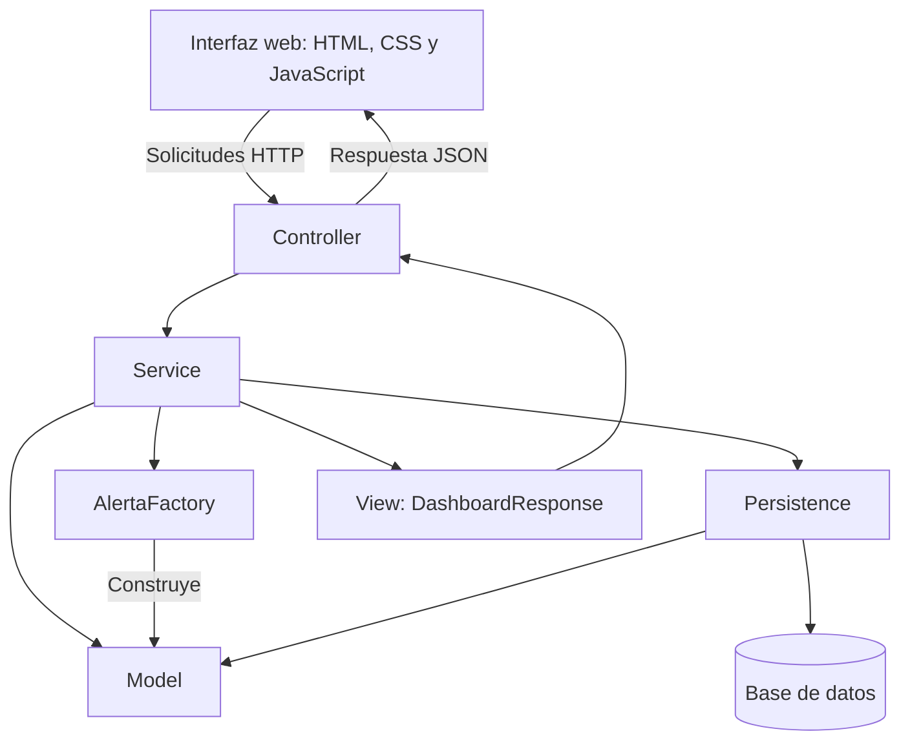
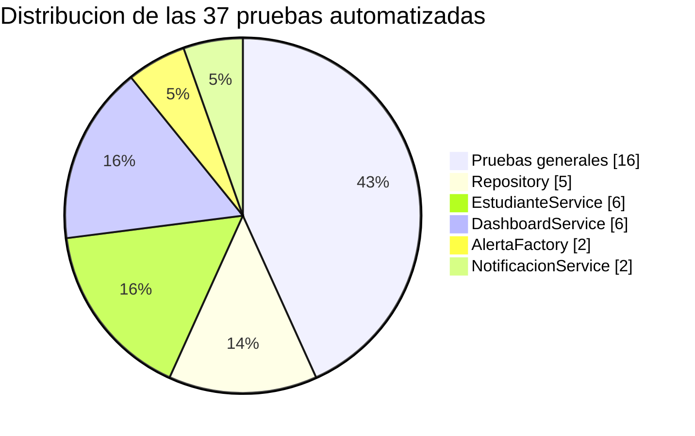

# Análisis y gestión de deuda técnica — SATE-UNIAJC

## Sesión 13 — Ingeniería de Software I

**Proyecto:** SATE-UNIAJC — Sistema de Alertas Tempranas y Acompañamiento Estudiantil

**Institución:** Institución Universitaria Antonio José Camacho

**Asignatura:** Ingeniería de Software I

**Fecha:** 27 de noviembre de 2026

**Rama de trabajo:** `Juan-sesion-13`

**Tema:** Arquitectura evolutiva, reestructuración modular, patrones de diseño y deuda técnica.

---

## 1. Objetivo

Identificar, analizar y reducir la deuda técnica relacionada con la arquitectura y la organización del código fuente de SATE-UNIAJC mediante la aplicación del patrón MVC, los patrones Repository y Factory, la separación de responsabilidades y el fortalecimiento de las pruebas automatizadas.

Las mejoras buscan incrementar la mantenibilidad del sistema sin modificar intencionalmente las reglas de negocio ni incorporar funcionalidades ajenas al alcance actual del proyecto.

## 2. Alcance

El análisis se concentra en los siguientes componentes:

- Capa de controladores.
- Capa de servicios.
- Capa de persistencia.
- Modelo de dominio.
- Representación de respuestas del dashboard.
- Creación de alertas académicas.
- Pruebas unitarias automatizadas.
- Documentación de decisiones arquitectónicas.

Este documento complementa la revisión de los principios YAGNI, KISS y DRY realizada durante la sesión 12.

La revisión no constituye una auditoría exhaustiva de seguridad, rendimiento o calidad de todo el sistema.

## 3. Concepto de deuda técnica

La deuda técnica representa el esfuerzo adicional que puede ser necesario en el futuro como consecuencia de decisiones de implementación que dificultan el mantenimiento, la evolución o la comprensión de un sistema de software.

No toda deuda técnica implica un error funcional. Un sistema puede funcionar correctamente y presentar oportunidades de mejora en su estructura interna.

En SATE-UNIAJC se aborda la deuda técnica mediante refactorizaciones incrementales, pruebas automatizadas y documentación de las decisiones arquitectónicas.

## 4. Deuda técnica identificada

### 4.1. Exceso de responsabilidades en los controladores

Antes de la refactorización, determinados controladores concentraban responsabilidades relacionadas con la atención de solicitudes HTTP, el acceso a datos y el procesamiento de información.

Los principales componentes intervenidos fueron:

- `EstudianteController.java`.
- `DashboardController.java`.

Esta situación dificultaba la separación de responsabilidades y la realización de pruebas unitarias independientes.

**Solución implementada:**

- Creación de `EstudianteService.java`.
- Creación de `DashboardService.java`.
- Delegación de la lógica de negocio a la capa de servicios.
- Conservación de los controladores como componentes encargados de gestionar las solicitudes HTTP.

**Resultado esperado:** mayor cohesión y menor acoplamiento entre componentes.

### 4.2. Acoplamiento con la tecnología de persistencia

El acceso a los datos de estudiantes se encontraba vinculado directamente a una interfaz de Spring Data JPA.

**Solución implementada:**

- Reorganización del paquete `repository` al paquete `persistence`.
- Definición de la interfaz `EstudianteRepository`.
- Creación de `EstudianteJpaRepository`.
- Creación de `EstudianteRepositoryImpl`.
- Incorporación de pruebas unitarias para la implementación del repositorio.

La interfaz permite separar el contrato de acceso a estudiantes de los detalles específicos de persistencia.

**Resultado esperado:** mayor independencia respecto a la tecnología de almacenamiento y facilidad para sustituir dependencias durante las pruebas.

### 4.3. Construcción directa de alertas académicas

El servicio `NotificacionSistemaService` era responsable tanto de verificar la existencia de alertas pendientes como de construir directamente las entidades de alerta y almacenarlas.

Aunque esta implementación era funcional, concentraba responsabilidades diferentes dentro del mismo componente.

**Solución implementada:**

- Creación de `AlertaFactory.java`.
- Centralización de la construcción de objetos `Alerta`.
- Inyección de la fábrica en `NotificacionSistemaService`.
- Conservación de la validación de alertas duplicadas.
- Incorporación de pruebas para alertas rojas y amarillas.

La fábrica recibe el estudiante y el resultado de la evaluación para construir la entidad correspondiente.

Se conserva una única entidad `Alerta`, evitando introducir jerarquías de clases innecesarias.

**Resultado esperado:** mayor separación de responsabilidades y facilidad para mantener la construcción de alertas.

### 4.4. Representación de la información del dashboard

El controlador del dashboard concentraba responsabilidades relacionadas con la obtención, procesamiento y representación de indicadores.

**Solución implementada:**

- Creación de `DashboardService`.
- Creación de `DashboardResponse` dentro del paquete `view`.
- Separación del cálculo de indicadores respecto a la gestión de solicitudes HTTP.

`DashboardResponse` actúa como un objeto de transferencia de datos para representar la respuesta del dashboard.

La interfaz gráfica continúa implementada mediante HTML, CSS y JavaScript dentro de `src/main/resources/static`.

**Resultado esperado:** mayor claridad en la estructura de las respuestas y facilidad para probar los cálculos de manera independiente.

### 4.5. Capacidad de prueba de los componentes

Antes de la sesión 13, el proyecto contaba con 18 pruebas automatizadas aprobadas.

La reorganización arquitectónica permitió incorporar pruebas específicas para los nuevos componentes y fortalecer las pruebas existentes.

**Solución implementada:**

- Pruebas unitarias del repositorio de estudiantes.
- Pruebas unitarias del servicio de estudiantes.
- Pruebas unitarias del servicio del dashboard.
- Pruebas unitarias de la fábrica de alertas.
- Actualización de las pruebas del servicio de notificaciones.

**Resultado obtenido:** 37 pruebas automatizadas aprobadas localmente.

## 5. Matriz de deuda técnica intervenida

| ID | Deuda técnica identificada | Acción realizada | Estado |
|---|---|---|---|
| DT-01 | Exceso de responsabilidades en EstudianteController | Extracción de EstudianteService | Intervenida |
| DT-02 | Exceso de responsabilidades en DashboardController | Extracción de DashboardService | Intervenida |
| DT-03 | Acoplamiento del acceso a estudiantes con Spring Data JPA | Aplicación del patrón Repository | Intervenida |
| DT-04 | Construcción directa de alertas en el servicio de notificaciones | Implementación de AlertaFactory | Intervenida |
| DT-05 | Representación de indicadores dentro del controlador | Creación de DashboardResponse | Intervenida |
| DT-06 | Capacidad de prueba limitada en los componentes intervenidos | Incorporación de pruebas unitarias | Intervenida |
| DT-07 | Falta de registro formal de las decisiones arquitectónicas | Creación del ADR-0001 | Intervenida |

El estado "Intervenida" indica que se realizaron acciones concretas para reducir la deuda identificada. No implica que se haya eliminado toda la deuda técnica del componente.

## 6. Relación con los principios de diseño

### 6.1. SRP — Single Responsibility Principle

El principio de responsabilidad única establece que un componente debe tener una responsabilidad claramente definida.

Aplicación en SATE-UNIAJC:

- Los controladores gestionan solicitudes HTTP.
- Los servicios coordinan la lógica de negocio.
- Los repositorios gestionan el acceso a datos.
- La fábrica centraliza la construcción de alertas.
- DashboardResponse representa los datos de respuesta del dashboard.

### 6.2. DIP — Dependency Inversion Principle

El principio de inversión de dependencias promueve la utilización de abstracciones para reducir la dependencia directa de detalles de implementación.

Aplicación en SATE-UNIAJC:

- Los componentes consumidores utilizan la interfaz EstudianteRepository.
- EstudianteRepositoryImpl implementa el contrato de persistencia.
- La implementación delega las operaciones correspondientes a Spring Data JPA.

Esta separación facilita el uso de dependencias simuladas durante las pruebas unitarias.

### 6.3. OCP — Open/Closed Principle

El principio abierto/cerrado establece que los componentes deben favorecer la extensión sin exigir modificaciones innecesarias de su comportamiento existente.

El motor de alertas conserva la interfaz EvaluadorAlerta y sus implementaciones especializadas.

La incorporación de AlertaFactory centraliza la construcción de las entidades, facilitando cambios futuros relacionados con su creación.

No se afirma que todos los componentes del sistema cumplan completamente este principio.

### 6.4. KISS — Keep It Simple, Stupid

Se conserva una arquitectura modular sencilla, utilizando los mecanismos existentes de Spring Boot.

No se incorporan microservicios, frameworks adicionales ni estructuras de clases innecesarias.

### 6.5. DRY — Don't Repeat Yourself

La separación de responsabilidades favorece la reutilización de los servicios, los contratos de persistencia y la construcción centralizada de alertas.

No se ha realizado una medición exhaustiva de duplicación de código.

### 6.6. YAGNI — You Aren't Gonna Need It

Las modificaciones se concentran en las necesidades arquitectónicas actuales.

No se implementan funcionalidades adicionales que no correspondan al alcance definido para la sesión 13.

La revisión previa de estos principios se encuentra en:

[Revisión de principios YAGNI, KISS y DRY](REVISION_YAGNI_KISS_DRY.md).

## 7. Relación con ISO/IEC 25010

La norma ISO/IEC 25010 proporciona un modelo de calidad del producto de software.

Las modificaciones realizadas se relacionan principalmente con la característica de mantenibilidad y sus subcaracterísticas.

| Subcaracterística | Aplicación en SATE-UNIAJC | Beneficio esperado |
|---|---|---|
| Modularidad | Separación de controladores, servicios, modelos, persistencia y representación de respuestas | Menor impacto de los cambios entre componentes |
| Reusabilidad | Servicios, contratos de persistencia y fábrica de alertas | Posibilidad de reutilizar componentes |
| Analizabilidad | Responsabilidades diferenciadas y documentación arquitectónica | Mayor facilidad para comprender el código |
| Modificabilidad | Separación de la lógica de negocio y los detalles de persistencia | Mayor facilidad para introducir cambios |
| Capacidad de prueba | Incorporación de pruebas unitarias y dependencias simuladas | Mayor facilidad para verificar componentes de forma independiente |

La relación con ISO/IEC 25010 constituye un análisis cualitativo de las mejoras realizadas.

No representa una certificación de cumplimiento de la norma ni una medición formal de todas las características de calidad del producto.

## 8. Evolución de la arquitectura

### 8.1. Organización de los paquetes

La estructura principal del código fuente después de la refactorización es:

```text
src/main/java/co/uniajc/sate/
├── config/
├── controller/
├── model/
├── persistence/
├── service/
│   ├── evaluacion/
│   ├── factory/
│   └── notificacion/
├── view/
└── SateUniajcApplication.java
```

Se conserva el paquete base `co.uniajc.sate` para mantener la compatibilidad con la estructura existente del proyecto.

La justificación de esta decisión se encuentra documentada en el ADR-0001.

### 8.2. Flujo arquitectónico general



El diagrama representa de manera conceptual las responsabilidades y relaciones principales de los componentes intervenidos.

## 9. Evolución de las pruebas automatizadas

### 9.1. Comparación antes y después

| Indicador | Antes de la sesión 13 | Después de la refactorización |
|---|---:|---:|
| Archivos Java de producción compilados | 34 | 40 |
| Clases de pruebas compiladas | 2 | 6 |
| Pruebas ejecutadas | 18 | 37 |
| Fallos | 0 | 0 |
| Errores | 0 | 0 |
| Pruebas omitidas | 0 | 0 |
| Resultado | BUILD SUCCESS | BUILD SUCCESS |

Se incorporaron 19 pruebas automatizadas adicionales, lo que representa un incremento aproximado del 105.6 % respecto a la cantidad inicial.

El incremento en la cantidad de pruebas no equivale a un porcentaje de cobertura de código.

### 9.2. Distribución de las pruebas

| Clase de pruebas | Pruebas aprobadas |
|---|---:|
| SateUniajcApplicationTests | 16 |
| EstudianteRepositoryImplTest | 5 |
| EstudianteServiceTest | 6 |
| DashboardServiceTest | 6 |
| AlertaFactoryTest | 2 |
| NotificacionSistemaServiceTest | 2 |
| **Total** | **37** |

### 9.3. Evidencia de ejecución local

Comando ejecutado:

```bash
mvn clean test
```

Resultado obtenido el 27 de noviembre de 2026:

```text
Tests run: 37, Failures: 0, Errors: 0, Skipped: 0

BUILD SUCCESS

Total time: 9.619 s
```

Durante la ejecución se presentaron advertencias relacionadas con Mockito, Byte Buddy y la carga dinámica de agentes en Java.

Estas advertencias no impidieron la compilación ni la ejecución exitosa de las pruebas.

Su revisión se considera una oportunidad de mantenimiento futuro.

### 9.4. Evolución de las pruebas por componente



## 10. Validación funcional básica

Después de las modificaciones se ejecutó localmente la aplicación mediante:

```bash
mvn spring-boot:run
```

Se verificó visualmente:

- Disponibilidad de la pantalla de inicio de sesión.
- Acceso al sistema.
- Visualización del dashboard.
- Consulta del listado académico.
- Visualización del motor de alertas.
- Ejecución de la evaluación de alertas.
- Generación de una alerta amarilla durante la evaluación.
- Visualización del portal de acompañamiento.

Los indicadores iniciales del dashboard conservaron los valores observados antes de la refactorización.

Estas verificaciones proporcionan evidencia funcional básica, pero no reemplazan una prueba integral de regresión ni la validación completa de todos los criterios de aceptación.

## 11. Deuda técnica restante y oportunidades de mejora

La refactorización realizada no elimina todas las oportunidades de mejora del sistema.

Se identifican los siguientes aspectos para futuras revisiones:

| ID | Oportunidad de mejora | Prioridad propuesta | Estado |
|---|---|---|---|
| DT-08 | Ampliar las pruebas de integración entre controladores, servicios y persistencia | Alta | Pendiente |
| DT-09 | Revisar la seguridad de autenticación, autorización y gestión de credenciales | Alta | Pendiente de evaluación |
| DT-10 | Incorporar mediciones de cobertura de código | Media | Pendiente |
| DT-11 | Revisar los controladores y servicios no intervenidos durante la sesión 13 | Media | Pendiente |
| DT-12 | Revisar la configuración de Mockito y Byte Buddy para futuras versiones de Java | Media | Pendiente |
| DT-13 | Verificar la coherencia entre los datos iniciales y las reglas vigentes del motor de alertas | Media | Pendiente |
| DT-14 | Evaluar el comportamiento de la persistencia en el entorno MySQL | Media | Pendiente de validación |

Las prioridades anteriores son propuestas técnicas y deben ser evaluadas por el equipo Scrum.

GitHub Issues y GitHub Projects continúan siendo las fuentes oficiales para la gestión y priorización del trabajo.

## 12. Trazabilidad de los cambios

| Commit | Descripción |
|---|---|
| `f1195fe` | Reorganización del paquete repository a persistence |
| `ebebdfa` | Implementación del patrón Repository para estudiantes con pruebas unitarias |
| `f6ebbcb` | Separación de la lógica de estudiantes en la capa service |
| `d4666f9` | Separación de la lógica del dashboard en service y view |
| `249b876` | Implementación de Factory para la creación de alertas |
| `fa91a50` | Registro del ADR-0001 sobre arquitectura MVC y patrones de diseño |

Los commits permiten identificar las modificaciones de manera incremental y mantener la trazabilidad de las decisiones técnicas.

## 13. Integración continua

El proyecto cuenta con workflows de GitHub Actions para integración continua y entrega continua.

Archivos:

- `.github/workflows/ci.yml`.
- `.github/workflows/cd.yml`.

La validación local de las 37 pruebas fue satisfactoria.

La ejecución de los workflows correspondientes a los cambios de la sesión 13 deberá verificarse después de publicar la rama y realizar el Pull Request correspondiente.

No se considera confirmada la ejecución remota de CI/CD hasta disponer de sus resultados en GitHub Actions.

## 14. Conclusiones

La sesión 13 permitió evolucionar la arquitectura de SATE-UNIAJC mediante una reorganización modular y la aplicación de patrones de diseño orientados a mejorar la separación de responsabilidades.

La implementación de Repository, la incorporación de servicios especializados y la centralización de la construcción de alertas contribuyen a reducir el acoplamiento y favorecer la mantenibilidad.

La incorporación de 19 pruebas adicionales permitió fortalecer la verificación automatizada de los componentes intervenidos.

La ejecución exitosa de las 37 pruebas y la validación funcional básica proporcionan evidencia favorable sobre la conservación del comportamiento del sistema.

La gestión de deuda técnica debe mantenerse como una actividad continua durante la evolución del proyecto.

## 15. Documentos relacionados

- [ADR-0001: Patrón MVC y decisiones arquitectónicas](adr/0001-patron-mvc.md).
- [Revisión de principios YAGNI, KISS y DRY](REVISION_YAGNI_KISS_DRY.md).
- [Documentación técnica](DOCUMENTACION_TECNICA.md).
- [Arquitectura MVC](diagramas/ARQUITECTURA_MVC.md).
- [Plan de pruebas](PLAN_PRUEBAS.md).
- [Documentación general](README_DOCUMENTOS.md).

## 16. Referencias

- Material académico de la sesión 13: Arquitectura Evolutiva, Patrón MVC y Registros de Decisiones (ADR).
- ISO/IEC 25010 — Modelo de calidad del producto de software.
- Gamma, E., Helm, R., Johnson, R. y Vlissides, J. Design Patterns: Elements of Reusable Object-Oriented Software.
- Repositorio SATE-UNIAJC: https://github.com/darwinvf2765/SATE-UNIAJC
- GitHub Actions: https://github.com/darwinvf2765/SATE-UNIAJC/actions
