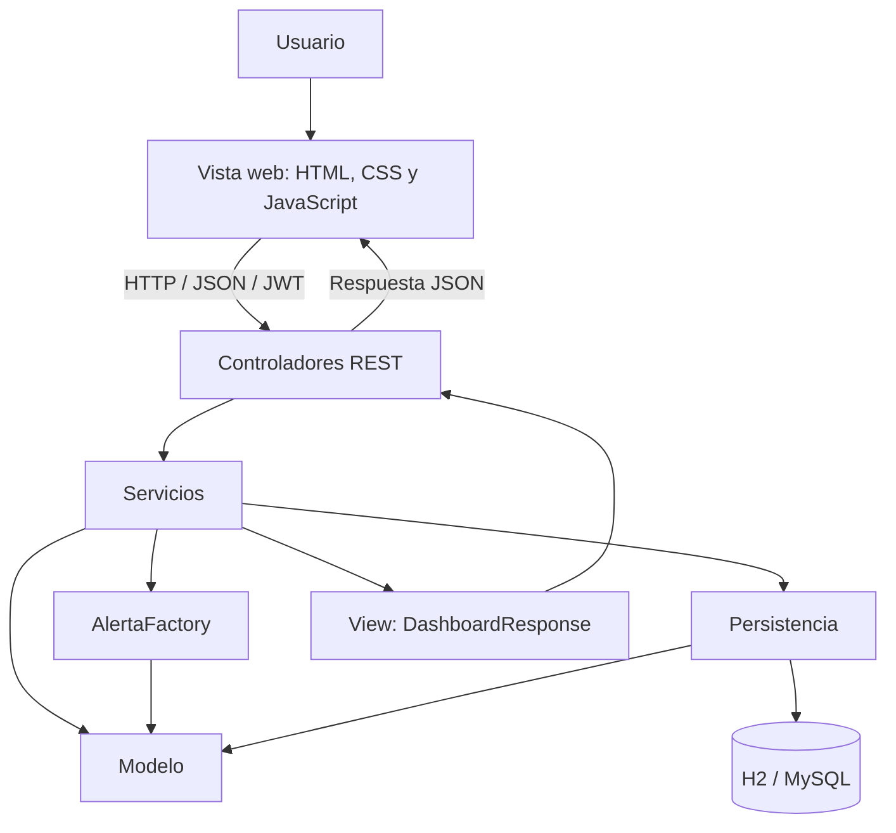
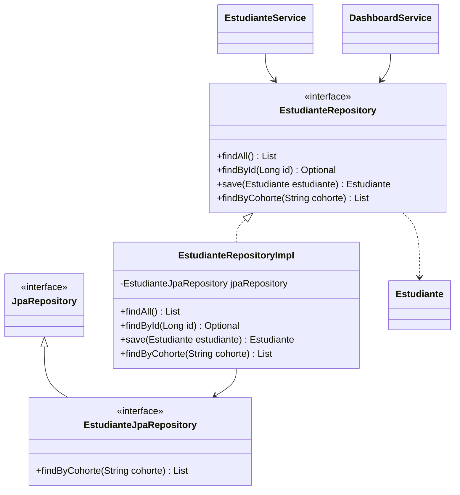
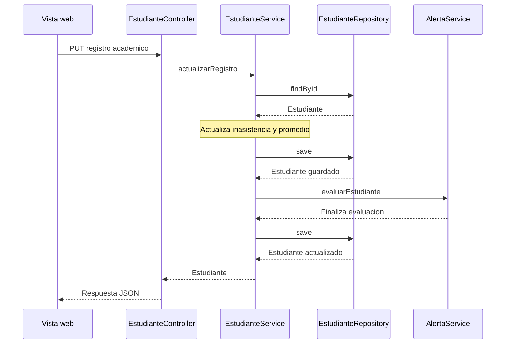
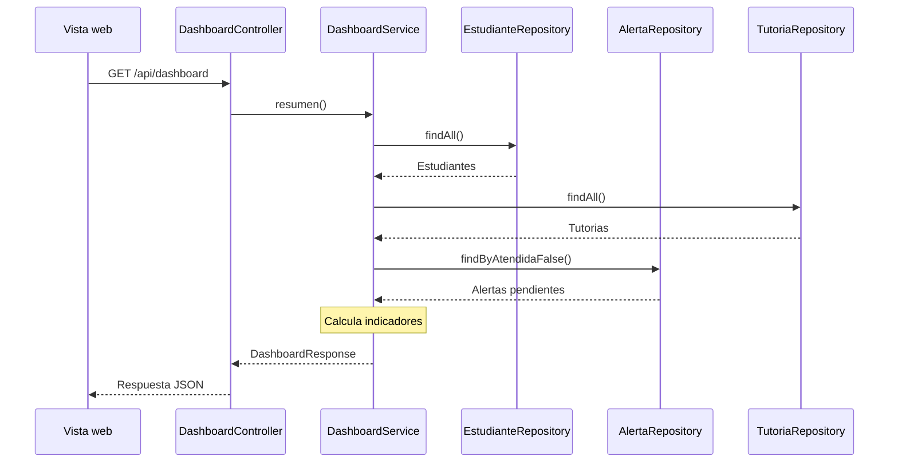
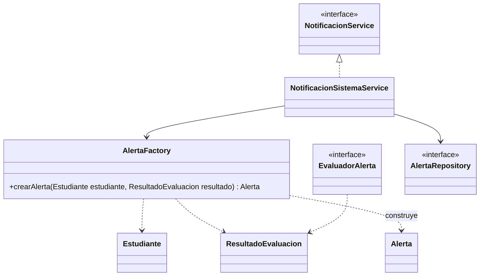
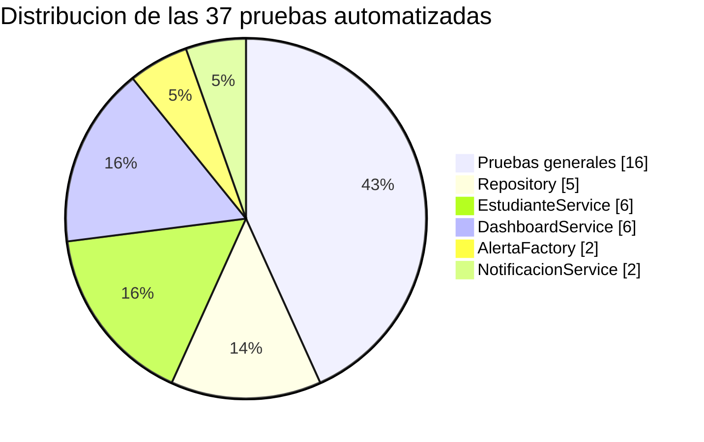
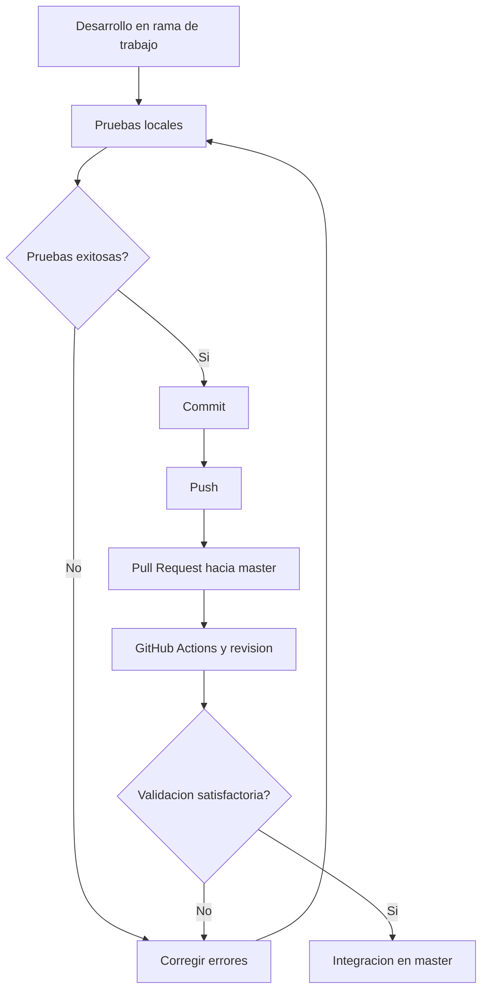

# Documentación técnica — SATE-UNIAJC

## 1. Información general

| Elemento | Descripción |
|---|---|
| Proyecto | SATE-UNIAJC |
| Nombre | Sistema de Alertas Tempranas y Acompañamiento Estudiantil |
| Institución | Institución Universitaria Antonio José Camacho |
| Asignatura | Ingeniería de Software I |
| Período académico | 2026-2 |
| Metodología | Scrumban |
| Actualización | Sesión 13 |
| Fecha | 27 de noviembre de 2026 |

### 1.1. Descripción del sistema

SATE-UNIAJC es una aplicación web desarrollada para apoyar el seguimiento académico y el acompañamiento de los estudiantes de la Institución Universitaria Antonio José Camacho.

El sistema permite gestionar información estudiantil, registrar asistencias, actualizar información académica, identificar condiciones de riesgo y administrar alertas y tutorías.

### 1.2. Equipo Scrum

| Integrante | Rol |
|---|---|
| Darwin Alexander Valencia Flor | Product Owner |
| Juan David Rosero Guerrero | Scrum Master |
| Jeremy Andrey Agreda Rosero | Developer |

### 1.3. Repositorio oficial

https://github.com/darwinvf2765/SATE-UNIAJC

---

## 2. Tecnologías utilizadas

| Tecnología | Función |
|---|---|
| Java 25 | Lenguaje del backend |
| Spring Boot 3.4.5 | Framework principal |
| Spring Web | Desarrollo de API REST |
| Spring Data JPA | Persistencia de datos |
| Spring Security | Seguridad y control de acceso |
| JWT — JJWT 0.12.6 | Autenticación mediante tokens |
| Jakarta Validation | Validación de datos |
| Maven | Gestión de dependencias y compilación |
| H2 | Base de datos local en memoria |
| MySQL | Alternativa de persistencia |
| HTML, CSS y JavaScript | Interfaz web |
| JUnit 5 | Pruebas automatizadas |
| Mockito | Simulación de dependencias |
| Git y GitHub | Control de versiones |
| GitHub Projects | Gestión ágil |
| GitHub Actions | Integración y entrega continua |
| Mermaid | Documentación de diagramas |

---

## 3. Arquitectura del sistema

### 3.1. Arquitectura evolutiva

SATE-UNIAJC utiliza una arquitectura modular por capas basada en el patrón MVC, complementada con servicios especializados y componentes de persistencia.

Durante la Sesión 13 se realizó una reestructuración orientada a mejorar la separación de responsabilidades, reducir el acoplamiento y facilitar las pruebas automatizadas.

La arquitectura conserva el paquete base `co.uniajc.sate`, evitando una migración innecesaria de nombres y rutas que no aporta cambios funcionales al sistema.

Esta decisión se encuentra documentada en el ADR-0001.

### 3.2. Modelo — Model

El paquete `model` contiene las entidades que representan la información del dominio.

| Entidad | Responsabilidad |
|---|---|
| Estudiante | Información estudiantil y estado académico |
| Usuario | Información de autenticación |
| Rol | Roles del sistema |
| Materia | Información de asignaturas |
| Asistencia | Registros de asistencia |
| Alerta | Condiciones de riesgo detectadas |
| Tutoria | Actividades de acompañamiento |

### 3.3. Vista — View

La presentación del sistema está desarrollada mediante HTML, CSS y JavaScript.

Archivos principales:

- `src/main/resources/static/index.html`
- `src/main/resources/static/styles.css`
- `src/main/resources/static/app.js`

La interfaz permite iniciar sesión, consultar indicadores, actualizar registros académicos, visualizar alertas y gestionar actividades de acompañamiento.

Durante la Sesión 13 se incorporó el paquete Java `view`, que contiene el DTO `DashboardResponse`.

Este componente representa los datos de salida del dashboard y complementa la vista web sin sustituirla.

### 3.4. Controlador — Controller

Los controladores reciben peticiones HTTP, validan los datos de entrada cuando corresponde y devuelven respuestas al cliente.

| Controlador | Responsabilidad |
|---|---|
| AuthController | Autenticación y recuperación de contraseña |
| EstudianteController | Operaciones relacionadas con estudiantes |
| AsistenciaController | Registro y consulta de asistencias |
| AlertaController | Consulta y gestión de alertas |
| TutoriaController | Gestión de tutorías |
| DashboardController | Consulta de indicadores generales |

Los controladores de estudiantes y dashboard fueron refactorizados para delegar sus operaciones a servicios especializados.

### 3.5. Servicios — Service

La capa de servicios contiene y coordina la lógica de negocio.

| Servicio | Responsabilidad |
|---|---|
| AuthService | Operaciones de autenticación |
| JwtService | Gestión de tokens JWT |
| EstudianteService | Operaciones académicas de estudiantes |
| DashboardService | Cálculo y consolidación de indicadores |
| AsistenciaService | Registro y procesamiento de asistencias |
| AlertaService | Coordinación del motor de alertas |
| NotificacionSistemaService | Gestión y almacenamiento de alertas |

También contiene los evaluadores académicos y la fábrica de alertas.

### 3.6. Persistencia — Persistence

El paquete `persistence` reemplaza al paquete anteriormente denominado `repository`.

Contiene las interfaces y componentes responsables del acceso a los datos.

La persistencia de estudiantes se encuentra organizada mediante:

- `EstudianteRepository`
- `EstudianteRepositoryImpl`
- `EstudianteJpaRepository`

Los demás repositorios conservan su integración con Spring Data JPA.

### 3.7. Configuración — Config

El paquete `config` contiene componentes relacionados con la configuración, inicialización y seguridad de la aplicación.

- `DataInitializer`
- `JwtAuthenticationFilter`
- `PasswordConfig`
- `SecurityConfig`

### 3.8. Diagrama conceptual de arquitectura



El diagrama representa la arquitectura conceptual y los componentes intervenidos durante la Sesión 13. No constituye un inventario exhaustivo de todas las dependencias existentes.

[Consultar diagrama de arquitectura MVC](diagramas/ARQUITECTURA_MVC.md).

---

## 4. Estructura del proyecto

### 4.1. Código fuente

```text
src/main/java/co/uniajc/sate/
├── SateUniajcApplication.java
├── config/
│   ├── DataInitializer.java
│   ├── JwtAuthenticationFilter.java
│   ├── PasswordConfig.java
│   └── SecurityConfig.java
├── controller/
│   ├── AlertaController.java
│   ├── AsistenciaController.java
│   ├── AuthController.java
│   ├── DashboardController.java
│   ├── EstudianteController.java
│   └── TutoriaController.java
├── model/
│   ├── Alerta.java
│   ├── Asistencia.java
│   ├── Estudiante.java
│   ├── Materia.java
│   ├── Rol.java
│   ├── Tutoria.java
│   └── Usuario.java
├── persistence/
│   ├── AlertaRepository.java
│   ├── AsistenciaRepository.java
│   ├── EstudianteJpaRepository.java
│   ├── EstudianteRepository.java
│   ├── EstudianteRepositoryImpl.java
│   ├── MateriaRepository.java
│   ├── RolRepository.java
│   ├── TutoriaRepository.java
│   └── UsuarioRepository.java
├── service/
│   ├── AlertaService.java
│   ├── AsistenciaService.java
│   ├── AuthService.java
│   ├── DashboardService.java
│   ├── EstudianteService.java
│   ├── JwtService.java
│   ├── evaluacion/
│   │   ├── EvaluadorAlerta.java
│   │   ├── EvaluadorInasistencia.java
│   │   └── EvaluadorPromedio.java
│   ├── factory/
│   │   └── AlertaFactory.java
│   └── notificacion/
│       ├── NotificacionService.java
│       └── NotificacionSistemaService.java
└── view/
    └── DashboardResponse.java
```

### 4.2. Recursos

```text
src/main/resources/
├── application.properties
├── application-mysql.properties
├── data.sql
├── schema.sql
└── static/
    ├── index.html
    ├── styles.css
    └── app.js
```

### 4.3. Pruebas automatizadas

```text
src/test/java/co/uniajc/sate/
├── SateUniajcApplicationTests.java
├── persistence/
│   └── EstudianteRepositoryImplTest.java
└── service/
    ├── DashboardServiceTest.java
    ├── EstudianteServiceTest.java
    ├── factory/
    │   └── AlertaFactoryTest.java
    └── notificacion/
        └── NotificacionSistemaServiceTest.java
```

### 4.4. Automatización y documentación

```text
.github/
└── workflows/
    ├── ci.yml
    └── cd.yml

docs/
├── adr/
│   └── 0001-patron-mvc.md
├── diagramas/
│   ├── ARQUITECTURA_MVC.md
│   ├── CLASES_HU04.md
│   └── CLASES_HU05.md
├── DEUDA_TECNICA.md
├── DOCUMENTACION_TECNICA.md
├── PLAN_PRUEBAS.md
├── README_DOCUMENTOS.md
├── REVISION_YAGNI_KISS_DRY.md
├── RETROSPECTIVA_SPRINT.md
├── acta_constitucion.md
├── despliegue.md
└── secuencia.md
```

### 4.5. Distribución de archivos Java

| Paquete | Archivos |
|---|---:|
| config | 4 |
| controller | 6 |
| model | 7 |
| persistence | 9 |
| service y subpaquetes | 12 |
| view | 1 |
| Clase principal | 1 |
| **Total de producción** | **40** |
| Clases de pruebas | 6 |
| **Total de archivos Java** | **46** |

---

## 5. Patrón Repository

### 5.1. Objetivo

Separar las operaciones de acceso a datos de los componentes que utilizan la información estudiantil.

La implementación permite que los servicios dependan de un contrato explícito en lugar de depender directamente de la interfaz especializada de Spring Data JPA.

### 5.2. Contrato de persistencia

Archivo:

`src/main/java/co/uniajc/sate/persistence/EstudianteRepository.java`

La interfaz define las siguientes operaciones:

| Método | Responsabilidad |
|---|---|
| findAll() | Consultar todos los estudiantes |
| findById(Long id) | Consultar un estudiante por identificador |
| save(Estudiante estudiante) | Guardar información estudiantil |
| findByCohorte(String cohorte) | Consultar estudiantes por cohorte |

El contrato utiliza tipos del dominio y tipos estándar de Java, sin extender directamente `JpaRepository`.

### 5.3. Implementación concreta

Archivo:

`src/main/java/co/uniajc/sate/persistence/EstudianteRepositoryImpl.java`

La clase implementa `EstudianteRepository` y utiliza la anotación `@Repository`.

Recibe mediante inyección por constructor una dependencia de tipo `EstudianteJpaRepository`.

Sus operaciones delegan las consultas y el almacenamiento al repositorio JPA.

### 5.4. Integración con Spring Data JPA

Archivo:

`src/main/java/co/uniajc/sate/persistence/EstudianteJpaRepository.java`

La interfaz extiende:

```java
JpaRepository<Estudiante, Long>
```

También declara la operación:

```java
List<Estudiante> findByCohorte(String cohorte);
```

Spring Data JPA proporciona la implementación de las operaciones de persistencia correspondientes.

### 5.5. Diagrama de clases



### 5.6. Beneficios y limitaciones

- Separación entre servicios y detalles de acceso a datos.
- Contrato explícito para las operaciones estudiantiles.
- Facilidad para simular dependencias mediante Mockito.
- Mayor capacidad de modificación de la implementación de persistencia.
- Incorporación de una capa adicional de delegación que debe mantenerse.

La implementación explícita del patrón se concentra en la persistencia de estudiantes. No se realizaron adaptadores equivalentes para todas las entidades, evitando ampliar innecesariamente el alcance de la actividad.

---

## 6. Servicio de estudiantes

### 6.1. EstudianteService

Archivo:

`src/main/java/co/uniajc/sate/service/EstudianteService.java`

El servicio concentra las operaciones académicas anteriormente gestionadas desde el controlador.

Sus dependencias principales son:

- `EstudianteRepository`
- `AlertaService`

### 6.2. Operaciones

| Método | Responsabilidad |
|---|---|
| listar() | Consultar todos los estudiantes |
| buscar(Long id) | Consultar un estudiante |
| crear(Estudiante estudiante) | Guardar un estudiante y evaluar su condición académica |
| actualizarRegistro(...) | Actualizar inasistencia, promedio y estado de alerta |

Cuando un estudiante no existe, el método `buscar` genera una excepción con el mensaje correspondiente.

La gestión uniforme de excepciones HTTP permanece como oportunidad de mejora.

### 6.3. Validación de registros

El controlador utiliza el record `RegistroRequest` para recibir los datos de actualización académica.

| Campo | Rango permitido |
|---|---|
| porcentajeInasistencia | 0.0 a 100.0 |
| promedio | 0.0 a 5.0 |

Las restricciones se expresan mediante anotaciones de Jakarta Validation.

### 6.4. Flujo de actualización académica



---

## 7. Servicio de dashboard y capa View

### 7.1. DashboardService

Archivo:

`src/main/java/co/uniajc/sate/service/DashboardService.java`

El servicio consolida la información utilizada por el dashboard.

Depende de:

- `EstudianteRepository`
- `AlertaRepository`
- `TutoriaRepository`

El método `resumen()` consulta la información y construye una respuesta especializada.

### 7.2. DashboardResponse

Archivo:

`src/main/java/co/uniajc/sate/view/DashboardResponse.java`

Es un record de Java utilizado como DTO de salida.

| Campo | Tipo |
|---|---|
| totalEstudiantes | int |
| alertasRojas | long |
| alertasAmarillas | long |
| estudiantesVerdes | long |
| proyeccionDesercion | double |
| totalTutorias | int |
| tutoriasRealizadas | long |
| efectividadTutorias | double |
| estudiantesPorCohorte | Map de String y Long |

El DTO define explícitamente la estructura de los datos enviados al cliente.

### 7.3. Indicadores

**Alertas rojas y amarillas**

Se contabilizan las alertas pendientes, clasificadas por su tipo.

**Estudiantes verdes**

Se contabilizan los estudiantes cuyo estado general es `VERDE`.

**Proyección de deserción**

El servicio utiliza una fórmula heurística:

```text
Proyección =
((estudiantes únicos con alertas pendientes × 0.80)
+ (estudiantes verdes × 0.10))
/ total de estudiantes × 100
```

La identificación de estudiantes únicos evita contar varias veces a un estudiante dentro del conjunto de alertas pendientes.

Si no existen estudiantes, el indicador devuelve cero.

La fórmula utiliza ponderaciones predefinidas. No constituye un modelo estadístico validado de predicción de deserción.

La posible coincidencia entre estudiantes verdes y estudiantes con alertas pendientes debe considerarse en futuras revisiones del indicador.

**Efectividad de tutorías**

```text
Efectividad =
(tutorías realizadas / total de tutorías) × 100
```

Este indicador representa la proporción de tutorías realizadas, no una medición directa de su impacto académico.

Si no existen tutorías, el resultado es cero.

**Estudiantes por cohorte**

Se agrupan los estudiantes según su cohorte utilizando un `TreeMap`.

Los indicadores porcentuales de proyección y tutorías se redondean a un decimal.

### 7.4. Flujo de consulta



---

## 8. Funcionalidades e historias de usuario

| Historia | Funcionalidad |
|---|---|
| HU-01 | Inicio de sesión |
| HU-02 | Recuperación de contraseña |
| HU-03 | Gestión de roles y permisos |
| HU-04 | Registro de asistencia |
| HU-05 | Registro académico y actualización de promedio |
| HU-06 | Alerta roja por inasistencia |
| HU-07 | Alerta amarilla por promedio bajo |

### 8.1. Autenticación

El sistema incorpora autenticación mediante credenciales y generación de tokens JWT.

Los componentes principales incluyen `AuthController`, `AuthService`, `JwtService` y la configuración de Spring Security.

### 8.2. Registro de asistencia

La aplicación incorpora componentes para registrar asistencias y actualizar el porcentaje de inasistencia estudiantil.

Componentes principales:

- `AsistenciaController`
- `AsistenciaService`
- `AsistenciaRepository`

### 8.3. Registro académico

Permite actualizar el porcentaje de inasistencia y el promedio académico de un estudiante.

La operación delega la evaluación de las condiciones de riesgo al motor de alertas.

El alcance del registro individual de calificaciones debe contrastarse con los criterios de aceptación de HU-05.

### 8.4. Acompañamiento estudiantil

El sistema incorpora funcionalidades relacionadas con la programación, consulta y actualización del estado de las tutorías.

La existencia de estas funcionalidades no implica que todos sus criterios de aceptación hayan sido verificados.

---

## 9. Motor de alertas académicas

### 9.1. HU-06 — Alerta roja

Se genera una alerta ROJA cuando el porcentaje de inasistencia supera el 15 %.

| Inasistencia | Genera alerta roja |
|---|---|
| 10 % | No |
| 15 % | No |
| 16 % | Sí |

La evaluación corresponde a `EvaluadorInasistencia`.

### 9.2. HU-07 — Alerta amarilla

Se genera una alerta AMARILLA cuando el promedio académico es inferior a 3.0.

| Promedio | Genera alerta amarilla |
|---|---|
| 2.8 | Sí |
| 3.0 | No |
| 3.5 | No |

La evaluación corresponde a `EvaluadorPromedio`.

### 9.3. Evaluadores

La interfaz `EvaluadorAlerta` proporciona un mecanismo común para ejecutar las evaluaciones académicas.

Sus implementaciones actuales son:

- `EvaluadorInasistencia`
- `EvaluadorPromedio`

El servicio `AlertaService` coordina las evaluaciones y determina el estado general del estudiante.

### 9.4. Prioridad del estado general

Cuando se cumplen simultáneamente las condiciones de inasistencia y promedio, pueden existir dos alertas independientes para un mismo estudiante.

La prioridad del estado general es:

1. ROJA.
2. AMARILLA.
3. VERDE.

### 9.5. Notificaciones

`NotificacionService` define el contrato de notificación.

`NotificacionSistemaService` gestiona la creación y almacenamiento de alertas, evitando generar otra alerta pendiente del mismo tipo para el mismo estudiante.

### 9.6. Datos iniciales

Los registros históricos o precargados pueden contener estados y motivos correspondientes a criterios anteriores.

La presencia de estos registros no modifica las reglas implementadas por los evaluadores actuales.

Se recomienda revisar la consistencia de los datos iniciales con los criterios de aceptación vigentes.

---

## 10. Patrón Factory

### 10.1. Objetivo

Centralizar la construcción de objetos `Alerta`, evitando que el servicio de notificaciones tenga que gestionar directamente todos los detalles de su creación.

### 10.2. Implementación

Archivo:

`src/main/java/co/uniajc/sate/service/factory/AlertaFactory.java`

La clase utiliza la anotación `@Component` y expone el método:

```java
public Alerta crearAlerta(
        Estudiante estudiante,
        EvaluadorAlerta.ResultadoEvaluacion resultado
)
```

### 10.3. Datos utilizados

| Atributo | Origen |
|---|---|
| Identificador del estudiante | Estudiante |
| Nombre del estudiante | Estudiante |
| Tipo de alerta | ResultadoEvaluacion |
| Motivo | ResultadoEvaluacion |
| Fecha de creación | LocalDateTime.now() |
| Estado atendida | false |

La fábrica construye una instancia de la entidad `Alerta` a partir de estos datos.

### 10.4. Integración

`NotificacionSistemaService` utiliza `AlertaFactory` para construir las alertas.

La fábrica no evalúa las reglas académicas ni almacena directamente los objetos en la base de datos.

Estas responsabilidades permanecen separadas.

### 10.5. Diagrama de clases



### 10.6. Alcance del patrón

La implementación corresponde a una fábrica simple de objetos.

No se introdujeron subclases independientes para alertas rojas y amarillas, debido a que ambas comparten la misma estructura de datos.

Tampoco se requiere una jerarquía de creadores propia del patrón GoF Factory Method para satisfacer las necesidades actuales.

Esta decisión evita complejidad innecesaria y conserva la estructura existente de persistencia.

---

## 11. Endpoints de la API

### 11.1. Autenticación

| Método | Endpoint | Descripción |
|---|---|---|
| POST | `/api/auth/login` | Iniciar sesión |
| POST | `/api/auth/forgot-password` | Solicitar recuperación |
| POST | `/api/auth/reset-password` | Restablecer contraseña |

### 11.2. Estudiantes

| Método | Endpoint | Descripción |
|---|---|---|
| GET | `/api/estudiantes` | Listar estudiantes |
| GET | `/api/estudiantes/{id}` | Consultar estudiante |
| POST | `/api/estudiantes` | Crear estudiante |
| PUT | `/api/estudiantes/{id}/registro` | Actualizar registro académico |

El endpoint de creación devuelve el estado HTTP 201 cuando la operación finaliza correctamente.

Ejemplo de cuerpo JSON para actualizar un registro:

```json
{
  "porcentajeInasistencia": 18.0,
  "promedio": 2.8
}
```

### 11.3. Asistencias

| Método | Endpoint | Descripción |
|---|---|---|
| POST | `/api/asistencias` | Registrar asistencia |
| GET | `/api/asistencias/estudiante/{id}` | Consultar asistencias |

### 11.4. Alertas

| Método | Endpoint | Descripción |
|---|---|---|
| GET | `/api/alertas` | Consultar alertas |
| GET | `/api/alertas/pendientes` | Consultar alertas pendientes |
| POST | `/api/alertas/evaluar` | Ejecutar evaluación |
| PUT | `/api/alertas/{id}/atendida` | Marcar alerta atendida |

### 11.5. Tutorías

| Método | Endpoint | Descripción |
|---|---|---|
| GET | `/api/tutorias` | Consultar tutorías |
| POST | `/api/tutorias` | Registrar tutoría |
| PUT | `/api/tutorias/{id}/estado` | Actualizar estado |

### 11.6. Dashboard

| Método | Endpoint | Descripción |
|---|---|---|
| GET | `/api/dashboard` | Consultar indicadores generales |

Los endpoints de estudiantes y dashboard fueron contrastados con los controladores actualizados durante la Sesión 13.

Las demás rutas se conservan como referencia de la documentación técnica anterior y requieren validación funcional específica.

---

## 12. Seguridad

El sistema utiliza Spring Security y JWT para gestionar la autenticación y las restricciones de acceso.

Según la configuración documentada previamente:

- `/api/auth/**`: acceso público para autenticación.
- `/api/asistencias/**`: acceso restringido al rol DOCENTE.
- `/api/alertas/**`: acceso restringido al rol DIRECTOR.
- `/api/dashboard/**`: acceso restringido al rol DIRECTOR.
- Otras rutas: requieren autenticación, salvo los recursos expresamente autorizados.

El filtro JWT procesa el encabezado de autorización:

```text
Authorization: Bearer <token>
```

### 12.1. Consideraciones

Se recomienda verificar:

- Accesos autorizados y denegados.
- Tokens inválidos y expirados.
- Permisos específicos por rol.
- Configuración de secretos.
- Recuperación de contraseña.
- Configuración de CORS.

La reestructuración de la Sesión 13 no constituye una auditoría integral de seguridad.

---

## 13. Persistencia de datos

### 13.1. H2

La configuración predeterminada utiliza una base de datos H2 en memoria.

Ventajas:

- Facilita la ejecución local.
- No requiere instalar un servidor externo.
- Permite realizar pruebas con un entorno sencillo.

Limitación:

Los datos almacenados en memoria no permanecen después de detener la aplicación.

### 13.2. MySQL

El proyecto incluye una configuración alternativa para MySQL.

Archivo:

`src/main/resources/application-mysql.properties`

Su utilización requiere configurar la conexión, las credenciales y el perfil correspondiente.

La validación completa de MySQL permanece pendiente.

No deben publicarse contraseñas reales ni secretos de producción en el repositorio.

### 13.3. Inicialización

El proyecto contiene los archivos:

- `schema.sql`
- `data.sql`

Estos archivos forman parte de la configuración de datos del sistema.

Se recomienda revisar su correspondencia con las reglas académicas vigentes.

---

## 14. Principios de diseño

### 14.1. SOLID

| Principio | Aplicación |
|---|---|
| SRP | Separación entre controladores, servicios, evaluadores, persistencia y fábrica |
| OCP | Incorporación de evaluadores mediante una interfaz común |
| DIP | Dependencia de contratos como EstudianteRepository, EvaluadorAlerta y NotificacionService |

La aplicación de estos principios se identifica en los componentes intervenidos y no implica que todo el proyecto cumpla completamente SOLID.

### 14.2. YAGNI, KISS y DRY

| Principio | Aplicación |
|---|---|
| YAGNI | Evitar funcionalidades y abstracciones fuera del alcance actual |
| KISS | Mantener una fábrica sencilla y servicios con responsabilidades explícitas |
| DRY | Centralizar operaciones académicas y construcción de alertas |

[Consultar revisión de principios YAGNI, KISS y DRY](REVISION_YAGNI_KISS_DRY.md).

---

## 15. Deuda técnica y calidad del software

### 15.1. Componentes intervenidos

| Situación identificada | Acción realizada |
|---|---|
| Responsabilidades académicas concentradas en el controlador | Incorporación de EstudianteService |
| Cálculo de indicadores dentro del controlador | Incorporación de DashboardService |
| Dependencia directa de detalles de persistencia | Contrato EstudianteRepository |
| Construcción de alertas dentro del servicio de notificación | Incorporación de AlertaFactory |
| Respuesta del dashboard sin DTO especializado | Incorporación de DashboardResponse |
| Necesidad de fortalecer la verificación automatizada | Incorporación de nuevas pruebas |

### 15.2. Relación con ISO/IEC 25010

| Característica de mantenibilidad | Contribución esperada |
|---|---|
| Modularidad | Separación de componentes y paquetes |
| Reutilización | Servicios y contratos especializados |
| Capacidad de análisis | Responsabilidades explícitas y documentación |
| Capacidad de modificación | Menor dependencia de detalles de implementación |
| Capacidad de prueba | Inyección de dependencias y pruebas unitarias |

Estas contribuciones corresponden a una evaluación cualitativa de las mejoras realizadas.

No representan una certificación formal ni una medición completa de conformidad con ISO/IEC 25010.

[Consultar análisis de deuda técnica](DEUDA_TECNICA.md).

---

## 16. Registro de decisiones arquitectónicas

Durante la Sesión 13 se incorporó el primer Architecture Decision Record del proyecto.

Archivo:

`docs/adr/0001-patron-mvc.md`

El ADR registra:

- Contexto arquitectónico.
- Estado de la decisión.
- Decisión adoptada.
- Consecuencias positivas.
- Consecuencias negativas y compromisos técnicos.

Documenta la reorganización MVC, la incorporación de Repository y Factory, y la conservación del paquete base del proyecto.

[Consultar ADR-0001](adr/0001-patron-mvc.md).

---

## 17. Pruebas automatizadas

### 17.1. Evolución

Durante la Sesión 13 se amplió la suite de pruebas automatizadas.

| Indicador | Antes | Después |
|---|---:|---:|
| Archivos Java de producción | 34 | 40 |
| Clases de pruebas | 2 | 6 |
| Pruebas automatizadas | 18 | 37 |
| Pruebas adicionales | 0 | 19 |

El número de pruebas aumentó aproximadamente un 105.6 % respecto a la cantidad inicial.

Este incremento no equivale a un porcentaje de cobertura de código.

### 17.2. Distribución de pruebas

| Clase | Pruebas |
|---|---:|
| SateUniajcApplicationTests | 16 |
| EstudianteRepositoryImplTest | 5 |
| EstudianteServiceTest | 6 |
| DashboardServiceTest | 6 |
| AlertaFactoryTest | 2 |
| NotificacionSistemaServiceTest | 2 |
| **Total** | **37** |



### 17.3. Resultados locales reportados

Fecha: 27 de noviembre de 2026.

Comando:

```bash
mvn clean test
```

| Indicador | Resultado |
|---|---|
| Pruebas ejecutadas | 37 |
| Fallos | 0 |
| Errores | 0 |
| Pruebas omitidas | 0 |
| Estado | BUILD SUCCESS |

Los resultados corresponden a las verificaciones locales reportadas durante el desarrollo de la Sesión 13.

La ejecución final deberá repetirse antes de integrar los cambios en la rama principal.

### 17.4. Advertencias

Durante las ejecuciones se presentaron advertencias relacionadas con Mockito, Byte Buddy y la carga dinámica de agentes en Java.

Estas advertencias no impidieron la ejecución exitosa de las pruebas.

Su revisión permanece como oportunidad de mantenimiento.

### 17.5. Limitaciones

La ejecución exitosa de las pruebas no garantiza por sí sola:

- Cobertura completa del código.
- Cumplimiento de todos los criterios de aceptación.
- Seguridad integral de la aplicación.
- Funcionamiento en todos los entornos.
- Ausencia de defectos.

[Consultar plan de pruebas](PLAN_PRUEBAS.md).

---

## 18. Validación funcional

Durante el desarrollo se realizó una comprobación básica de la aplicación mediante ejecución local.

Se observaron las siguientes interfaces:

- Inicio de sesión.
- Dashboard.
- Registro académico.
- Motor de alertas.
- Portal de acompañamiento.

También se observó la generación de una alerta amarilla al ejecutar el motor de evaluación sobre los datos de prueba.

Esta evidencia proporciona información favorable sobre el funcionamiento básico de la aplicación.

La validación funcional final debe realizarse sobre la versión que contiene todos los cambios de la Sesión 13.

---

## 19. Integración continua y entrega continua

### 19.1. Integración continua — CI

Archivo:

`.github/workflows/ci.yml`

El workflow utiliza Java 25 y Maven para compilar el proyecto y ejecutar las pruebas automatizadas.

Comando documentado:

```bash
mvn --batch-mode clean test
```

Eventos de ejecución:

- Push a la rama `master`.
- Pull Request dirigido a `master`.
- Ejecución manual.

### 19.2. Entrega continua — CD

Archivo:

`.github/workflows/cd.yml`

El workflow contempla:

- Ejecución de pruebas automatizadas.
- Empaquetado de la aplicación.
- Verificación del archivo JAR.
- Publicación del artefacto en GitHub Actions.

La publicación del artefacto no equivale al despliegue automático en un servidor externo.

El entorno de staging real permanece pendiente de configuración.

### 19.3. Estado de la Sesión 13

Las pruebas locales han sido reportadas como exitosas.

La verificación remota de los nuevos cambios mediante GitHub Actions permanece pendiente de publicación de los commits y creación del Pull Request correspondiente.

GitHub Actions:

https://github.com/darwinvf2765/SATE-UNIAJC/actions

[Consultar diagrama de despliegue](despliegue.md).

---

## 20. Ejecución local

### 20.1. Requisitos

- JDK 25.
- Maven 3.9 o superior.
- Git.
- Navegador web.

### 20.2. Clonar el repositorio

```bash
git clone https://github.com/darwinvf2765/SATE-UNIAJC.git
cd SATE-UNIAJC
```

### 20.3. Verificar el entorno

```bash
java -version
mvn -version
```

### 20.4. Ejecutar las pruebas

```bash
mvn clean test
```

### 20.5. Iniciar la aplicación

```bash
mvn spring-boot:run
```

### 20.6. Abrir la interfaz

```text
http://localhost:8080
```

### 20.7. Empaquetar la aplicación

```bash
mvn clean package
```

### 20.8. Detener la aplicación

Utilizar `Ctrl + C` en la terminal donde se encuentra ejecutándose Spring Boot.

---

## 21. Gestión ágil y control de versiones

El proyecto utiliza GitHub Issues y GitHub Projects para administrar historias de usuario, tareas, responsables y criterios de aceptación.

Repositorio:

https://github.com/darwinvf2765/SATE-UNIAJC

Tablero documentado:

https://github.com/users/darwinvf2765/projects/1

La rama principal es `master`.

Los cambios de la Sesión 13 se desarrollan en la rama `Juan-sesion-13`.

### 21.1. Flujo de integración



La integración debe realizarse después de revisar los cambios y verificar las pruebas correspondientes.

---

## 22. Entregables de la Sesión 13

| Entregable | Evidencia | Estado |
|---|---|---|
| Reestructuración MVC | Paquetes model, view, controller y service | Implementado |
| Patrón Repository | EstudianteRepository y su implementación | Implementado |
| ADR-0001 | docs/adr/0001-patron-mvc.md | Documentado |
| Pruebas JUnit 5 | Suite de 37 pruebas | Verificación local reportada |
| CI/CD | GitHub Actions | Validación remota pendiente |

### 22.1. Actividades complementarias

| Actividad | Estado |
|---|---|
| Patrón Factory | Implementado |
| Refactorización de EstudianteController | Implementada |
| Refactorización de DashboardController | Implementada |
| DTO DashboardResponse | Implementado |
| Análisis de deuda técnica | Documentado |
| Relación con ISO/IEC 25010 | Documentada |
| Actualización de README | Realizada |
| Actualización documental general | En proceso |

---

## 23. Pendientes y oportunidades de mejora

- Completar la validación funcional de HU-01 a HU-07.
- Verificar los permisos de acceso por rol.
- Revisar la recuperación de contraseña.
- Revisar la configuración de secretos y CORS.
- Validar todos los endpoints mediante pruebas HTTP.
- Incorporar una gestión uniforme de excepciones.
- Revisar los límites transaccionales de las operaciones académicas.
- Revisar la consistencia de los datos iniciales.
- Evaluar la fórmula de proyección de deserción.
- Revisar la escalabilidad de las consultas del dashboard.
- Generar un reporte de cobertura de código.
- Revisar las advertencias de Mockito y Byte Buddy.
- Validar MySQL en un entorno de pruebas.
- Configurar un entorno de staging real.
- Mantener actualizados los diagramas y documentos técnicos.
- Verificar los workflows después de publicar los cambios de la Sesión 13.

---

## 24. Conclusiones

La evolución arquitectónica de SATE-UNIAJC durante la Sesión 13 fortalece la separación de responsabilidades mediante una organización modular basada en MVC.

La incorporación de Repository permite establecer un contrato explícito de acceso a los datos estudiantiles.

Los servicios especializados reducen las responsabilidades de los controladores intervenidos.

La fábrica centraliza la construcción de alertas y el DTO DashboardResponse establece una estructura explícita para los indicadores enviados a la interfaz.

La ampliación de la suite de pruebas de 18 a 37 proporciona evidencia adicional sobre el comportamiento de los componentes intervenidos.

La documentación de decisiones arquitectónicas y deuda técnica facilita el seguimiento de las modificaciones y sus consecuencias.

El proyecto continúa sujeto a validaciones funcionales, revisión de seguridad, medición de cobertura y verificación de integración continua.

---

## 25. Documentos relacionados

- [README principal](../README.md).
- [Índice de documentación](README_DOCUMENTOS.md).
- [ADR-0001 — Patrón MVC](adr/0001-patron-mvc.md).
- [Análisis de deuda técnica](DEUDA_TECNICA.md).
- [Arquitectura MVC](diagramas/ARQUITECTURA_MVC.md).
- [Diagrama de clases HU-04](diagramas/CLASES_HU04.md).
- [Diagrama de clases HU-05](diagramas/CLASES_HU05.md).
- [Diagrama de secuencia](secuencia.md).
- [Diagrama de despliegue](despliegue.md).
- [Plan de pruebas](PLAN_PRUEBAS.md).
- [Revisión YAGNI, KISS y DRY](REVISION_YAGNI_KISS_DRY.md).
- [Retrospectiva del Sprint](RETROSPECTIVA_SPRINT.md).

## 26. Referencias

- Material académico de la Sesión 13: Arquitectura Evolutiva, Patrón MVC y Registros de Decisiones (ADR).
- ISO/IEC 25010 — Modelo de calidad del producto de software.
- Gamma, E., Helm, R., Johnson, R. y Vlissides, J. Design Patterns: Elements of Reusable Object-Oriented Software.
- Documentación de Spring Boot: https://docs.spring.io/spring-boot/
- Documentación de Spring Data JPA: https://docs.spring.io/spring-data/jpa/reference/
- Documentación de Mermaid: https://mermaid.js.org/
- Repositorio SATE-UNIAJC: https://github.com/darwinvf2765/SATE-UNIAJC