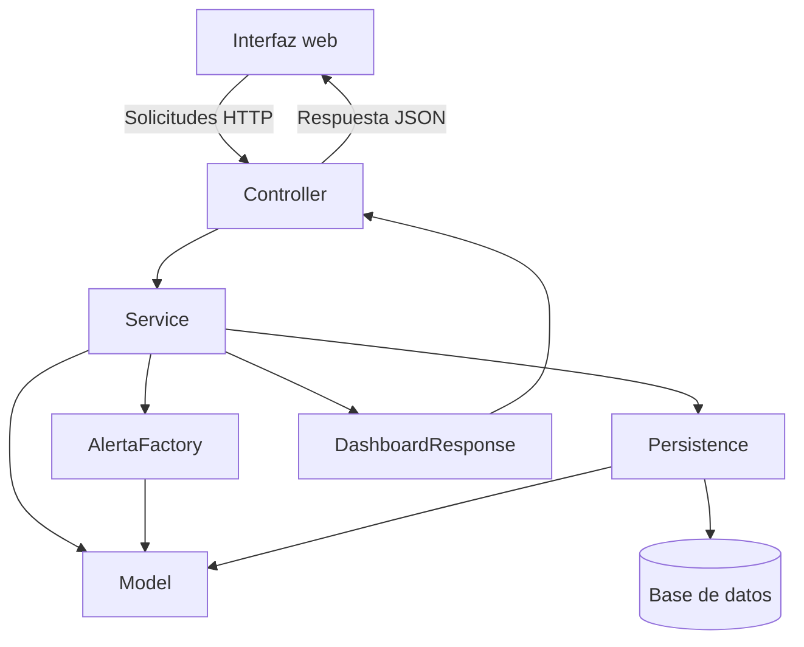
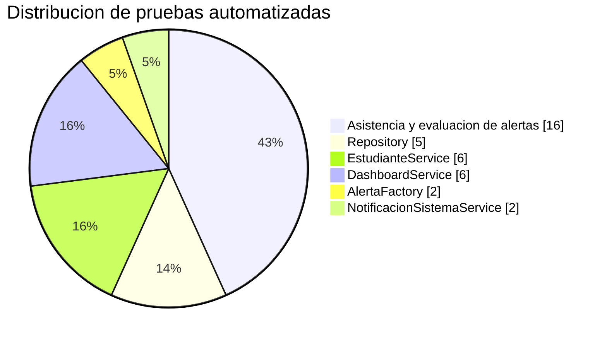
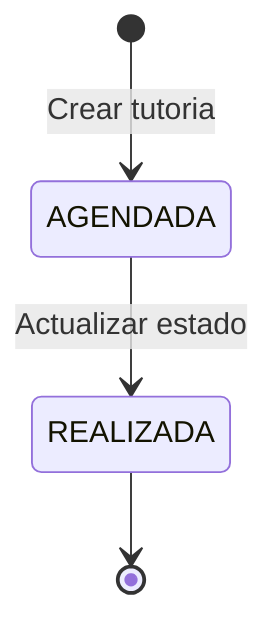
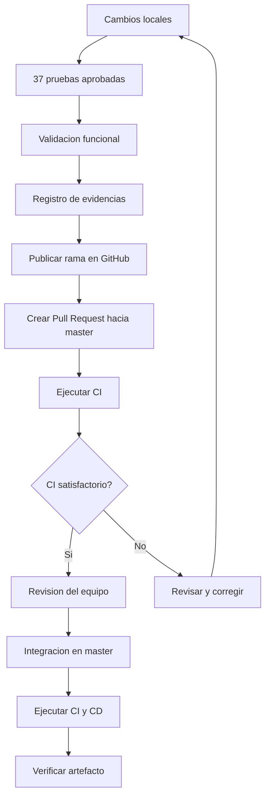

# Evidencias de implementación y validación — SATE-UNIAJC

## Sesión 13 — Ingeniería de Software I

**Proyecto:** SATE-UNIAJC — Sistema de Alertas Tempranas y Acompañamiento Estudiantil

**Institución:** Institución Universitaria Antonio José Camacho

**Asignatura:** Ingeniería de Software I

**Fecha:** 27 de noviembre de 2026

**Rama de trabajo:** `Juan-sesion-13`

**Commit de referencia de la validación:** `f3c9db1`

**Tema:** Arquitectura evolutiva, patrón MVC, patrones de diseño, deuda técnica y pruebas automatizadas.

---

## 1. Objetivo

Consolidar las evidencias técnicas y funcionales obtenidas durante la implementación de las actividades correspondientes a la sesión 13 del proyecto SATE-UNIAJC.

El documento registra los resultados de la reorganización arquitectónica, la aplicación de patrones de diseño, la reducción de deuda técnica, la ejecución de pruebas automatizadas y la validación funcional del sistema.

Las evidencias permiten establecer la trazabilidad entre las modificaciones realizadas y los resultados obtenidos durante su verificación local.

## 2. Alcance de la intervención

Durante la sesión 13 se realizaron las siguientes actividades:

- Reorganización del paquete `repository` a `persistence`.
- Implementación del patrón Repository para estudiantes.
- Separación de responsabilidades en EstudianteController.
- Creación de EstudianteService.
- Separación de responsabilidades en DashboardController.
- Creación de DashboardService.
- Creación de DashboardResponse en el paquete view.
- Implementación de una fábrica simple para la creación de alertas.
- Incorporación de pruebas unitarias.
- Actualización de las pruebas existentes.
- Elaboración del ADR-0001.
- Análisis de deuda técnica.
- Actualización de la documentación técnica.
- Actualización de los diagramas UML y de secuencia.
- Actualización del plan de pruebas.
- Ejecución final de las pruebas automatizadas.
- Validación funcional mediante la interfaz web.

La intervención se concentró en mejorar la estructura interna del sistema sin modificar intencionalmente las reglas de negocio vigentes.

## 3. Entorno de validación

| Componente | Versión o configuración |
|---|---|
| Sistema operativo | Windows 11 |
| Java | Oracle JDK 25.0.2 LTS |
| Maven | Apache Maven 3.9.16 |
| Spring Boot | 3.4.5 |
| Framework de pruebas | JUnit 5 |
| Simulación de dependencias | Mockito |
| Byte Buddy | 1.17.8 |
| Maven Surefire | 3.5.3 |
| Persistencia local prevista | H2 |
| Persistencia alternativa | MySQL |
| Interfaz gráfica | HTML, CSS y JavaScript |
| Control de versiones | Git |
| Repositorio remoto | GitHub |
| Rama de validación | Juan-sesion-13 |
| Commit de referencia | f3c9db1 |
| Dirección local | http://localhost:8080 |

La validación no incluye pruebas de persistencia en MySQL ni pruebas de despliegue en un entorno productivo.

## 4. Evidencia de evolución arquitectónica

### 4.1. Organización de paquetes

```text
src/main/java/co/uniajc/sate/
├── config/
├── controller/
├── model/
├── persistence/
├── service/
│   ├── evaluacion/
│   ├── factory/
│   └── notificacion/
├── view/
└── SateUniajcApplication.java
```

Se conservó el paquete base `co.uniajc.sate` para mantener la compatibilidad con la estructura existente del proyecto.

Esta decisión se encuentra documentada en el ADR-0001.

### 4.2. Arquitectura general



El diagrama representa conceptualmente las relaciones principales de los componentes intervenidos.

No implica que todos los controladores del sistema hayan eliminado completamente el acceso directo a los repositorios.

### 4.3. Componentes incorporados

| Componente | Responsabilidad |
|---|---|
| EstudianteRepository | Contrato de acceso a estudiantes |
| EstudianteJpaRepository | Operaciones mediante Spring Data JPA |
| EstudianteRepositoryImpl | Implementación del contrato Repository |
| EstudianteService | Coordinación de operaciones académicas |
| DashboardService | Procesamiento de indicadores |
| DashboardResponse | Representación de la respuesta del dashboard |
| AlertaFactory | Construcción centralizada de alertas |

La fábrica implementada corresponde a una fábrica simple. No se afirma que constituya una implementación estricta del patrón Factory Method de GoF.

## 5. Evidencia de ejecución final de pruebas automatizadas

### 5.1. Comando ejecutado

```bash
mvn clean test
```

### 5.2. Resultado obtenido

```text
Tests run: 37, Failures: 0, Errors: 0, Skipped: 0

BUILD SUCCESS

Total time: 10.064 s

Finished at: 2026-11-27T16:58:41-05:00
```

La ejecución corresponde al commit `f3c9db1` de la rama `Juan-sesion-13`.

### 5.3. Resultados consolidados

| Indicador | Resultado |
|---|---:|
| Archivos Java de producción compilados | 40 |
| Clases de pruebas compiladas | 6 |
| Pruebas ejecutadas | 37 |
| Pruebas aprobadas | 37 |
| Fallos | 0 |
| Errores | 0 |
| Pruebas omitidas | 0 |
| Porcentaje de aprobación | 100 % |
| Tiempo total | 10.064 segundos |
| Resultado de compilación | BUILD SUCCESS |

El porcentaje de aprobación corresponde exclusivamente a las pruebas ejecutadas.

No representa un porcentaje de cobertura del código fuente.

### 5.4. Distribución por clase de pruebas

| Clase | Ejecutadas | Fallos | Errores | Omitidas | Tiempo |
|---|---:|---:|---:|---:|---:|
| EstudianteRepositoryImplTest | 5 | 0 | 0 | 0 | 1.608 s |
| SateUniajcApplicationTests | 16 | 0 | 0 | 0 | 0.446 s |
| DashboardServiceTest | 6 | 0 | 0 | 0 | 0.256 s |
| EstudianteServiceTest | 6 | 0 | 0 | 0 | 0.038 s |
| AlertaFactoryTest | 2 | 0 | 0 | 0 | 0.068 s |
| NotificacionSistemaServiceTest | 2 | 0 | 0 | 0 | 0.040 s |
| **Total** | **37** | **0** | **0** | **0** | — |

Los tiempos individuales no incluyen todas las operaciones realizadas por Maven durante la compilación y ejecución.

### 5.5. Distribución gráfica



### 5.6. Reportes de Maven Surefire

Se verificó la existencia y el contenido de los seis reportes de pruebas generados dentro de:

```text
target/surefire-reports/
```

Archivos verificados:

```text
co.uniajc.sate.persistence.EstudianteRepositoryImplTest.txt
co.uniajc.sate.SateUniajcApplicationTests.txt
co.uniajc.sate.service.DashboardServiceTest.txt
co.uniajc.sate.service.EstudianteServiceTest.txt
co.uniajc.sate.service.factory.AlertaFactoryTest.txt
co.uniajc.sate.service.notificacion.NotificacionSistemaServiceTest.txt
```

Todos los reportes registraron cero fallos, cero errores y cero pruebas omitidas.

Los archivos de `target` corresponden a resultados generados durante la compilación y pueden reproducirse mediante Maven.

### 5.7. Advertencias de ejecución

Durante la ejecución se observaron advertencias relacionadas con:

- Carga dinámica de agentes de Java.
- Configuración del mecanismo inline de Mockito.
- Byte Buddy.
- Uso de métodos obsoletos de `sun.misc.Unsafe`.
- Restricciones futuras del JDK.

Las advertencias no impidieron la ejecución satisfactoria de las pruebas.

Su revisión se mantiene como una oportunidad de mantenimiento futuro.

## 6. Comparación antes y después de la sesión 13

| Indicador | Antes | Después | Incremento |
|---|---:|---:|---:|
| Archivos Java de producción | 34 | 40 | 6 |
| Clases de pruebas | 2 | 6 | 4 |
| Pruebas automatizadas | 18 | 37 | 19 |
| Fallos | 0 | 0 | 0 |
| Errores | 0 | 0 | 0 |
| Pruebas omitidas | 0 | 0 | 0 |

El incremento porcentual en la cantidad de pruebas se calcula mediante:

```text
Incremento = ((37 - 18) / 18) × 100

Incremento = 105.56 %
```

Se incorporaron 19 pruebas adicionales, equivalentes a un incremento aproximado del 105.6 % respecto a la cantidad inicial.

Este incremento no constituye una medición de cobertura de código.

## 7. Validación funcional final

### 7.1. Inicio de la aplicación

La aplicación se ejecutó localmente mediante:

```bash
mvn spring-boot:run
```

Dirección utilizada:

```text
http://localhost:8080
```

Se realizaron verificaciones mediante la interfaz gráfica y se revisaron las capturas correspondientes a los resultados observados.

Las operaciones se realizaron con los registros de prueba disponibles en el entorno local.

### 7.2. Matriz consolidada de verificaciones

| ID | Verificación | Resultado observado | Estado |
|---|---|---|---|
| VF-01 | Disponibilidad del inicio de sesión | Formulario disponible | Aprobada |
| VF-02 | Acceso al sistema | Acceso mediante el usuario director | Aprobada |
| VF-03 | Visualización del dashboard | Indicadores y cohortes visibles | Aprobada |
| VF-04 | Consulta del registro académico | Listado de seis estudiantes disponible | Aprobada |
| VF-05 | Actualización académica | Inasistencia y promedio actualizados | Aprobada |
| VF-06 | Generación de alerta roja | Alerta generada por inasistencia del 16 % | Aprobada |
| VF-07 | Generación de alerta amarilla | Alerta generada por promedio inferior a 3.0 | Aprobada |
| VF-08 | Prevención de duplicados | Ocho alertas antes y después de reevaluar | Aprobada |
| VF-09 | Acompañamiento estudiantil | Tutoría creada y marcada como realizada | Aprobada |
| VF-10 | Actualización del dashboard | Indicadores actualizados después de las operaciones | Aprobada |

### 7.3. Resultado consolidado

| Indicador | Cantidad |
|---|---:|
| Verificaciones funcionales realizadas | 10 |
| Verificaciones aprobadas | 10 |
| Verificaciones fallidas | 0 |
| Verificaciones pendientes | 0 |
| Porcentaje de aprobación | 100 % |

La aprobación corresponde a los escenarios funcionales específicos ejecutados.

No representa una validación exhaustiva de todos los criterios de aceptación, roles, escenarios de seguridad o casos de integración del sistema.

## 8. Evidencias funcionales detalladas

### 8.1. VF-01 — Disponibilidad del inicio de sesión

Se verificó la disponibilidad de la pantalla de autenticación.

Elementos observados:

- Identificación del sistema SATE-UNIAJC.
- Campo de correo institucional.
- Campo de contraseña.
- Botón de ingreso.
- Enlace de recuperación de contraseña.

**Resultado:** aprobado.

La disponibilidad del enlace de recuperación no demuestra que el proceso completo de recuperación haya sido validado.

### 8.2. VF-02 — Acceso al sistema

Se realizó el acceso mediante el usuario de prueba correspondiente al director.

Después del inicio de sesión se visualizó el dashboard principal.

**Resultado:** aprobado.

No se registraron contraseñas ni tokens de autenticación en este documento.

### 8.3. VF-03 — Visualización del dashboard

Indicadores observados inicialmente:

| Indicador | Valor inicial |
|---|---:|
| Estudiantes | 6 |
| Alertas rojas pendientes | 2 |
| Alertas amarillas pendientes | 1 |
| Proyección de deserción | 43.3 % |
| Tutorías | 4 |
| Efectividad de tutorías | 50 % |
| Estudiantes de la cohorte 2026-1 | 3 |
| Estudiantes de la cohorte 2026-2 | 3 |

**Resultado:** aprobado.

### 8.4. VF-04 — Consulta del registro académico

Se verificó la disponibilidad del listado académico y del formulario de actualización.

El listado presentó:

- Estudiantes.
- Cohortes.
- Porcentajes de inasistencia.
- Promedios académicos.
- Estados de alerta.

Se observaron seis registros académicos.

**Resultado:** aprobado.

### 8.5. VF-05 — Actualización académica

Se seleccionó un estudiante de prueba y se actualizó su registro académico.

| Dato | Valor inicial | Valor final |
|---|---:|---:|
| Inasistencia | 8 % | 16 % |
| Promedio | 4.2 | 4.2 |
| Estado académico | VERDE | ROJA |

La actualización se realizó mediante el botón:

```text
Guardar registro y evaluar alerta
```

El listado académico reflejó los valores actualizados.

**Resultado:** aprobado.

### 8.6. VF-06 — Generación de alerta roja

Después de actualizar el registro académico se verificó la creación de una alerta roja.

| Campo | Resultado |
|---|---|
| Inasistencia registrada | 16 % |
| Promedio registrado | 4.2 |
| Tipo de alerta | ROJA |
| Motivo | Inasistencia superior al 15 % |
| Fecha | 27/11/2026 |
| Hora observada | 5:07 p. m. |
| Estado | Pendiente de atención |

La alerta generada coincide con la regla de negocio vigente:

```text
Inasistencia > 15 %
```

**Resultado:** aprobado.

### 8.7. VF-07 — Generación de alerta amarilla

Durante la evaluación del motor de alertas se observó la creación de una alerta amarilla para un estudiante con promedio de 2.8.

| Campo | Resultado |
|---|---|
| Promedio académico | 2.8 |
| Tipo de alerta | AMARILLA |
| Motivo | Promedio inferior a 3.0 |
| Fecha | 27/11/2026 |
| Hora observada | 5:02 p. m. |
| Estado | Pendiente de atención |

La alerta coincide con la regla de negocio vigente:

```text
Promedio < 3.0
```

**Resultado:** aprobado.

### 8.8. VF-08 — Prevención de duplicados

Se ejecutó nuevamente el motor de alertas sin modificar los registros académicos.

El sistema presentó el mensaje:

```text
Motor de reglas ejecutado.
```

Después de aceptar el mensaje se verificó el listado completo de alertas.

| Indicador | Antes | Después |
|---|---:|---:|
| Alertas totales | 8 | 8 |
| Alertas rojas | 3 | 3 |
| Alertas amarillas | 5 | 5 |
| Alertas pendientes | 7 | 7 |
| Alertas atendidas | 1 | 1 |
| Nuevas alertas duplicadas | 0 | 0 |

Fecha de verificación:

```text
27/11/2026 — aproximadamente 5:11 p. m.
```

No se observaron nuevas alertas pendientes duplicadas para el mismo estudiante y tipo.

**Resultado:** aprobado.

Esta verificación corresponde a ejecuciones consecutivas del motor de alertas y no demuestra el comportamiento ante solicitudes concurrentes.

### 8.9. VF-09 — Acompañamiento estudiantil

Se creó una tutoría académica utilizando los siguientes datos de prueba:

| Campo | Valor |
|---|---|
| Docente | Docente de prueba |
| Tipo | Académica |
| Fecha programada | 28/11/2026 |
| Hora programada | 10:00 a. m. |
| Estado inicial | AGENDADA |
| Estado final | REALIZADA |

Se verificó que la tutoría apareciera en el listado y que su estado pudiera actualizarse.



El diagrama representa exclusivamente la transición observada durante la prueba.

**Resultado:** aprobado.

Se identificó adicionalmente que el sistema permite marcar como realizada una tutoría cuya fecha programada todavía no ha llegado.

Esta situación deberá evaluarse con el equipo Scrum para determinar si requiere una regla de validación adicional.

### 8.10. VF-10 — Actualización del dashboard

Después de realizar las operaciones académicas y de acompañamiento se actualizaron los indicadores del dashboard.

| Indicador | Valor inicial | Valor final |
|---|---:|---:|
| Estudiantes | 6 | 6 |
| Alertas rojas pendientes | 2 | 3 |
| Alertas amarillas pendientes | 1 | 4 |
| Proyección de deserción | 43.3 % | 58.3 % |
| Tutorías registradas | 4 | 5 |
| Tutorías realizadas | 2 | 3 |
| Efectividad de tutorías | 50 % | 60 % |
| Cohorte 2026-1 | 3 | 3 |
| Cohorte 2026-2 | 3 | 3 |

Los valores finales corresponden al conjunto de operaciones realizadas durante la validación, incluidas las modificaciones académicas adicionales.

**Resultado:** aprobado.

## 9. Verificación de los indicadores del dashboard

### 9.1. Efectividad de tutorías

La implementación calcula el porcentaje de tutorías realizadas respecto al total de tutorías registradas.

```text
Efectividad = (Tutorías realizadas / Total de tutorías) × 100
```

Valores finales:

```text
Tutorías realizadas = 3
Total de tutorías = 5

Efectividad = (3 / 5) × 100

Efectividad = 60 %
```

El resultado coincide con el indicador observado en el dashboard.

Este porcentaje representa la proporción de tutorías realizadas, no una medición del impacto académico de las tutorías.

### 9.2. Proyección de deserción

La fórmula implementada utiliza:

- Estudiantes distintos con alertas pendientes.
- Estudiantes con estado académico verde.
- Total de estudiantes.
- Factores de ponderación definidos en el sistema.

```text
Proyección =
((Estudiantes con alertas pendientes × 0.8)
+ (Estudiantes verdes × 0.1))
/ Total de estudiantes × 100
```

Valores finales observados:

```text
Estudiantes distintos con alertas pendientes = 4
Estudiantes verdes = 3
Total de estudiantes = 6
```

Aplicación de la fórmula:

```text
Proyección = ((4 × 0.8) + (3 × 0.1)) / 6 × 100

Proyección = (3.2 + 0.3) / 6 × 100

Proyección = 58.3333 %

Resultado redondeado = 58.3 %
```

El resultado coincide con el indicador presentado por el dashboard.

La fórmula corresponde a una aproximación heurística y no constituye un modelo estadístico validado de predicción de deserción.

También existe la posibilidad de superposición entre estudiantes con alertas pendientes y estudiantes con estado verde.

## 10. Reglas de negocio verificadas

| Regla | Condición | Evidencia |
|---|---|---|
| Alerta roja | Inasistencia superior al 15 % | Pruebas unitarias y VF-06 |
| Alerta amarilla | Promedio inferior a 3.0 | Pruebas unitarias y VF-07 |
| Límite de inasistencia | Exactamente 15 % no genera alerta roja | Pruebas unitarias |
| Límite de promedio | Exactamente 3.0 no genera alerta amarilla | Pruebas unitarias |
| Evaluación simultánea | Un estudiante puede cumplir ambas condiciones | Pruebas unitarias |
| Prevención de duplicados | No repetir alertas pendientes del mismo estudiante y tipo | Pruebas unitarias y VF-08 |
| Actualización académica | Guardar inasistencia y promedio | Pruebas unitarias y VF-05 |
| Actualización de tutorías | Cambiar el estado de una tutoría | VF-09 |
| Indicadores del dashboard | Actualizar los valores según los registros | Pruebas unitarias y VF-10 |

## 11. Hallazgos y deuda técnica restante

Durante la validación final se identificaron aspectos que requieren seguimiento.

| ID | Hallazgo | Referencia | Estado |
|---|---|---|---|
| H-01 | Advertencias de Mockito y Byte Buddy relacionadas con futuras versiones de Java | DT-12 | Pendiente |
| H-02 | Alertas iniciales con motivos correspondientes a reglas académicas anteriores | DT-13 | Pendiente |
| H-03 | Alertas pendientes que permanecen después de actualizar el estado académico | Revisión del ciclo de vida de alertas | Por evaluar |
| H-04 | Posible superposición de estudiantes dentro de la fórmula de proyección | DT-23 | Pendiente |
| H-05 | El indicador de efectividad representa tutorías realizadas y no impacto académico | DT-24 | Pendiente |
| H-06 | Posibilidad de marcar una tutoría futura como realizada | Validación temporal de tutorías | Por evaluar |
| H-07 | Ausencia de mediciones formales de cobertura de código | DT-10 | Pendiente |
| H-08 | Ausencia de validación de concurrencia en la prevención de duplicados | DT-22 | Pendiente |
| H-09 | Validación de persistencia mediante MySQL no realizada | DT-14 | Pendiente |
| H-10 | Necesidad de ampliar pruebas de integración y seguridad | DT-08 y DT-09 | Pendiente |

Los hallazgos no se consideran automáticamente defectos críticos.

Su clasificación y priorización deberán ser evaluadas por el equipo Scrum mediante GitHub Issues y GitHub Projects.

## 12. Trazabilidad de los commits

| Commit | Descripción |
|---|---|
| `f1195fe` | Reorganización del paquete repository a persistence |
| `ebebdfa` | Implementación del patrón Repository para estudiantes |
| `f6ebbcb` | Separación de la lógica de estudiantes en service |
| `d4666f9` | Separación de la lógica del dashboard en service y view |
| `249b876` | Implementación de Factory para la creación de alertas |
| `fa91a50` | Registro del ADR-0001 |
| `c6f06bb` | Documentación de deuda técnica y mantenibilidad |
| `a505282` | Actualización del README |
| `c858a38` | Actualización de la documentación técnica |
| `fffa776` | Actualización de diagramas MVC, Repository y Factory |
| `c5cb5bb` | Actualización del índice de documentación |
| `d9e9210` | Actualización del diagrama UML HU04 |
| `9459f35` | Actualización del diagrama UML HU05 |
| `deb36ed` | Actualización de los diagramas de secuencia |
| `b543592` | Actualización del plan de pruebas |
| `f3c9db1` | Ampliación del análisis de deuda técnica |

Los 16 commits anteriores corresponden a las modificaciones locales verificadas antes de elaborar este documento.

## 13. Estado del repositorio durante la validación

Comandos ejecutados:

```bash
git status
git branch --show-current
git rev-parse --short HEAD
```

Resultado obtenido:

```text
On branch Juan-sesion-13

Your branch is ahead of 'origin/Juan-sesion-13'
by 16 commits.

nothing to commit, working tree clean

Juan-sesion-13

f3c9db1
```

El resultado confirma que, antes de crear este documento, los cambios de la sesión 13 estaban registrados mediante commits locales y no existían modificaciones pendientes en el directorio de trabajo.

La publicación de los commits en GitHub todavía se encontraba pendiente.

## 14. Integración continua y entrega continua

### 14.1. Integración continua

Archivo:

```text
.github/workflows/ci.yml
```

El workflow de CI contempla:

- Preparación del entorno de ejecución.
- Configuración de Java 25.
- Compilación del proyecto.
- Ejecución de pruebas automatizadas mediante Maven.

Comando principal:

```bash
mvn --batch-mode clean test
```

La ejecución local fue satisfactoria.

La ejecución remota deberá verificarse mediante el Pull Request dirigido a master o mediante una ejecución manual del workflow.

### 14.2. Entrega continua

Archivo:

```text
.github/workflows/cd.yml
```

El workflow de CD contempla:

- Configuración del entorno.
- Ejecución de pruebas automatizadas.
- Empaquetado de la aplicación.
- Verificación del archivo JAR.
- Publicación del artefacto generado.

Artefacto previsto:

```text
target/sate-uniajc-1.0.0.jar
```

Nombre del artefacto en GitHub Actions:

```text
sate-uniajc-staging
```

La ejecución del workflow de CD no implica que exista un entorno de staging desplegado y operativo.

### 14.3. Flujo de integración previsto



### 14.4. Estado de validación

| Actividad | Estado |
|---|---|
| Compilación local | Aprobada |
| Pruebas automatizadas locales | Aprobadas |
| Validación funcional local | Aprobada |
| Publicación de la rama | Pendiente |
| Pull Request | Pendiente |
| Ejecución remota de CI | Pendiente de verificación |
| Ejecución remota de CD | Pendiente de verificación |
| Generación remota del artefacto JAR | Pendiente de verificación |
| Despliegue real en staging | No confirmado |

## 15. Cumplimiento de los entregables de la sesión 13

| Entregable | Evidencia | Estado |
|---|---|---|
| Reorganización modular mediante MVC | Paquetes model, view, controller y service | Implementado |
| Interfaz EstudianteRepository | Contrato e implementación en persistence | Implementado |
| Registro ADR-0001 | docs/adr/0001-patron-mvc.md | Implementado |
| Pruebas JUnit 5 satisfactorias | 37 pruebas aprobadas localmente | Aprobado localmente |
| Verificación de CI/CD | Workflows existentes en GitHub Actions | Pendiente de validación remota |

Como actividades complementarias se incorporaron:

- Fábrica simple para la creación de alertas.
- Análisis de deuda técnica.
- Relación cualitativa con ISO/IEC 25010.
- Actualización de diagramas arquitectónicos.
- Actualización de diagramas UML.
- Actualización de diagramas de secuencia.
- Ampliación del plan de pruebas.
- Validación funcional mediante la interfaz gráfica.

La conservación del paquete base `co.uniajc.sate` constituye una decisión de compatibilidad documentada en el ADR.

Su aceptación frente a la estructura de paquetes propuesta en el material académico deberá ser confirmada por la docente.

## 16. Resumen de resultados

| Indicador | Resultado |
|---|---|
| Pruebas iniciales | 18 |
| Pruebas finales | 37 |
| Pruebas adicionales | 19 |
| Incremento en cantidad de pruebas | 105.6 % |
| Fallos de pruebas | 0 |
| Errores de pruebas | 0 |
| Pruebas omitidas | 0 |
| Verificaciones funcionales aprobadas | 10 de 10 |
| Commits locales previos a este documento | 16 |
| Resultado de Maven | BUILD SUCCESS |
| Estado de validación local | Satisfactorio |
| Estado de integración remota | Pendiente |

## 17. Limitaciones de las evidencias

Las evidencias obtenidas corresponden a una validación local del sistema.

No se afirma que se hayan realizado:

- Pruebas exhaustivas de integración HTTP.
- Pruebas completas de autorización para todos los roles.
- Auditorías de seguridad.
- Pruebas de carga y rendimiento.
- Pruebas de concurrencia.
- Mediciones de cobertura mediante JaCoCo.
- Validaciones completas de persistencia en MySQL.
- Despliegues reales en staging o producción.
- Validaciones estadísticas de los indicadores de deserción.
- Verificación exhaustiva de todos los criterios de aceptación.

Las capturas de pantalla fueron revisadas como evidencia funcional durante la sesión de trabajo.

Este documento registra sus resultados, pero no incorpora físicamente los archivos de imagen.

Las pruebas automatizadas corresponden a pruebas unitarias con dependencias simuladas en los componentes correspondientes.

## 18. Conclusiones

La sesión 13 permitió evolucionar la arquitectura de SATE-UNIAJC mediante la reorganización modular, la separación de responsabilidades y la aplicación de patrones de diseño.

La implementación de Repository favorece la separación entre el contrato de acceso a estudiantes y los detalles de persistencia.

La incorporación de servicios especializados permite reducir las responsabilidades de los controladores intervenidos.

La creación de AlertaFactory centraliza la construcción de alertas y facilita el mantenimiento del servicio de notificaciones.

La cantidad de pruebas automatizadas aumentó de 18 a 37, sin registrar fallos, errores ni pruebas omitidas en la ejecución final.

Las diez verificaciones funcionales realizadas proporcionan evidencia favorable del comportamiento del sistema en el entorno local.

Los hallazgos identificados permiten orientar futuras actividades de mantenimiento y evolución del proyecto.

La validación remota de CI/CD permanece pendiente hasta publicar la rama, realizar el Pull Request y comprobar los resultados correspondientes en GitHub Actions.

## 19. Documentos relacionados

- [Documentación técnica](DOCUMENTACION_TECNICA.md).
- [Análisis de deuda técnica](DEUDA_TECNICA.md).
- [Plan de pruebas](PLAN_PRUEBAS.md).
- [ADR-0001](adr/0001-patron-mvc.md).
- [Arquitectura MVC](diagramas/ARQUITECTURA_MVC.md).
- [Diagrama UML HU04](diagramas/CLASES_HU04.md).
- [Diagrama UML HU05](diagramas/CLASES_HU05.md).
- [Diagramas de secuencia](secuencia.md).
- [Revisión de principios YAGNI, KISS y DRY](REVISION_YAGNI_KISS_DRY.md).
- [Documentación general](README_DOCUMENTOS.md).
- [Documentación de despliegue](despliegue.md).
- [README principal](../README.md).

## 20. Referencias

- Material académico de la sesión 13: Arquitectura Evolutiva, Patrón MVC y Registros de Decisiones (ADR).
- ISO/IEC 25010 — Modelo de calidad del producto de software.
- Gamma, E., Helm, R., Johnson, R. y Vlissides, J. Design Patterns: Elements of Reusable Object-Oriented Software.
- Repositorio SATE-UNIAJC: https://github.com/darwinvf2765/SATE-UNIAJC
- GitHub Actions: https://github.com/darwinvf2765/SATE-UNIAJC/actions
- Reportes locales de Maven Surefire.
- Evidencias visuales de la validación funcional del 27 de noviembre de 2026.

---

**SATE-UNIAJC — Ingeniería de Software I**

**Sesión 13 — Arquitectura evolutiva y gestión de deuda técnica**

**Estado: implementación y validación local satisfactorias; integración remota pendiente.**