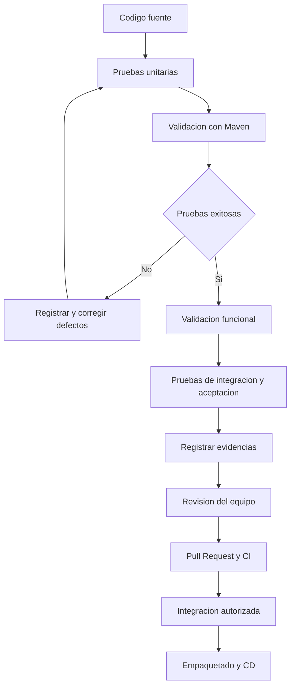
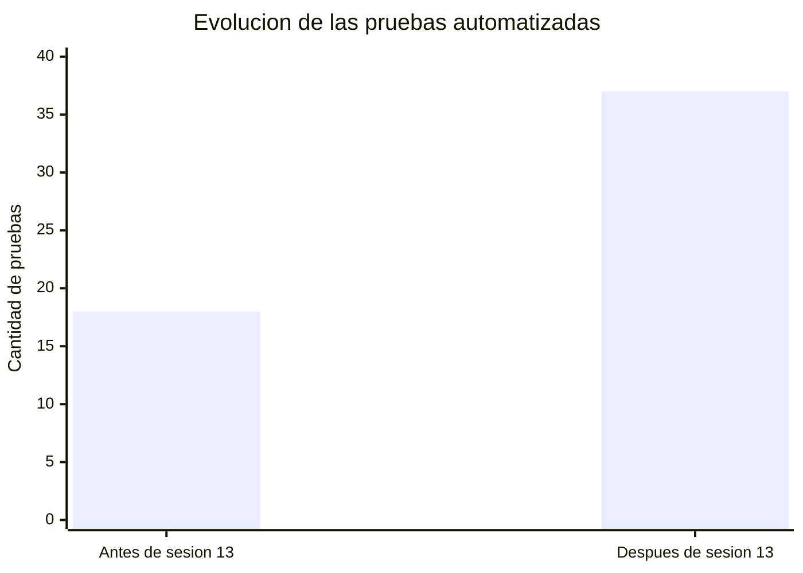
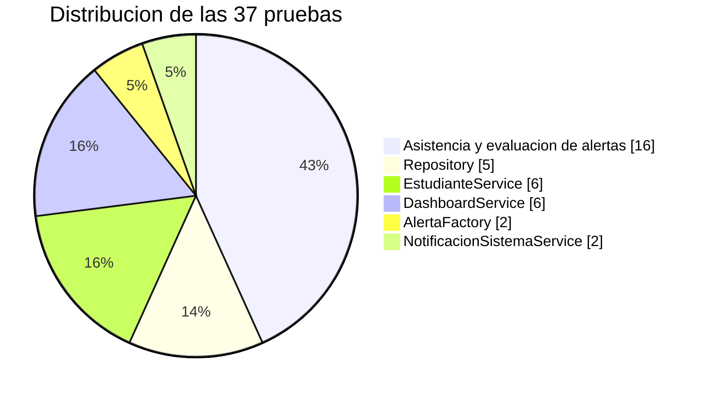
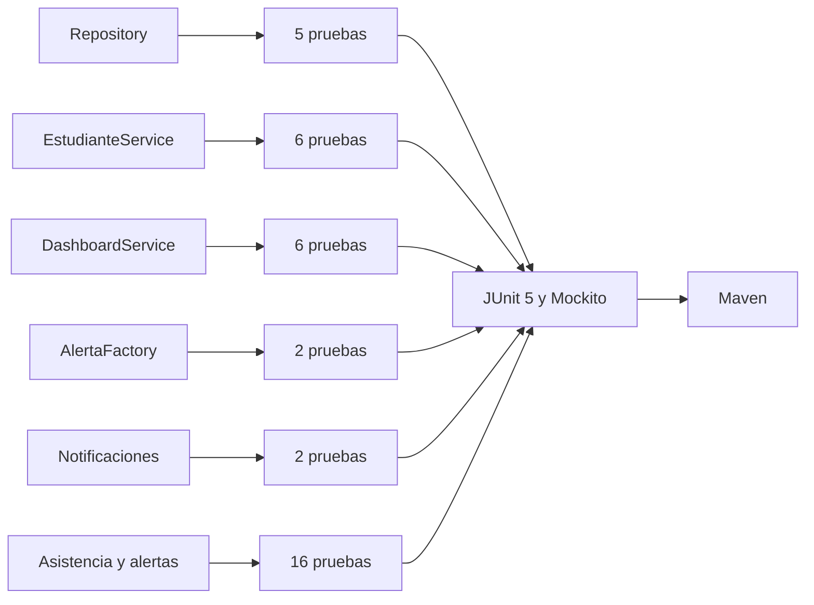
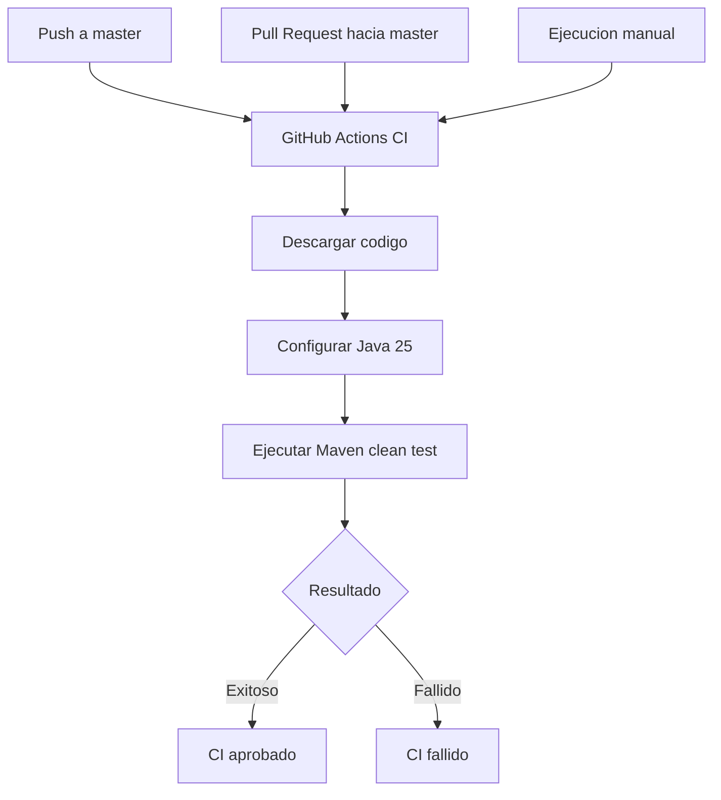
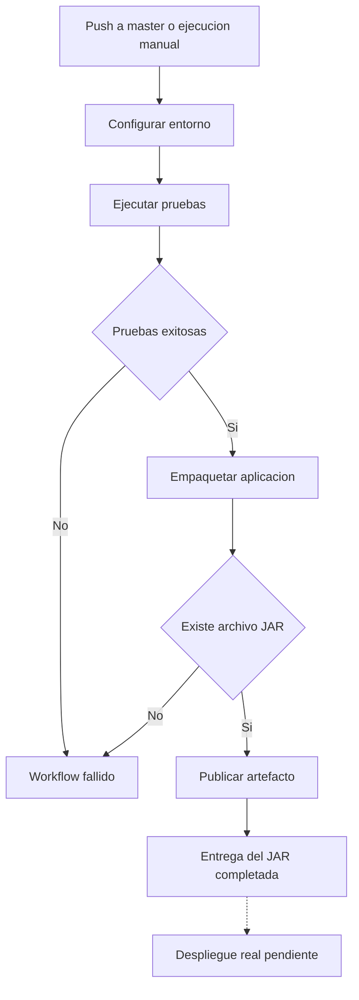

# Plan de pruebas — SATE-UNIAJC

## Sesión 13 — Arquitectura evolutiva

**Proyecto:** SATE-UNIAJC — Sistema de Alertas Tempranas y Acompañamiento Estudiantil.

**Institución:** Institución Universitaria Antonio José Camacho.

**Asignatura:** Ingeniería de Software I.

**Fecha de actualización:** 27 de noviembre de 2026.

**Rama de trabajo:** `Juan-sesion-13`.

---

## 1. Objetivo

Establecer la estrategia, los casos, procedimientos,
criterios y evidencias necesarios para verificar
el funcionamiento de SATE-UNIAJC.

El plan contempla:

- Autenticación.
- Recuperación de contraseña.
- Control de acceso.
- Gestión de estudiantes.
- Registro académico.
- Registro de asistencia.
- Evaluación de alertas académicas.
- Gestión de tutorías.
- Consulta del dashboard.
- Persistencia de información.
- Validación de la arquitectura evolutiva.
- Integración y entrega continua.

La actualización incorpora las pruebas desarrolladas
durante la Sesión 13 para verificar los componentes
introducidos mediante la reorganización modular
y los patrones de diseño.

Los criterios de aceptación oficiales se gestionan
mediante GitHub Issues y GitHub Projects.

---

## 2. Alcance

### 2.1. Componentes funcionales

| Historia | Funcionalidad |
|---|---|
| HU-01 | Inicio de sesión |
| HU-02 | Recuperación de contraseña |
| HU-03 | Control de acceso mediante roles |
| HU-04 | Registro de asistencia |
| HU-05 | Registro académico |
| HU-06 | Alerta roja por inasistencia |
| HU-07 | Alerta amarilla por promedio |
| Complementario | Gestión de tutorías |
| Complementario | Consulta del dashboard |

### 2.2. Componentes arquitectónicos

- EstudianteRepository.
- EstudianteRepositoryImpl.
- EstudianteJpaRepository.
- EstudianteService.
- DashboardService.
- DashboardResponse.
- AlertaFactory.
- NotificacionSistemaService.
- EvaluadorAlerta y sus implementaciones.

### 2.3. Limitaciones del alcance

Las pruebas automatizadas existentes se concentran
en la verificación unitaria de componentes.

No constituyen una validación integral de:

- Seguridad de la aplicación.
- Rendimiento bajo carga.
- Persistencia real en MySQL.
- Disponibilidad en producción.
- Compatibilidad con todos los navegadores.
- Cumplimiento completo de los criterios de aceptación.

La validación de estos aspectos requiere pruebas
adicionales y evidencias específicas.

---

## 3. Entorno de pruebas

| Componente | Configuración |
|---|---|
| Proyecto Maven | sate-uniajc |
| Versión del proyecto | 1.0.0 |
| Lenguaje | Java 25 |
| Framework | Spring Boot 3.4.5 |
| Compilación | Maven |
| JUnit | JUnit 5 |
| Simulación de dependencias | Mockito |
| Dependencia de pruebas | spring-boot-starter-test |
| Byte Buddy | 1.17.8 |
| JWT | JJWT 0.12.6 |
| Base de datos local | H2 en memoria |
| Base de datos alternativa | MySQL |
| Sistema operativo local | Windows 11 |
| Sistema operativo CI/CD | ubuntu-latest |
| Distribución Java en CI/CD | Eclipse Temurin |
| Rama de referencia | master |
| Rama de trabajo | Juan-sesion-13 |

La configuración de dependencias se encuentra en:

[pom.xml](../pom.xml).

### 3.1. Comando principal

```bash
mvn clean test
```

### 3.2. Directorio de resultados

```text
target/surefire-reports/
```

### 3.3. Consideraciones

La disponibilidad de H2 y MySQL como dependencias
no significa que las pruebas unitarias actuales
utilicen una base de datos real.

Los repositorios son simulados mediante Mockito
en las clases de pruebas revisadas.

---

## 4. Estrategia de pruebas

### 4.1. Pruebas unitarias

Verifican componentes individuales mediante
entradas controladas y dependencias simuladas.

Se utilizan:

- JUnit 5.
- Mockito.
- Anotaciones Test.
- Anotaciones Mock.
- Anotaciones InjectMocks.
- MockitoExtension.
- Aserciones de JUnit.
- Verificación de interacciones.

### 4.2. Pruebas de integración

Buscan comprobar la interacción real entre:

- Controladores REST.
- Servicios.
- Repositorios.
- Spring Security.
- Spring Data JPA.
- Bases de datos.

La implementación de una suite específica
de integración permanece pendiente.

### 4.3. Pruebas funcionales

Verifican los procesos disponibles mediante
la interfaz web y las solicitudes HTTP.

Los resultados deben registrarse individualmente
y asociarse con las historias correspondientes.

### 4.4. Pruebas de regresión

Buscan comprobar que las modificaciones
arquitectónicas no alteren involuntariamente
el comportamiento existente.

### 4.5. Pruebas de aceptación

Verifican los criterios definidos oficialmente
para las historias de usuario.

Su aprobación corresponde al proceso de validación
establecido por el equipo Scrum.

### 4.6. Estrategia general



El diagrama representa la estrategia propuesta.

No implica que todas sus etapas hayan sido
ejecutadas o automatizadas.

---

## 5. Evolución de las pruebas automatizadas

### 5.1. Situación inicial

La evidencia histórica del plan de pruebas
registraba una ejecución local el 10 de noviembre
de 2026 con los siguientes resultados:

| Indicador | Resultado |
|---|---|
| Pruebas ejecutadas | 18 |
| Pruebas exitosas | 18 |
| Fallos | 0 |
| Errores | 0 |
| Omitidas | 0 |
| Resultado | BUILD SUCCESS |

### 5.2. Situación después de la refactorización

La Sesión 13 incorpora pruebas específicas
para Repository, Service y Factory.

| Indicador | Antes | Después |
|---|---:|---:|
| Archivos Java de producción | 34 | 40 |
| Clases de pruebas | 2 | 6 |
| Pruebas automatizadas | 18 | 37 |
| Incremento neto de pruebas | 0 | 19 |

### 5.3. Incremento porcentual

```text
Incremento =
    ((37 - 18) / 18) * 100

Incremento aproximado = 105.6 %
```

El incremento corresponde a la cantidad
de pruebas automatizadas.

No representa un porcentaje de cobertura
de código fuente.

### 5.4. Comparación gráfica



---

## 6. Inventario de clases de pruebas

Las pruebas se encuentran en:

```text
src/test/java/co/uniajc/sate/
├── SateUniajcApplicationTests.java
├── persistence/
│   └── EstudianteRepositoryImplTest.java
└── service/
    ├── DashboardServiceTest.java
    ├── EstudianteServiceTest.java
    ├── factory/
    │   └── AlertaFactoryTest.java
    └── notificacion/
        └── NotificacionSistemaServiceTest.java
```

### 6.1. Distribución

| Clase | Tipo | Casos |
|---|---|---:|
| SateUniajcApplicationTests | Unitaria | 16 |
| EstudianteRepositoryImplTest | Unitaria | 5 |
| EstudianteServiceTest | Unitaria | 6 |
| DashboardServiceTest | Unitaria | 6 |
| AlertaFactoryTest | Unitaria | 2 |
| NotificacionSistemaServiceTest | Unitaria | 2 |
| **Total** | | **37** |

### 6.2. Distribución gráfica



### 6.3. Clasificación técnica

SateUniajcApplicationTests utiliza MockitoExtension.

A pesar de su nombre, no utiliza la anotación
SpringBootTest en el código revisado.

Por tanto, sus pruebas se clasifican como unitarias
y no como pruebas de integración del contexto
completo de Spring Boot.

---

## 7. Inventario detallado de las 37 pruebas

Los siguientes casos corresponden a métodos Test
identificados directamente en el código fuente.

Los identificadores PU se asignan en este documento
para facilitar la trazabilidad.

No reemplazan los identificadores oficiales
de las historias de usuario.

### 7.1. SateUniajcApplicationTests — Asistencia

| ID | Método de prueba | Comportamiento comprobado |
|---|---|---|
| PU-01 | debeCalcularPorcentajeDeInasistencia | Calcula 20 % con dos ausencias en diez registros |
| PU-02 | debeRetornarCeroCuandoNoHayAsistencias | Retorna 0 % cuando no existen registros |
| PU-03 | debeRegistrarAsistenciaYActualizarPorcentaje | Actualiza el porcentaje a 100 %, solicita guardado y evaluación |
| PU-04 | debeCalcularInasistenciaPorMateria | Calcula 25 % con una ausencia en cuatro registros |
| PU-05 | debeRetornarCeroCuandoNoHayAsistenciasPorMateria | Retorna 0 % sin registros por materia |
| PU-06 | debeCalcularCorrectamenteElQuincePorCiento | Calcula 15 % con tres ausencias en veinte registros |
| PU-07 | debeRechazarEstudianteNuloAlCalcularPorMateria | Lanza IllegalArgumentException |

Total: 7 pruebas.

### 7.2. SateUniajcApplicationTests — HU-06

| ID | Método de prueba | Comportamiento comprobado |
|---|---|---|
| PU-08 | debeGenerarAlertaRojaCuandoInasistenciaSupera15Porciento | Determina estado ROJA con 16 % y solicita notificación |
| PU-09 | noDebeGenerarAlertaRojaConInasistenciaExactamente15 | Determina estado VERDE sin solicitar notificación |
| PU-10 | debeRechazarInasistenciaNegativa | Rechaza una inasistencia de -1 % |
| PU-11 | debeRechazarInasistenciaSuperiorA100 | Rechaza una inasistencia de 101 % |

Total: 4 pruebas.

### 7.3. SateUniajcApplicationTests — HU-07

| ID | Método de prueba | Comportamiento comprobado |
|---|---|---|
| PU-12 | debeGenerarAlertaAmarillaCuandoPromedioEsInferiorA3 | Determina estado AMARILLA con promedio 2.8 |
| PU-13 | noDebeGenerarAlertaAmarillaConPromedioExactamente3 | Determina estado VERDE sin solicitar notificación |
| PU-14 | debeRechazarPromedioNegativo | Rechaza promedio de -1.0 |
| PU-15 | debeRechazarPromedioSuperiorA5 | Rechaza promedio de 5.1 |

Total: 4 pruebas.

### 7.4. SateUniajcApplicationTests — Evaluación combinada

| ID | Método de prueba | Comportamiento comprobado |
|---|---|---|
| PU-16 | debeGenerarDosAlertasCuandoCumpleAmbasCondiciones | Determina estado ROJA y verifica dos llamadas al notificador con 20 % de inasistencia y promedio 2.5 |

Total: 1 prueba.

La prueba verifica dos llamadas al servicio
de notificaciones simulado.

No comprueba que dos registros hayan sido
almacenados realmente en una base de datos.

### 7.5. EstudianteRepositoryImplTest

| ID | Método de prueba | Comportamiento comprobado |
|---|---|---|
| PU-17 | debeListarTodosLosEstudiantes | Delega findAll y retorna el resultado |
| PU-18 | debeBuscarEstudiantePorId | Delega findById y retorna un Optional presente |
| PU-19 | debeRetornarVacioCuandoEstudianteNoExiste | Retorna Optional vacío |
| PU-20 | debeGuardarEstudiante | Delega save y retorna el estudiante |
| PU-21 | debeBuscarEstudiantesPorCohorte | Delega findByCohorte |

Total: 5 pruebas.

Estas pruebas verifican el comportamiento
de EstudianteRepositoryImpl mediante un
EstudianteJpaRepository simulado.

No verifican consultas SQL ni persistencia real.

### 7.6. EstudianteServiceTest

| ID | Método de prueba | Comportamiento comprobado |
|---|---|---|
| PU-22 | debeListarTodosLosEstudiantes | Retorna estudiantes del repositorio |
| PU-23 | debeBuscarEstudianteExistente | Retorna el estudiante encontrado |
| PU-24 | debeLanzarExcepcionSiEstudianteNoExiste | Lanza RuntimeException con el mensaje esperado |
| PU-25 | debeCrearEstudiante | Solicita guardar el estudiante y retorna el resultado |
| PU-26 | debeActualizarRegistroAcademico | Actualiza inasistencia a 20 % y promedio a 2.8 |
| PU-27 | debeEvaluarAlertasAlCrearEstudiante | Solicita una evaluación al crear el estudiante |

Total: 6 pruebas.

PU-26 también verifica:

- Consulta del estudiante por identificador.
- Dos llamadas directas a save.
- Una llamada a evaluarEstudiante.

AlertaService se encuentra simulado.

La prueba no verifica el procesamiento real
de las reglas ni la persistencia de alertas.

### 7.7. DashboardServiceTest

| ID | Método de prueba | Comportamiento comprobado |
|---|---|---|
| PU-28 | debeRetornarResumenVacio | Retorna indicadores en cero y agrupación vacía |
| PU-29 | debeContarEstudiantesCorrectamente | Cuenta tres estudiantes y dos estudiantes verdes |
| PU-30 | debeContarAlertasPorTipo | Cuenta dos alertas rojas y una amarilla |
| PU-31 | debeCalcularProyeccionSinDuplicarEstudiantes | Retorna 45 % con dos alertas del mismo estudiante |
| PU-32 | debeCalcularEfectividadDeTutorias | Retorna 50 % con dos tutorías realizadas de cuatro |
| PU-33 | debeAgruparEstudiantesPorCohorte | Agrupa dos estudiantes en 2026-1 y uno en 2026-2 |

Total: 6 pruebas.

PU-31 comprueba la eliminación de identificadores
duplicados dentro del conjunto de estudiantes
con alertas pendientes.

No demuestra que los estudiantes verdes y los
estudiantes con alertas pendientes formen
grupos mutuamente excluyentes.

PU-32 comprueba el porcentaje de tutorías realizadas.

No mide el impacto académico de las tutorías.

### 7.8. AlertaFactoryTest

| ID | Método de prueba | Comportamiento comprobado |
|---|---|---|
| PU-34 | debeCrearAlertaRoja | Construye una alerta ROJA con los datos esperados |
| PU-35 | debeCrearAlertaAmarilla | Construye una alerta AMARILLA con los datos esperados |

Total: 2 pruebas.

Ambas pruebas verifican:

- Existencia de la entidad construida.
- Identificador del estudiante.
- Nombre del estudiante.
- Tipo de alerta.
- Motivo.
- Fecha no nula.
- Estado inicial no atendida.

La Factory no realiza operaciones de persistencia.

### 7.9. NotificacionSistemaServiceTest

| ID | Método de prueba | Comportamiento comprobado |
|---|---|---|
| PU-36 | debeGuardarNotificacionEnElSistema | Solicita construir y guardar una alerta cuando no existe otra pendiente |
| PU-37 | noDebeGuardarUnaNotificacionDuplicada | No utiliza Factory ni save cuando existe una alerta pendiente del mismo tipo |

Total: 2 pruebas.

AlertaRepository y AlertaFactory se encuentran
simulados mediante Mockito.

Las pruebas no comprueban concurrencia
ni almacenamiento real.

### 7.10. Resumen

| Componente | Casos |
|---|---:|
| Asistencia | 7 |
| Evaluación de alerta roja | 4 |
| Evaluación de alerta amarilla | 4 |
| Evaluación combinada | 1 |
| Repository | 5 |
| EstudianteService | 6 |
| DashboardService | 6 |
| AlertaFactory | 2 |
| Notificaciones | 2 |
| **Total** | **37** |

---

## 8. Matriz de trazabilidad por historia de usuario

### 8.1. Convenciones

| Estado | Significado |
|---|---|
| Unitaria directa | Existe una prueba unitaria relacionada directamente con el comportamiento |
| Unitaria parcial | Existe una prueba relacionada, pero no cubre todo el escenario |
| Evidencia básica | Existe una observación funcional previa |
| Pendiente | No existe evidencia suficiente del escenario específico |

Los estados indican el alcance de las evidencias.

No equivalen automáticamente a la aprobación
completa de una historia de usuario.

### 8.2. Matriz funcional

| ID | HU | Escenario | Resultado esperado | Evidencia |
|---|---|---|---|---|
| CP-01 | HU-01 | Credenciales válidas | Acceso y entrega de JWT | Evidencia básica; HTTP pendiente |
| CP-02 | HU-01 | Credenciales incorrectas | HTTP 401 | Pendiente |
| CP-03 | HU-02 | Token válido | Restablecer contraseña | Pendiente |
| CP-04 | HU-02 | Token inválido o expirado | HTTP 400 | Pendiente |
| CP-05 | HU-03 | Rol autorizado | Permitir operación | Pendiente |
| CP-06 | HU-03 | Rol no autorizado | Denegar operación | Pendiente |
| CP-07 | HU-04 | Registrar asistencia | Guardar registro y evaluar riesgo | PU-03; unitaria parcial |
| CP-08 | HU-04 | Calcular inasistencia | Porcentaje esperado | PU-01 a PU-07 |
| CP-09 | HU-05 | Actualizar registro académico | Actualizar valores | PU-26; unitaria parcial |
| CP-10 | HU-05 | Valores fuera de rango | Rechazar solicitud inválida | PU-10, PU-11, PU-14 y PU-15; evidencia parcial |
| CP-11 | HU-06 | Inasistencia de 16 % | Resultado ROJA | PU-08 |
| CP-12 | HU-06 | Inasistencia de 15 % | No generar resultado ROJA | PU-09 |
| CP-13 | HU-06 | Inasistencia de 10 % | No generar resultado ROJA | Pendiente de prueba específica |
| CP-14 | HU-07 | Promedio de 2.8 | Resultado AMARILLA | PU-12 |
| CP-15 | HU-07 | Promedio de 3.0 | No generar resultado AMARILLA | PU-13 |
| CP-16 | HU-07 | Promedio de 3.5 | No generar resultado AMARILLA | Pendiente de prueba específica |
| CP-17 | HU-06/07 | Ambas condiciones de riesgo | Dos resultados y prioridad ROJA | PU-16; valores relacionados |
| CP-18 | HU-06/07 | Alerta pendiente del mismo tipo | No generar duplicado | PU-37; unitaria parcial |
| CP-19 | HU-06/07 | Consultar alertas | Mostrar información registrada | Evidencia básica; HTTP pendiente |
| CP-20 | HU-06/07 | Marcar alerta como atendida | Actualizar estado | Pendiente |

### 8.3. Observaciones de trazabilidad

PU-16 utiliza promedio 2.5.

El escenario BDD original utiliza promedio 2.8.

Ambos valores cumplen la misma condición de riesgo,
pero no constituyen exactamente el mismo conjunto
de datos de prueba.

Las pruebas de valores inválidos de los evaluadores
no demuestran automáticamente que los controladores
REST rechacen correctamente todas las solicitudes
con datos inválidos.

La implementación de HU-05 corresponde actualmente
a la actualización directa del promedio académico.

El registro individual de calificaciones parciales
requiere verificar el alcance oficial de la historia.

---

## 9. Matriz de pruebas arquitectónicas

| ID | Componente | Objetivo | Evidencia |
|---|---|---|---|
| PA-01 | Repository | Delegar listado de estudiantes | PU-17 |
| PA-02 | Repository | Buscar estudiante existente | PU-18 |
| PA-03 | Repository | Gestionar estudiante inexistente | PU-19 |
| PA-04 | Repository | Delegar guardado | PU-20 |
| PA-05 | Repository | Consultar por cohorte | PU-21 |
| PA-06 | EstudianteService | Listar y buscar estudiantes | PU-22 y PU-23 |
| PA-07 | EstudianteService | Gestionar búsqueda inexistente | PU-24 |
| PA-08 | EstudianteService | Crear estudiante | PU-25 |
| PA-09 | EstudianteService | Actualizar registro académico | PU-26 |
| PA-10 | EstudianteService | Delegar evaluación de alertas | PU-26 y PU-27 |
| PA-11 | DashboardService | Gestionar conjuntos vacíos | PU-28 |
| PA-12 | DashboardService | Calcular cantidades | PU-29 y PU-30 |
| PA-13 | DashboardService | Calcular proyección | PU-31 |
| PA-14 | DashboardService | Calcular indicador de tutorías | PU-32 |
| PA-15 | DashboardService | Agrupar por cohorte | PU-33 |
| PA-16 | AlertaFactory | Construir alerta roja | PU-34 |
| PA-17 | AlertaFactory | Construir alerta amarilla | PU-35 |
| PA-18 | NotificacionSistemaService | Delegar construcción y guardado | PU-36 |
| PA-19 | NotificacionSistemaService | Evitar duplicado en escenario simulado | PU-37 |

### 9.1. Relación con la arquitectura



Las pruebas contribuyen a verificar
la separación de responsabilidades.

No constituyen una medición formal
de la calidad arquitectónica.

---

## 10. Pruebas de valores límite

### 10.1. Porcentaje de inasistencia

| Valor | Resultado esperado | Evidencia |
|---|---|---|
| -1 % | Rechazar valor | PU-10 |
| 0 % | Valor válido sin riesgo rojo | Pendiente de evaluación específica |
| 10 % | No generar resultado ROJA | Pendiente |
| 14.99 % | No generar resultado ROJA | Pendiente |
| 15 % | No generar resultado ROJA | PU-09 |
| 15.01 % | Generar resultado ROJA | Pendiente |
| 16 % | Generar resultado ROJA | PU-08 |
| 100 % | Valor válido con riesgo rojo | Pendiente de evaluación específica |
| 101 % | Rechazar valor | PU-11 |

PU-03 comprueba que el servicio de asistencia
puede calcular un porcentaje de 100 %.

No comprueba directamente el resultado
del evaluador para ese valor.

### 10.2. Promedio académico

| Valor | Resultado esperado | Evidencia |
|---|---|---|
| -1.0 | Rechazar valor | PU-14 |
| 0.0 | Valor válido con riesgo amarillo | Pendiente |
| 2.8 | Generar resultado AMARILLA | PU-12 |
| 2.99 | Generar resultado AMARILLA | Pendiente |
| 3.0 | No generar resultado AMARILLA | PU-13 |
| 3.01 | No generar resultado AMARILLA | Pendiente |
| 3.5 | No generar resultado AMARILLA | Pendiente |
| 5.0 | Valor válido sin riesgo amarillo | Pendiente |
| 5.1 | Rechazar valor | PU-15 |

### 10.3. Casos adicionales

Se propone verificar:

- Valores no finitos.
- Campos omitidos en solicitudes JSON.
- Estudiantes inexistentes.
- Materias inexistentes.
- Fechas de asistencia inválidas.
- Registros repetidos.
- Solicitudes concurrentes.

Estos casos deben incorporarse según
la prioridad definida por el equipo.

---

## 11. Escenarios BDD

Los escenarios siguientes se expresan mediante
Given, When y Then.

No corresponden necesariamente a pruebas
automatizadas con Cucumber.

### 11.1. HU-06 — Alerta roja

**Given:** Dado que un estudiante presenta
una inasistencia del 16 %.

**When:** Cuando se ejecuta el motor de alertas.

**Then:** Entonces se obtiene un resultado ROJA
y se solicita la notificación correspondiente.

Evidencia unitaria relacionada: PU-08.

### 11.2. HU-06 — Límite exacto

**Given:** Dado que un estudiante presenta
exactamente un 15 % de inasistencia.

**When:** Cuando se evalúa la regla de inasistencia.

**Then:** Entonces no se genera un resultado ROJA.

Evidencia unitaria relacionada: PU-09.

### 11.3. HU-07 — Alerta amarilla

**Given:** Dado que un estudiante presenta
un promedio de 2.8.

**When:** Cuando se ejecuta la regla académica.

**Then:** Entonces se obtiene un resultado AMARILLA
y se solicita la notificación correspondiente.

Evidencia unitaria relacionada: PU-12.

### 11.4. HU-07 — Límite exacto

**Given:** Dado que un estudiante presenta
un promedio de 3.0.

**When:** Cuando se evalúa la regla académica.

**Then:** Entonces no se genera un resultado AMARILLA.

Evidencia unitaria relacionada: PU-13.

### 11.5. HU-06 y HU-07 — Riesgo combinado

**Given:** Dado que un estudiante presenta
20 % de inasistencia y promedio de 2.8.

**When:** Cuando se ejecutan ambas reglas.

**Then:** Entonces se obtienen dos resultados
independientes y el estado general es ROJA.

Evidencia unitaria relacionada: PU-16,
con promedio de 2.5.

### 11.6. Prevención de duplicados

**Given:** Dado que existe una alerta pendiente
del mismo estudiante y tipo.

**When:** Cuando se solicita otra notificación
con las mismas características.

**Then:** Entonces no se construye ni se guarda
una nueva alerta.

Evidencia unitaria relacionada: PU-37.

### 11.7. Factory

**Given:** Dado un estudiante y un resultado
de evaluación válido.

**When:** Cuando AlertaFactory construye la alerta.

**Then:** Entonces la entidad contiene los datos
esperados y se encuentra inicialmente no atendida.

Evidencia unitaria relacionada: PU-34 y PU-35.

### 11.8. Repository

**Given:** Dado un repositorio JPA que retorna
un estudiante existente.

**When:** Cuando EstudianteRepositoryImpl
consulta el identificador.

**Then:** Entonces delega la operación
y retorna el resultado correspondiente.

Evidencia unitaria relacionada: PU-18.

### 11.9. Dashboard vacío

**Given:** Dado que no existen estudiantes,
tutorías ni alertas pendientes.

**When:** Cuando DashboardService genera el resumen.

**Then:** Entonces retorna los indicadores en cero
y una agrupación por cohorte vacía.

Evidencia unitaria relacionada: PU-28.

---

## 12. Casos pendientes de integración

| ID | Módulo | Escenario | Resultado esperado | Estado |
|---|---|---|---|---|
| TI-01 | Seguridad | Solicitud protegida sin JWT | Acceso denegado | Pendiente |
| TI-02 | Seguridad | JWT inválido o expirado | Acceso denegado | Pendiente |
| TI-03 | Seguridad | Docente consulta dashboard de director | Aplicar permisos oficiales | Pendiente |
| TI-04 | Estudiantes | Crear estudiante sin datos obligatorios | Validación controlada | Pendiente |
| TI-05 | Tutorías | Registrar tutoría válida | Registro persistido | Pendiente |
| TI-06 | Tutorías | Actualizar estado | Cambio persistido | Pendiente |
| TI-07 | Dashboard | Consultar indicadores | Respuesta JSON válida | Pendiente de evidencia HTTP |
| TI-08 | Persistencia | Reiniciar aplicación con MySQL | Conservar datos | Pendiente |
| TI-09 | Interfaz | Login y navegación por rol | Opciones autorizadas | Pendiente de validación integral |
| TI-10 | Interfaz | Ejecutar motor de alertas | Alertas actualizadas | Evidencia básica |
| TI-11 | Repository | Guardar y recuperar estudiante con H2 | Persistencia real | Pendiente |
| TI-12 | Repository | Consultar estudiantes por cohorte con H2 | Resultados correctos | Pendiente |
| TI-13 | HU-04 | Registrar asistencia mediante HTTP | Registro y porcentaje actualizados | Pendiente |
| TI-14 | HU-05 | Actualizar promedio mediante HTTP | Valores persistidos | Pendiente |
| TI-15 | HU-05 | Enviar promedio fuera de rango | Rechazar solicitud | Pendiente |
| TI-16 | Alertas | Evaluar estudiante con ambos riesgos | Persistir alertas correspondientes | Pendiente |
| TI-17 | Alertas | Reevaluar alerta pendiente | No duplicar registros | Pendiente |
| TI-18 | Alertas | Solicitudes concurrentes | Mantener consistencia | Pendiente |
| TI-19 | Persistencia | Fallo durante operación relacionada | Verificar atomicidad | Pendiente |
| TI-20 | Dashboard | Estudiante verde con alerta pendiente | Verificar coherencia del indicador | Pendiente |

Las expectativas relacionadas con autorización
deben contrastarse con los criterios oficiales
y la configuración de Spring Security.

---

## 13. Evidencia de ejecución automatizada

### 13.1. Ejecución local reportada

Fecha: 27 de noviembre de 2026.

Comando:

```bash
mvn clean test
```

Resultado registrado previamente:

```text
Tests run: 37, Failures: 0, Errors: 0, Skipped: 0

BUILD SUCCESS

Total time: 9.619 s
```

### 13.2. Resumen

| Indicador | Resultado reportado |
|---|---:|
| Pruebas ejecutadas | 37 |
| Pruebas exitosas | 37 |
| Fallos | 0 |
| Errores | 0 |
| Omitidas | 0 |

La evidencia anterior corresponde a una ejecución
local previa documentada durante la refactorización.

La ejecución final de la rama Juan-sesion-13
debe comprobarse nuevamente.

### 13.3. Advertencias

Durante la ejecución anterior se reportaron
advertencias relacionadas con:

- Mockito.
- Byte Buddy.
- Carga dinámica de agentes Java.

Estas advertencias no impidieron el resultado
BUILD SUCCESS de la ejecución reportada.

Su revisión se mantiene como una oportunidad
de mantenimiento futuro.

### 13.4. Evidencia final pendiente

| Campo | Resultado |
|---|---|
| Fecha de ejecución final | Pendiente |
| Commit evaluado | Pendiente |
| Pruebas ejecutadas | Pendiente |
| Fallos | Pendiente |
| Errores | Pendiente |
| Omitidas | Pendiente |
| Tiempo de ejecución | Pendiente |
| Resultado general | Pendiente |

---

## 14. Procedimiento de ejecución local

### 14.1. Verificar el entorno

Desde la raíz del repositorio:

```powershell
git status
git branch --show-current
git rev-parse --short HEAD
java -version
mvn -version
```

### 14.2. Ejecutar todas las pruebas

```powershell
mvn clean test
```

Comprobar:

- Compilación exitosa.
- Ejecución de las pruebas.
- Ausencia de fallos.
- Ausencia de errores.
- Ausencia de pruebas omitidas.
- Resultado BUILD SUCCESS.

### 14.3. Consultar los reportes

```powershell
Get-ChildItem target/surefire-reports
```

Para consultar los resúmenes:

```powershell
Get-ChildItem target/surefire-reports -Filter *.txt |
    ForEach-Object {
        Get-Content $_.FullName
    }
```

### 14.4. Ejecutar pruebas individuales

Repository:

```powershell
mvn "-Dtest=EstudianteRepositoryImplTest" test
```

Servicio de estudiantes:

```powershell
mvn "-Dtest=EstudianteServiceTest" test
```

Dashboard:

```powershell
mvn "-Dtest=DashboardServiceTest" test
```

Factory:

```powershell
mvn "-Dtest=AlertaFactoryTest" test
```

Notificaciones:

```powershell
mvn "-Dtest=NotificacionSistemaServiceTest" test
```

Asistencia y evaluación de alertas:

```powershell
mvn "-Dtest=SateUniajcApplicationTests" test
```

Las ejecuciones individuales permiten diagnosticar
fallos específicos.

No reemplazan la ejecución completa de la suite.

---

## 15. Validación funcional

### 15.1. Inicio de la aplicación

```powershell
mvn spring-boot:run
```

Dirección local habitual:

```text
http://localhost:8080
```

La dirección debe confirmarse mediante
la configuración y los mensajes de arranque.

### 15.2. Escenarios de validación

| ID | Escenario | Resultado esperado |
|---|---|---|
| VF-01 | Abrir aplicación | Pantalla de inicio de sesión disponible |
| VF-02 | Iniciar sesión | Acceso con usuario de prueba autorizado |
| VF-03 | Consultar dashboard | Indicadores visibles |
| VF-04 | Consultar estudiantes | Listado disponible |
| VF-05 | Actualizar registro académico | Información actualizada |
| VF-06 | Ejecutar evaluación de alertas | Resultados coherentes con las reglas |
| VF-07 | Reevaluar alertas pendientes | No duplicar alertas del mismo tipo |
| VF-08 | Consultar acompañamiento | Información de tutorías disponible |
| VF-09 | Actualizar tutoría | Estado actualizado |
| VF-10 | Cerrar sesión | Finalizar acceso desde la interfaz |

### 15.3. Consideraciones

Utilizar datos de prueba y cuentas autorizadas.

No registrar contraseñas, tokens JWT ni tokens
de recuperación en capturas o documentos públicos.

Las modificaciones funcionales deben realizarse
en el entorno local de pruebas.

La validación debe evitar afectar información
real de estudiantes.

### 15.4. Evidencia funcional previa

Durante la refactorización se reportaron
observaciones básicas de:

- Inicio de sesión.
- Visualización del dashboard.
- Consulta del listado académico.
- Visualización del motor de alertas.
- Ejecución de la evaluación.
- Generación de una alerta amarilla.
- Visualización del portal de acompañamiento.

Estas observaciones no reemplazan una validación
individual de todos los escenarios anteriores.

---

## 16. Integración continua — CI

### 16.1. Archivo de configuración

[ci.yml](../.github/workflows/ci.yml).

Nombre del workflow:

```text
CI - Pruebas SATE-UNIAJC
```

### 16.2. Eventos de ejecución

- Push hacia master.
- Pull Request dirigido a master.
- Ejecución manual mediante workflow_dispatch.

### 16.3. Entorno

| Elemento | Configuración |
|---|---|
| Runner | ubuntu-latest |
| Java | 25 |
| Distribución | temurin |
| Checkout | actions/checkout@v4 |
| Configuración Java | actions/setup-java@v4 |
| Caché | Maven |
| Permisos | contents: read |

### 16.4. Comando ejecutado

```bash
mvn --batch-mode clean test
```

### 16.5. Flujo de integración



### 16.6. Consideración sobre la rama de trabajo

Un push a Juan-sesion-13 no activa automáticamente
el workflow CI según la configuración actual.

La ejecución automática correspondiente
a la revisión de esta rama se espera
al crear o actualizar un Pull Request
dirigido a master.

También existe la opción de ejecución manual.

---

## 17. Entrega continua — CD

### 17.1. Archivo de configuración

[cd.yml](../.github/workflows/cd.yml).

Nombre del workflow:

```text
CD - Entrega Continua SATE-UNIAJC
```

### 17.2. Eventos de ejecución

- Push hacia master.
- Ejecución manual mediante workflow_dispatch.

El workflow CD no declara un evento automático
de Pull Request.

### 17.3. Etapas

1. Descargar el código fuente.
2. Configurar Java 25.
3. Verificar versiones de Java y Maven.
4. Ejecutar las pruebas automatizadas.
5. Empaquetar la aplicación.
6. Comprobar la existencia del archivo JAR.
7. Publicar el artefacto en GitHub Actions.
8. Registrar la finalización del proceso.

### 17.4. Comandos principales

Pruebas:

```bash
mvn --batch-mode clean test
```

Empaquetado:

```bash
mvn --batch-mode package -DskipTests
```

La opción skipTests se utiliza durante
el empaquetado porque las pruebas ya fueron
ejecutadas en un paso anterior del workflow.

### 17.5. Artefacto generado

| Elemento | Configuración |
|---|---|
| Archivo | target/sate-uniajc-1.0.0.jar |
| Nombre del artefacto | sate-uniajc-staging |
| Acción | actions/upload-artifact@v4 |
| Retención | 7 días |
| Archivo inexistente | Error del workflow |

### 17.6. Flujo de entrega



### 17.7. Limitación

La configuración actual automatiza las pruebas,
el empaquetado y la publicación del artefacto.

No realiza un despliegue real en un servidor
de staging o producción.

La ejecución remota correspondiente a los cambios
de la Sesión 13 permanece pendiente de verificación.

---

## 18. Registro de evidencias

Cada prueba funcional o de integración debe contar
con información suficiente para reproducirla.

| Campo | Información |
|---|---|
| Identificador del caso | |
| Historia de usuario | |
| Responsable | |
| Fecha | |
| Rama | |
| Commit evaluado | |
| Entorno | |
| Datos de entrada | |
| Resultado esperado | |
| Resultado obtenido | |
| Estado | Aprobado / Fallido / Bloqueado / Pendiente |
| Evidencia | |
| Incidencia relacionada | |

### 18.1. Evidencias automatizadas

- Salida de Maven.
- Reportes de Surefire.
- Identificador del commit.
- Resultado de GitHub Actions.
- Enlace a la ejecución correspondiente.

### 18.2. Evidencias funcionales

- Capturas de pantalla.
- Resultados HTTP.
- Datos de prueba.
- Descripción del procedimiento.
- Resultado esperado y obtenido.

### 18.3. Protección de información

Las evidencias no deben contener credenciales,
tokens de acceso, información personal real
ni otros datos sensibles.

---

## 19. Gestión de defectos

Los defectos identificados deben documentarse
mediante GitHub Issues.

Cada incidencia debería incluir:

- Título descriptivo.
- Historia de usuario relacionada.
- Caso de prueba asociado.
- Entorno de ejecución.
- Commit evaluado.
- Pasos de reproducción.
- Resultado esperado.
- Resultado obtenido.
- Evidencia.
- Prioridad propuesta.

La priorización definitiva corresponde
al proceso de gestión del equipo Scrum.

Un escenario pendiente no constituye
automáticamente un defecto confirmado.

---

## 20. Criterios de entrada y salida

### 20.1. Criterios de entrada

- Código fuente disponible.
- Dependencias configuradas.
- Entorno Java y Maven operativo.
- Rama de trabajo identificada.
- Datos de prueba disponibles.
- Requisitos y criterios de aceptación consultables.

### 20.2. Criterios de salida de la validación local

- Compilación exitosa.
- Suite automatizada ejecutada.
- Cero fallos y errores.
- Resultados registrados.
- Escenarios funcionales críticos revisados.
- Limitaciones y defectos documentados.
- Directorio de trabajo controlado mediante Git.

### 20.3. Criterios para el Pull Request

- Cambios publicados en la rama correspondiente.
- Descripción de la refactorización.
- Documentación arquitectónica actualizada.
- ADR-0001 disponible.
- Evidencias de pruebas locales.
- Revisión de los cambios.
- Resultado satisfactorio de CI.

### 20.4. Criterios posteriores a la integración

- Integración autorizada por el equipo.
- Ejecución de los workflows de master.
- Verificación del resultado de CI.
- Verificación del resultado de CD.
- Disponibilidad del artefacto JAR.

### 20.5. Criterios de aceptación funcional

Una historia de usuario no debe considerarse
completamente aprobada únicamente porque
las pruebas unitarias hayan finalizado correctamente.

También deben verificarse sus criterios oficiales,
las evidencias funcionales y la aprobación
correspondiente del Product Owner.

---

## 21. Limitaciones y deuda técnica

| Área | Limitación identificada |
|---|---|
| Cobertura | No existe medición formal configurada |
| Autenticación | No existen pruebas unitarias específicas de AuthService en la suite revisada |
| Autorización | No existen pruebas HTTP específicas de permisos |
| Repository | Se utilizan dependencias simuladas |
| Persistencia | Falta validar H2 y MySQL mediante integración |
| HU-04 | Falta verificar solicitudes HTTP y registros repetidos |
| HU-05 | Falta confirmar alcance de calificaciones parciales |
| Validación | Falta verificar campos omitidos y valores límite adicionales |
| Alertas | Falta comprobar persistencia real y concurrencia |
| Dashboard | La proyección corresponde a una heurística |
| Tutorías | El indicador mide porcentaje de realización |
| CI/CD | Falta confirmar las ejecuciones remotas de la rama |
| Staging | Despliegue real pendiente |

Consultar:

[Análisis y gestión de deuda técnica](DEUDA_TECNICA.md).

Las oportunidades de mejora deben evaluarse
y priorizarse antes de introducir cambios
adicionales en el código.

---

## 22. Relación con ISO/IEC 25010

La ampliación de las pruebas se relaciona
principalmente con la capacidad de prueba,
como parte de la mantenibilidad del software.

| Aspecto | Aplicación |
|---|---|
| Modularidad | Pruebas independientes por componente |
| Analizabilidad | Identificación de comportamientos y resultados |
| Modificabilidad | Verificación de regresiones |
| Capacidad de prueba | Uso de JUnit y dependencias simuladas |
| Reusabilidad | Contratos y componentes independientes |

Esta relación corresponde a un análisis cualitativo.

No constituye una certificación de cumplimiento
de ISO/IEC 25010.

---

## 23. Trazabilidad de los cambios

| Commit | Descripción |
|---|---|
| f1195fe | Reorganización del paquete persistence |
| ebebdfa | Implementación de Repository y pruebas unitarias |
| f6ebbcb | Extracción de EstudianteService y pruebas |
| d4666f9 | Extracción de DashboardService y pruebas |
| 249b876 | Implementación de Factory y pruebas |
| fa91a50 | Registro del ADR-0001 |
| c6f06bb | Documentación de deuda técnica |
| a505282 | Actualización del README |
| c858a38 | Actualización de documentación técnica |
| fffa776 | Actualización de diagramas arquitectónicos |
| c5cb5bb | Actualización del índice documental |
| d9e9210 | Actualización del diagrama HU-04 |
| 9459f35 | Actualización del diagrama HU-05 |
| deb36ed | Actualización de diagramas de secuencia |

La trazabilidad corresponde a los commits
existentes antes de actualizar este documento.

---

## 24. Estado de la validación de la Sesión 13

| Actividad | Estado |
|---|---|
| Inventario de pruebas | Comprobado |
| Identificación de los 37 métodos Test | Comprobado |
| Revisión de configuración Maven | Comprobado |
| Revisión de workflow CI | Comprobado |
| Revisión de workflow CD | Comprobado |
| Ejecución local previa | Reportada como exitosa |
| Ejecución final de Maven | Pendiente |
| Validación funcional final | Pendiente |
| Publicación de la rama | Pendiente |
| Pull Request | Pendiente |
| Ejecución remota de CI | Pendiente |
| Ejecución remota de CD | Pendiente |
| Despliegue real a staging | Pendiente |

El estado deberá actualizarse cuando se disponga
de las evidencias correspondientes.

---

## 25. Documentos relacionados

- [README principal](../README.md).
- [Documentación técnica](DOCUMENTACION_TECNICA.md).
- [ADR-0001: Patrón MVC](adr/0001-patron-mvc.md).
- [Arquitectura MVC](diagramas/ARQUITECTURA_MVC.md).
- [Diagrama de clases HU-04](diagramas/CLASES_HU04.md).
- [Diagrama de clases HU-05](diagramas/CLASES_HU05.md).
- [Diagramas de secuencia](secuencia.md).
- [Análisis de deuda técnica](DEUDA_TECNICA.md).
- [Diagrama de despliegue](despliegue.md).
- [Revisión YAGNI, KISS y DRY](REVISION_YAGNI_KISS_DRY.md).
- [Índice de documentación](README_DOCUMENTOS.md).

### Repositorio

https://github.com/darwinvf2765/SATE-UNIAJC

### GitHub Actions

https://github.com/darwinvf2765/SATE-UNIAJC/actions

### GitHub Issues

https://github.com/darwinvf2765/SATE-UNIAJC/issues

GitHub Issues y GitHub Projects constituyen
las herramientas oficiales de seguimiento
de las historias y tareas del equipo.

---

## 26. Conclusiones

La Sesión 13 permitió fortalecer la estrategia
de pruebas de SATE-UNIAJC mediante la incorporación
de componentes con responsabilidades diferenciadas.

La implementación del patrón Repository,
la extracción de servicios especializados
y la incorporación de AlertaFactory facilitaron
la creación de pruebas unitarias independientes.

El proyecto pasó de 18 a 37 pruebas automatizadas,
con un incremento neto de 19 casos.

El inventario actualizado permite identificar
los comportamientos comprobados y las limitaciones
de las pruebas existentes.

La ejecución local previa proporciona evidencia
favorable sobre el comportamiento de los componentes
intervenidos.

La ejecución final de Maven, la validación funcional
y los resultados de GitHub Actions deberán comprobarse
antes de considerar concluida la integración.

El plan de pruebas debe mantenerse actualizado
durante la evolución del sistema.