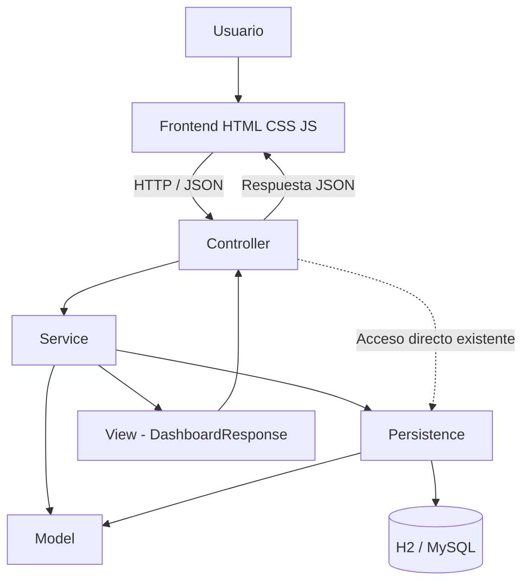
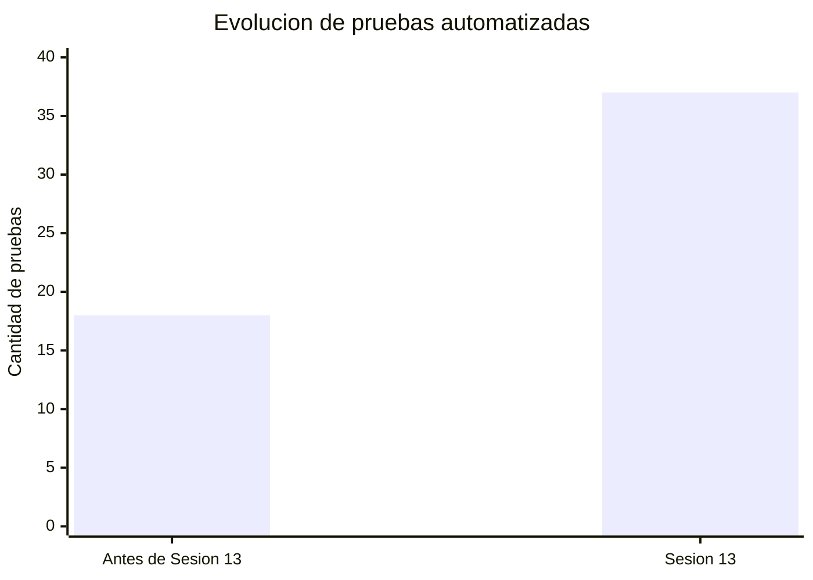
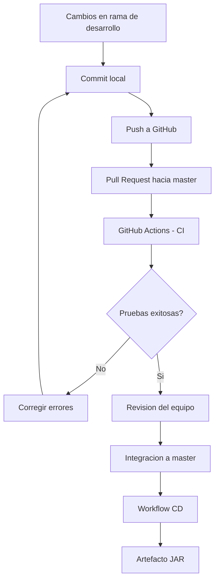

# Documentación del proyecto SATE-UNIAJC

## Sesión 13 — Arquitectura evolutiva, patrones de diseño y deuda técnica

**Última actualización:** 27 de noviembre de 2026.

---

## 1. Información general

**Proyecto:** SATE-UNIAJC — Sistema de Alertas Tempranas y Acompañamiento Estudiantil.

**Institución:** Institución Universitaria Antonio José Camacho.

**Asignatura:** Ingeniería de Software I.

**Metodología:** Scrum con tablero Kanban en GitHub Projects.

**Repositorio oficial:**

https://github.com/darwinvf2765/SATE-UNIAJC

**Rama de trabajo de la Sesión 13:** `Juan-sesion-13`.

---

## 2. Equipo Scrum

| Integrante | Rol Scrum |
|---|---|
| Darwin Alexander Valencia Flor | Product Owner |
| Juan David Rosero Guerrero | Scrum Master |
| Jeremy Andrey Agreda Rosero | Developer |

El equipo utiliza GitHub como plataforma de control
de versiones, colaboración, seguimiento de actividades
y validación automatizada del software.

---

## 3. Gestión ágil del proyecto

El Product Backlog, las historias de usuario, los
criterios de aceptación y las tareas se gestionan
mediante GitHub Issues y GitHub Projects.

### Tablero oficial

https://github.com/users/darwinvf2765/projects/1

### GitHub Issues

https://github.com/darwinvf2765/SATE-UNIAJC/issues

### Historias de usuario registradas

| Identificador | Historia de usuario |
|---|---|
| HU-01 | Inicio de sesión |
| HU-02 | Recuperación de contraseña |
| HU-03 | Gestión de roles y permisos |
| HU-04 | Registro de asistencia |
| HU-05 | Registro de calificaciones |
| HU-06 | Alerta roja por inasistencia superior al 15 % |
| HU-07 | Alerta amarilla por promedio inferior a 3.0 |

Los estados, responsables, prioridades y criterios
de aceptación vigentes deben consultarse en el
tablero oficial y las Issues correspondientes.

Los documentos PRODUCT_BACKLOG.md y KANBAN.md
se consideran documentos históricos o de referencia,
no la fuente oficial de seguimiento.

---

## 4. Índice de documentación

### 4.1. Documentación general y gestión del proyecto

| Documento | Descripción |
|---|---|
| [README principal](../README.md) | Presentación general, instalación y ejecución del proyecto |
| [Acta de constitución](acta_constitucion.md) | Conformación del equipo Scrum y responsabilidades |
| [Retrospectiva del Sprint](RETROSPECTIVA_SPRINT.md) | Resultados, aprendizajes y oportunidades de mejora |
| [Índice de documentación](README_DOCUMENTOS.md) | Organización y acceso a la documentación del proyecto |
| [Logo del proyecto](logo-sate.png) | Identidad visual de SATE-UNIAJC |

### 4.2. Documentación técnica y arquitectura

| Documento | Descripción |
|---|---|
| [Documentación técnica](DOCUMENTACION_TECNICA.md) | Arquitectura, componentes, servicios, endpoints y decisiones técnicas |
| [Arquitectura MVC](diagramas/ARQUITECTURA_MVC.md) | Arquitectura por capas y patrones Repository y Factory |
| [Diagrama de clases HU-04](diagramas/CLASES_HU04.md) | Componentes relacionados con el registro de asistencia |
| [Diagrama de clases HU-05](diagramas/CLASES_HU05.md) | Componentes relacionados con el registro académico |
| [Diagrama de secuencia](secuencia.md) | Interacciones entre componentes del sistema |
| [Diagrama de despliegue](despliegue.md) | Representación de la infraestructura de ejecución |

### 4.3. Decisiones arquitectónicas y calidad

| Documento | Descripción |
|---|---|
| [ADR-0001: Patrón MVC](adr/0001-patron-mvc.md) | Registro de la decisión arquitectónica de la Sesión 13 |
| [Deuda técnica](DEUDA_TECNICA.md) | Identificación de deuda técnica y oportunidades de mantenibilidad |
| [Revisión YAGNI, KISS y DRY](REVISION_YAGNI_KISS_DRY.md) | Evaluación de principios de diseño y simplicidad |

### 4.4. Pruebas y automatización

| Documento o archivo | Descripción |
|---|---|
| [Plan de pruebas](PLAN_PRUEBAS.md) | Planificación y evidencias de pruebas |
| [Evidencias de la Sesión 13](EVIDENCIAS_SESION_13.md) | Resultados finales de pruebas automatizadas y validación funcional |
| [Workflow CI](../.github/workflows/ci.yml) | Integración continua y ejecución de pruebas |
| [Workflow CD](../.github/workflows/cd.yml) | Empaquetado y publicación del artefacto JAR |

---

## 5. Tecnologías del sistema

SATE-UNIAJC utiliza las siguientes tecnologías:

| Tecnología | Propósito |
|---|---|
| Java 25 | Lenguaje de programación del backend |
| Spring Boot 3.4.5 | Framework principal |
| Maven | Gestión de dependencias y construcción |
| Spring Security | Autenticación y autorización |
| JWT | Identificación de usuarios autenticados |
| Spring Data JPA | Persistencia de información |
| H2 | Base de datos para ejecución local y pruebas |
| MySQL | Alternativa de persistencia |
| HTML | Estructura de la interfaz web |
| CSS | Presentación visual |
| JavaScript | Interacción con el backend |
| JUnit 5 | Pruebas automatizadas |
| Mockito | Simulación de dependencias en pruebas unitarias |
| Git y GitHub | Control de versiones y colaboración |
| GitHub Actions | Automatización de integración y empaquetado |
| Mermaid | Diagramas técnicos versionados como texto |

---

## 6. Arquitectura del sistema

SATE-UNIAJC utiliza una arquitectura por capas
basada en Spring Boot y compatible con el patrón MVC.

Durante la Sesión 13 se reorganizaron componentes
para mejorar la separación de responsabilidades.

### 6.1. Estructura del backend

```text
src/main/java/co/uniajc/sate/
├── config/
├── controller/
├── model/
├── persistence/
├── service/
│   ├── evaluacion/
│   ├── factory/
│   └── notificacion/
├── view/
└── SateUniajcApplication.java
```

### 6.2. Responsabilidades

| Paquete | Responsabilidad |
|---|---|
| config | Seguridad, configuración e inicialización |
| controller | Recepción de solicitudes HTTP |
| model | Entidades del dominio |
| persistence | Acceso y almacenamiento de información |
| service | Coordinación de la lógica de negocio |
| service/evaluacion | Evaluación de reglas de alertas |
| service/factory | Construcción centralizada de alertas |
| service/notificacion | Gestión de notificaciones |
| view | Estructuras de respuesta para la presentación |

La interfaz web permanece en los recursos estáticos
de Spring Boot.

### 6.3. Diagrama conceptual



El diagrama representa la organización conceptual
del sistema.

Algunos controladores todavía acceden directamente
a repositorios, situación documentada como una
oportunidad de evolución arquitectónica.

Para consultar las dependencias detalladas:

[Diagrama de arquitectura MVC](diagramas/ARQUITECTURA_MVC.md).

---

## 7. Patrones de diseño incorporados

### 7.1. Patrón MVC

La separación de responsabilidades se fortalece
mediante los paquetes model, view y controller,
complementados por service y persistence.

Durante la Sesión 13 se incorporaron:

- EstudianteService.
- DashboardService.
- DashboardResponse.

Estos componentes permiten reducir responsabilidades
en los controladores intervenidos.

### 7.2. Patrón Repository

La persistencia de estudiantes se organiza mediante:

- EstudianteRepository.
- EstudianteRepositoryImpl.
- EstudianteJpaRepository.

EstudianteRepository define el contrato de acceso
a datos.

EstudianteRepositoryImpl implementa dicho contrato
y delega las operaciones a EstudianteJpaRepository.

Esta separación facilita las pruebas unitarias
y reduce el acoplamiento directo con Spring Data JPA
en los componentes consumidores.

### 7.3. Patrón Factory

AlertaFactory centraliza la construcción de objetos
de tipo Alerta.

NotificacionSistemaService conserva la responsabilidad
de verificar alertas pendientes y guardar las nuevas
alertas mediante AlertaRepository.

La implementación corresponde a una fábrica simple.

No se introducen jerarquías adicionales de clases
que no sean necesarias para los requisitos actuales.

---

## 8. Motor de alertas

El sistema contempla dos reglas principales.

### HU-06 — Alerta roja

Se genera cuando el porcentaje de inasistencia
del estudiante supera el 15 %.

### HU-07 — Alerta amarilla

Se genera cuando el promedio académico del
estudiante es inferior a 3.0.

Las dos alertas pueden existir de manera independiente
para un mismo estudiante.

El estado general del estudiante se determina
mediante la siguiente prioridad:

1. ROJA: existe un resultado de evaluación rojo.
2. AMARILLA: existe un resultado de evaluación amarillo
   y no existe un resultado rojo.
3. VERDE: no existen resultados de evaluación de alerta.

### Componentes relacionados

- EvaluadorAlerta.
- EvaluadorInasistencia.
- EvaluadorPromedio.
- AlertaService.
- NotificacionService.
- NotificacionSistemaService.
- AlertaFactory.
- AlertaRepository.

El servicio de notificación verifica si existe una
alerta pendiente del mismo tipo para el estudiante
antes de crear una nueva.

---

## 9. Registro de decisiones arquitectónicas

Durante la Sesión 13 se incorporó el primer
Architecture Decision Record del proyecto.

| Identificador | Decisión | Documento |
|---|---|---|
| ADR-0001 | Arquitectura MVC y separación de responsabilidades | [Consultar ADR](adr/0001-patron-mvc.md) |

El ADR documenta:

- Contexto de la decisión.
- Estado de la decisión.
- Decisión arquitectónica adoptada.
- Consecuencias y compromisos del diseño.

Los registros ADR permiten conservar la justificación
de las decisiones técnicas y facilitar la comprensión
de la evolución del sistema.

---

## 10. Deuda técnica y mantenibilidad

La Sesión 13 incorpora una revisión de deuda técnica
relacionada con la estructura y mantenibilidad
del software.

Las modificaciones buscan contribuir a las siguientes
características de ISO/IEC 25010:

| Característica | Contribución esperada |
|---|---|
| Modularidad | Separación de componentes |
| Reutilización | Servicios y contratos reutilizables |
| Analizabilidad | Responsabilidades más explícitas |
| Modificabilidad | Cambios localizados |
| Capacidad de prueba | Pruebas unitarias de componentes |

Estas contribuciones representan mejoras cualitativas
y no una certificación formal de cumplimiento
de la norma ISO/IEC 25010.

La documentación también identifica oportunidades
de mejora pendientes.

Consultar:

- [Análisis de deuda técnica](DEUDA_TECNICA.md).
- [Revisión YAGNI, KISS y DRY](REVISION_YAGNI_KISS_DRY.md).

---

## 11. Pruebas automatizadas

La suite de pruebas fue ampliada durante la Sesión 13
para verificar los componentes incorporados y
refactorizados.

### 11.1. Distribución de pruebas

| Clase de prueba | Casos |
|---|---:|
| SateUniajcApplicationTests | 16 |
| EstudianteRepositoryImplTest | 5 |
| EstudianteServiceTest | 6 |
| DashboardServiceTest | 6 |
| AlertaFactoryTest | 2 |
| NotificacionSistemaServiceTest | 2 |
| **Total** | **37** |

### 11.2. Evolución de las pruebas

| Indicador | Antes de la Sesión 13 | Sesión 13 |
|---|---:|---:|
| Pruebas automatizadas | 18 | 37 |
| Incremento de casos | — | 19 |
| Incremento porcentual | — | 105.6 % |



### 11.3. Resultados locales reportados

| Indicador | Resultado |
|---|---|
| Pruebas ejecutadas | 37 |
| Fallos | 0 |
| Errores | 0 |
| Pruebas omitidas | 0 |
| Resultado de Maven | BUILD SUCCESS |
| Fecha de ejecución final | 27 de noviembre de 2026 |
| Hora de finalización | 16:58:41 (UTC-5) |
| Tiempo total | 10.064 segundos |
| Commit validado | f3c9db1 |
| Clases de producción compiladas | 40 |
| Clases de prueba compiladas | 6 |

### 11.4. Comando de verificación

Desde la raíz del proyecto:

```bash
mvn clean test
```

La ejecución final local fue realizada el
27 de noviembre de 2026 sobre el commit f3c9db1.

Las 37 pruebas automatizadas finalizaron correctamente,
sin fallos, errores ni pruebas omitidas.

También se realizó la validación funcional local
de los componentes principales del sistema.

Consultar el documento de
[evidencias de la Sesión 13](EVIDENCIAS_SESION_13.md).

La validación remota mediante GitHub Actions
permanece pendiente antes de completar
el proceso de integración a master.

Las pruebas automatizadas no reemplazan la validación
funcional de todos los criterios de aceptación.

El incremento en la cantidad de pruebas tampoco
representa una medición de cobertura de código.

---

## 12. Integración continua y entrega continua

El repositorio utiliza GitHub Actions para automatizar
actividades de construcción y verificación.

### 12.1. Integración continua — CI

Archivo:

```text
.github/workflows/ci.yml
```

El workflow utiliza Java 25 y Maven para ejecutar
las pruebas automatizadas según los eventos
configurados en el repositorio.

Su propósito es detectar errores antes de integrar
cambios a la rama principal.

### 12.2. Entrega continua — CD

Archivo:

```text
.github/workflows/cd.yml
```

El workflow automatiza el empaquetado de la aplicación
y la publicación del artefacto JAR.

La publicación del artefacto no implica que exista
un despliegue automático hacia un servidor de
staging o producción.

### 12.3. Flujo conceptual de integración



Este flujo representa el proceso esperado de
integración y entrega del proyecto.

Los eventos efectivos de ejecución dependen
de la configuración de cada workflow.

### 12.4. Consulta de ejecuciones

https://github.com/darwinvf2765/SATE-UNIAJC/actions

---

## 13. Entregables de la Sesión 13

| Entregable | Evidencia | Estado local |
|---|---|---|
| Reestructuración modular MVC | Paquetes model, view, controller y service | Implementado |
| Patrón Repository | EstudianteRepository y su implementación en persistence | Implementado |
| Registro de decisión arquitectónica | docs/adr/0001-patron-mvc.md | Documentado |
| Pruebas automatizadas JUnit 5 | Suite ampliada a 37 pruebas | Ejecuciones locales exitosas |

### Evidencias complementarias

- Reorganización del paquete persistence.
- Refactorización de EstudianteController.
- Refactorización de DashboardController.
- Incorporación de DashboardResponse.
- Implementación de AlertaFactory.
- Pruebas unitarias de los componentes intervenidos.
- Documentación de deuda técnica.
- Actualización del README principal.
- Actualización de la documentación técnica.
- Actualización del diagrama de arquitectura MVC.
- Actualización de los diagramas de clases HU-04 y HU-05.
- Actualización de los diagramas de secuencia.
- Actualización del plan de pruebas.
- Ampliación del análisis de deuda técnica.
- Ejecución final de 37 pruebas automatizadas.
- Validación funcional local del sistema.
- [Documento de evidencias finales](EVIDENCIAS_SESION_13.md).

La aceptación definitiva de los entregables depende
de la revisión académica y de la validación final
del código integrado.

---

## 14. Actividades pendientes de revisión

### 14.1. Cierre de la Sesión 13

- [x] Reorganizar el paquete persistence.
- [x] Implementar el patrón Repository.
- [x] Separar responsabilidades de EstudianteController.
- [x] Separar responsabilidades de DashboardController.
- [x] Incorporar DashboardResponse.
- [x] Implementar AlertaFactory.
- [x] Ampliar las pruebas automatizadas.
- [x] Crear el ADR-0001.
- [x] Documentar deuda técnica.
- [x] Actualizar el README principal.
- [x] Actualizar la documentación técnica.
- [x] Actualizar el diagrama de arquitectura MVC.
- [x] Actualizar el índice de documentación.
- [x] Actualizar los diagramas de clases relacionados.
- [x] Actualizar el diagrama de secuencia.
- [x] Actualizar el plan de pruebas.
- [ ] Verificar la visualización de los diagramas.
- [x] Ejecutar la validación final con Maven.
- [x] Realizar la validación funcional correspondiente.
- [x] Ampliar el análisis de deuda técnica.
- [x] Documentar las evidencias finales de la Sesión 13.
- [ ] Publicar la rama Juan-sesion-13.
- [ ] Crear y revisar el Pull Request.
- [ ] Verificar los resultados de GitHub Actions.

### 14.2. Oportunidades de mejora futuras

- Evaluar la separación de responsabilidades
  de AlertaController y TutoriaController.
- Ampliar las pruebas de integración HTTP.
- Medir la cobertura de código.
- Continuar la revisión de seguridad.
- Revisar la correspondencia entre historias de usuario,
  implementación y criterios de aceptación.
- Revisar la retrospectiva y los resultados del Sprint.
- Evaluar alternativas de despliegue automatizado.

Las actividades futuras deben priorizarse mediante
el Product Backlog oficial del equipo.

---

## 15. Control y mantenimiento de la documentación

La documentación técnica debe mantenerse actualizada
mediante Git y GitHub.

Se establecen los siguientes lineamientos:

- Mantener correspondencia entre documentación y código.
- Registrar decisiones arquitectónicas mediante ADR.
- Actualizar los diagramas cuando cambien las dependencias.
- Documentar resultados verificables de las pruebas.
- Diferenciar actividades implementadas de actividades pendientes.
- Evitar duplicar información que se gestiona oficialmente
  mediante GitHub Projects.
- Realizar cambios incrementales mediante commits descriptivos.
- Revisar los cambios mediante Pull Requests.
- Mantener los documentos accesibles mediante enlaces relativos.

GitHub Projects continúa siendo la fuente oficial
para los estados del trabajo y las prioridades del equipo.

GitHub conserva el historial de modificaciones del
código fuente y de la documentación técnica.

---

**Proyecto:** SATE-UNIAJC.

**Institución:** Institución Universitaria Antonio José Camacho.

**Asignatura:** Ingeniería de Software I.

**Sesión 13:** Arquitectura evolutiva, patrones de diseño
y deuda técnica.