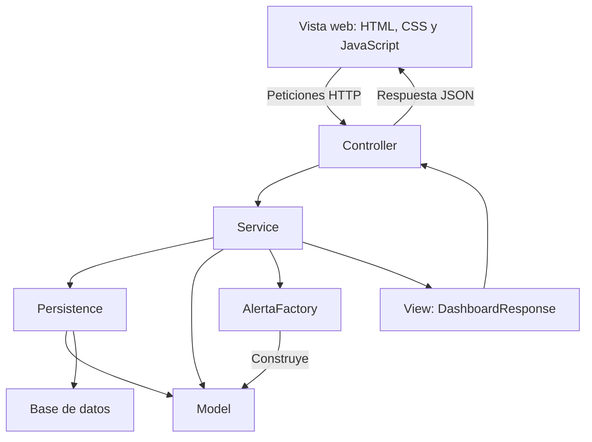

# ADR-0001: Adopción del Patrón Model-View-Controller (MVC)

## 1. Identificación

- **Proyecto:** SATE-UNIAJC
- **Asignatura:** Ingeniería de Software I
- **Actividad:** Sesión 13 - Arquitectura Evolutiva
- **Fecha:** 27 de noviembre de 2026
- **Rama de implementación:** `Juan-sesion-13`

## 2. Estado

**Propuesto (Proposed).**

La decisión se encuentra implementada y validada mediante pruebas
automatizadas locales. Está pendiente de revisión por parte del equipo,
integración en la rama `master` y validación mediante CI/CD.

## 3. Contexto

SATE-UNIAJC es un Sistema de Alertas Tempranas y Acompañamiento
Estudiantil desarrollado con Spring Boot, Java 25, Maven, Spring Data
JPA y una interfaz web basada en HTML, CSS y JavaScript.

El proyecto contaba previamente con una organización parcialmente
basada en el patrón MVC. Sin embargo, algunos controladores asumían
responsabilidades relacionadas con la lógica de negocio, el procesamiento
de información y el acceso a los datos.

Esta situación dificultaba la separación de responsabilidades,
incrementaba el acoplamiento entre componentes y limitaba la capacidad
de realizar pruebas unitarias independientes.

También se identificó la necesidad de centralizar la creación de
alertas académicas y establecer una abstracción para el acceso a los
datos de los estudiantes.

La evolución arquitectónica debe preservar las funcionalidades
existentes, las reglas de negocio, los contratos de la API REST y la
compatibilidad con la interfaz web.

## 4. Decisión

Se decide consolidar el patrón Model-View-Controller (MVC), complementado
con una capa de servicios y una capa de persistencia, aplicando los
principios de separación de responsabilidades, bajo acoplamiento y
alta cohesión.

### 4.1. Organización de paquetes

La estructura principal del proyecto se organiza de la siguiente manera:

    src/main/java/co/uniajc/sate/
    ├── config/
    ├── controller/
    ├── model/
    ├── persistence/
    ├── service/
    │   ├── evaluacion/
    │   ├── factory/
    │   └── notificacion/
    ├── view/
    └── SateUniajcApplication.java

Cada paquete cumple las siguientes responsabilidades:

| Paquete | Responsabilidad |
|---------|-----------------|
| `model` | Representar las entidades y los datos del dominio. |
| `view` | Definir estructuras de presentación y respuesta para la interfaz web. |
| `controller` | Recibir peticiones HTTP y delegar operaciones a los servicios. |
| `service` | Encapsular la lógica de negocio y coordinar operaciones. |
| `persistence` | Abstraer y gestionar el acceso a los datos. |
| `config` | Gestionar la configuración y seguridad de la aplicación. |

Los recursos visuales se conservan en:

    src/main/resources/static/
    ├── app.js
    ├── index.html
    └── styles.css

Esta separación permite mantener la interfaz web independiente
de la lógica de negocio.

### 4.2. Patrón Repository

Se reorganiza el paquete `repository` bajo el nombre `persistence`.

Para el acceso a los datos de estudiantes se implementan los
siguientes componentes:

- `EstudianteRepository`: contrato de acceso a los datos.
- `EstudianteRepositoryImpl`: implementación del contrato.
- `EstudianteJpaRepository`: integración con Spring Data JPA.

La capa de servicios depende del contrato de persistencia,
reduciendo su dependencia directa de la tecnología utilizada
para acceder a la base de datos.

### 4.3. Capa de servicios

Se incorporan los siguientes servicios:

- `EstudianteService`: centraliza las operaciones relacionadas
  con los estudiantes.
- `DashboardService`: centraliza el procesamiento y cálculo de
  los indicadores del dashboard.

Los controladores correspondientes delegan estas responsabilidades
a los servicios, evitando concentrar la lógica de negocio en
la capa encargada de atender las peticiones HTTP.

### 4.4. Capa de presentación

Se incorpora el paquete `view` con la clase `DashboardResponse`,
implementada mediante un record de Java.

Este componente representa los datos que se entregan a la interfaz
web para visualizar los indicadores académicos.

La presentación gráfica continúa realizándose mediante HTML,
CSS y JavaScript, conservando los recursos estáticos existentes.

### 4.5. Patrón Factory

Se incorpora `AlertaFactory` dentro del paquete `service.factory`
para centralizar la construcción de las entidades `Alerta`.

El servicio `NotificacionSistemaService` delega la creación
de alertas a esta fábrica y conserva la responsabilidad de
verificar duplicados y almacenar las alertas generadas.

Se mantiene una única entidad `Alerta`, diferenciando las alertas
rojas y amarillas mediante su tipo y motivo.

Esta implementación corresponde a una fábrica simple y evita
introducir jerarquías de clases innecesarias.

### 4.6. Conservación del paquete base

Se decide conservar el paquete base existente:

    co.uniajc.sate

Aunque la guía de la sesión 13 presenta la ruta
`co.edu.uniajc.sate`, se mantiene temporalmente la estructura
original del proyecto para evitar modificaciones generalizadas
en las declaraciones de paquetes, importaciones y referencias
existentes.

Esta decisión no impide aplicar la separación arquitectónica MVC.

La migración del paquete base podrá realizarse posteriormente
mediante una refactorización independiente, si es requerida
por la docente.

### 4.7. Flujo arquitectónico

## 5. Consecuencias

### 5.1. Consecuencias positivas

- Mayor separación de responsabilidades entre componentes.
- Reducción del acoplamiento entre controladores y persistencia.
- Mayor cohesión de las clases y paquetes.
- Centralización de la lógica de negocio.
- Centralización de la creación de alertas académicas.
- Mayor facilidad para realizar pruebas unitarias.
- Mejor comprensión de la estructura arquitectónica.
- Conservación de la interfaz web y de los contratos existentes.
- Mejora esperada de la mantenibilidad, especialmente en
  modularidad, modificabilidad y capacidad de prueba, de acuerdo
  con las características de calidad de ISO/IEC 25010.

### 5.2. Consecuencias negativas y compromisos

- Incremento de la cantidad de clases e interfaces.
- Mayor número de componentes que deben mantenerse coordinados.
- Necesidad de actualizar los diagramas y la documentación técnica.
- Necesidad de mantener las pruebas alineadas con la arquitectura.
- Posible curva de aprendizaje para nuevos integrantes del equipo.
- Conservación temporal de un paquete base diferente al indicado
  literalmente en la guía académica.
- Necesidad de revisar progresivamente otros controladores que
  todavía puedan contener responsabilidades de negocio.

### 5.3. Validación de la decisión

La implementación fue validada localmente mediante Maven y JUnit 5,
utilizando el siguiente comando:

    mvn clean test

Resultados obtenidos el 27 de noviembre de 2026:

| Clase de prueba | Pruebas aprobadas |
|-----------------|------------------:|
| SateUniajcApplicationTests | 16 |
| EstudianteRepositoryImplTest | 5 |
| EstudianteServiceTest | 6 |
| DashboardServiceTest | 6 |
| AlertaFactoryTest | 2 |
| NotificacionSistemaServiceTest | 2 |
| **Total** | **37** |

Resultado general:

    Tests run: 37
    Failures: 0
    Errors: 0
    Skipped: 0
    BUILD SUCCESS

El proyecto pasó de 18 a 37 pruebas automatizadas, incorporando
19 pruebas adicionales durante la evolución arquitectónica.

También se realizó una validación funcional local de:

- Inicio de sesión.
- Visualización del dashboard.
- Consulta del registro académico.
- Visualización de alertas.
- Evaluación del motor de alertas.
- Generación de una nueva alerta académica.
- Visualización del portal de acompañamiento.

La prevención de alertas duplicadas cuenta con una prueba
unitaria aprobada. Su comprobación manual adicional queda
pendiente de confirmación.

### 5.4. Trazabilidad de la implementación

| Commit | Descripción |
|--------|-------------|
| `f1195fe` | Reorganización del paquete repository a persistence. |
| `ebebdfa` | Implementación del patrón Repository para estudiantes. |
| `f6ebbcb` | Separación de la lógica de estudiantes en service. |
| `d4666f9` | Separación de la lógica del dashboard en service y view. |
| `249b876` | Implementación de Factory para la creación de alertas. |

### 5.5. Seguimiento

La decisión deberá mantenerse actualizada conforme evolucione
la arquitectura del proyecto.

Queda pendiente la revisión del equipo, la publicación de los
cambios en GitHub y la comprobación de los resultados de CI/CD.

---

SATE-UNIAJC - Ingeniería de Software I

Sesión 13 - Arquitectura Evolutiva, Patrón MVC y Registros
de Decisiones de Arquitectura.
