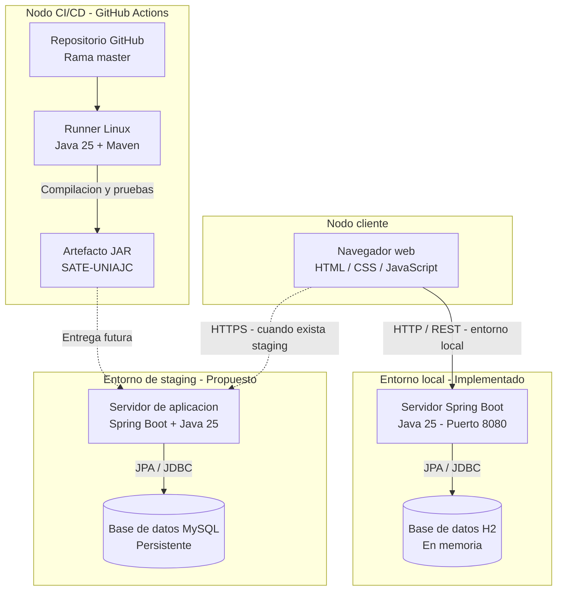

# Diagrama de Despliegue UML — SATE-UNIAJC

## Sesión 12 — Ingeniería de Software I

**Proyecto:** SATE-UNIAJC — Sistema de Alertas Tempranas y Acompañamiento Estudiantil.

## 1. Objetivo

Representar los nodos de infraestructura involucrados en la ejecución y entrega del sistema SATE-UNIAJC.

Se distingue entre el entorno local actualmente utilizado y una arquitectura de staging propuesta para entrega continua.

## 2. Diagrama de despliegue

## 3. Descripción de nodos

### Nodo cliente

El usuario accede al sistema mediante un navegador web.

La interfaz está desarrollada con HTML, CSS y JavaScript.

### Nodo de aplicación

La aplicación utiliza Spring Boot 3.4.5 sobre Java 25.

Expone los controladores REST y ejecuta los servicios del sistema.

En desarrollo local utiliza el puerto 8080.

### Nodo de base de datos

Actualmente, la configuración local utiliza H2 en memoria.

El proyecto también cuenta con configuración alternativa para MySQL.

No se ha verificado todavía un servidor MySQL desplegado en producción o staging.

### Nodo CI/CD

GitHub Actions utiliza un runner Linux para descargar el código, configurar Java 25 y ejecutar las pruebas Maven.

El workflow de integración continua se encuentra en:

`.github/workflows/ci.yml`

El archivo `.github/workflows/cd.yml` corresponde al entregable de entrega continua solicitado en la Sesión 12 y debe implementarse por separado.

## 4. Entorno local implementado

El entorno actual permite:

- Ejecutar Spring Boot mediante Maven.
- Abrir la aplicación en http://localhost:8080.
- Utilizar H2 como base de datos en memoria.
- Ejecutar pruebas automatizadas con Java 25.
- Verificar la integración continua en GitHub Actions.

## 5. Entorno de staging propuesto

Como evolución del proyecto, se plantea:

- Alojar el servidor Spring Boot en un entorno de pruebas.
- Utilizar una base de datos persistente.
- Entregar el archivo JAR generado por Maven.
- Configurar variables de entorno y credenciales seguras.
- Proteger las comunicaciones externas mediante HTTPS.
- Verificar el despliegue mediante pruebas de disponibilidad.

Este entorno es una propuesta y no debe interpretarse como un despliegue real ya completado.

## 6. Evidencias

Repositorio:
https://github.com/darwinvf2765/SATE-UNIAJC

GitHub Actions:
https://github.com/darwinvf2765/SATE-UNIAJC/actions

## 7. Relación con la Sesión 12

El diagrama representa los nodos Cliente, CI/CD, Servidor de Aplicación y Base de Datos solicitados en la guía.

Se adaptó el ejemplo académico a Java 25 y la rama master, utilizados realmente por SATE-UNIAJC.
