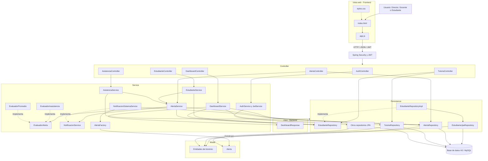
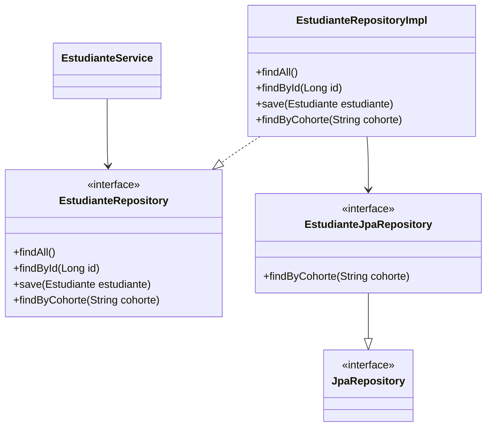
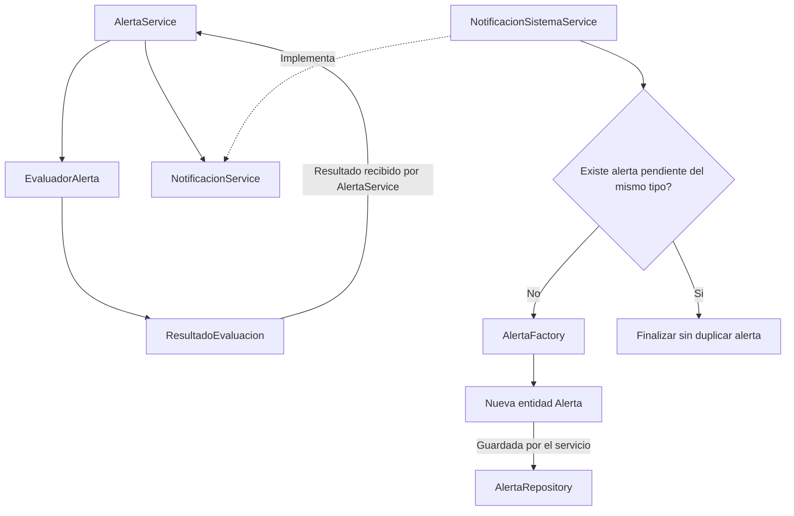
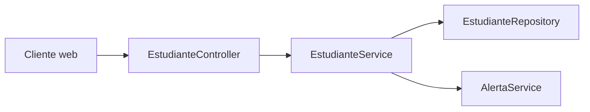
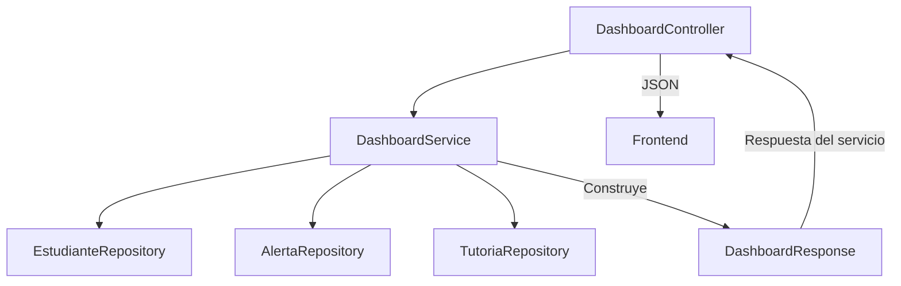

# Diagrama de arquitectura MVC — SATE-UNIAJC

## Sesión 13 — Arquitectura evolutiva

**Proyecto:** SATE-UNIAJC

**Asignatura:** Ingeniería de Software I

**Institución:** Institución Universitaria Antonio José Camacho

**Fecha de actualización:** 27 de noviembre de 2026.

**Rama de desarrollo:** `Juan-sesion-13`.

---

## 1. Objetivo

Representar la arquitectura actual de SATE-UNIAJC después de
la reestructuración modular realizada durante la Sesión 13.

El diagrama permite identificar las responsabilidades de los
componentes, sus dependencias y la aplicación de los patrones
MVC, Repository y Factory.

La arquitectura se representa de acuerdo con los componentes
implementados, diferenciando las mejoras realizadas de las
oportunidades de refactorización pendientes.

---

## 2. Enfoque arquitectónico

SATE-UNIAJC utiliza una arquitectura por capas basada en
Spring Boot y compatible con el patrón MVC.

La estructura incorpora las siguientes capas:

| Capa | Responsabilidad |
|---|---|
| Model | Representación de entidades y datos del dominio |
| View | Presentación y estructuras de respuesta |
| Controller | Recepción y procesamiento de solicitudes HTTP |
| Service | Coordinación de la lógica de negocio |
| Persistence | Acceso y almacenamiento de información |
| Config | Configuración, seguridad e inicialización |

La separación de responsabilidades busca favorecer la
modularidad, mantenibilidad y capacidad de prueba del sistema.

---

## 3. Estructura de paquetes

El proyecto conserva el paquete base `co.uniajc.sate`.

```text
src/main/java/co/uniajc/sate/
├── config/
├── controller/
├── model/
├── persistence/
├── service/
│   ├── evaluacion/
│   ├── factory/
│   └── notificacion/
├── view/
└── SateUniajcApplication.java
```

La interfaz web permanece en:

```text
src/main/resources/static/
├── index.html
├── styles.css
└── app.js
```

La conservación del paquete base evita cambios innecesarios
en los nombres de paquetes y mantiene la continuidad de
la estructura existente.

---

## 4. Diagrama general de arquitectura MVC



El diagrama presenta las dependencias principales del sistema.

Las relaciones de autenticación y asistencia se muestran
de manera resumida, mientras que los componentes intervenidos
durante la Sesión 13 se representan con mayor detalle.

---

## 5. Responsabilidades de las capas

### 5.1. Model

Representa las entidades del dominio:

- Estudiante.
- Usuario.
- Rol.
- Materia.
- Asistencia.
- Alerta.
- Tutoria.

Estas entidades representan la información utilizada por
los servicios y los componentes de persistencia.

### 5.2. View

La presentación se organiza en dos componentes:

**Frontend:**

- HTML.
- CSS.
- JavaScript.

**Backend:**

- `DashboardResponse`.

`DashboardResponse` es un record de Java que estructura
los indicadores devueltos por el dashboard.

No sustituye la interfaz web, sino que define la estructura
de datos utilizada para presentar sus resultados.

### 5.3. Controller

Recibe solicitudes HTTP y devuelve respuestas al cliente.

Los controladores principales son:

- AuthController.
- EstudianteController.
- AsistenciaController.
- AlertaController.
- TutoriaController.
- DashboardController.

Durante la Sesión 13 se trasladaron responsabilidades de
EstudianteController y DashboardController a servicios
especializados.

### 5.4. Service

Coordina las operaciones y reglas de negocio.

Componentes principales:

- AuthService.
- JwtService.
- EstudianteService.
- DashboardService.
- AsistenciaService.
- AlertaService.
- Evaluadores de alertas.
- Servicios de notificación.
- AlertaFactory.

### 5.5. Persistence

Gestiona el acceso a los datos.

El paquete anteriormente denominado `repository` fue
reorganizado como `persistence`.

Para la entidad Estudiante se incorporó un contrato
independiente de Spring Data JPA y una implementación
que delega las operaciones al repositorio JPA.

### 5.6. Config

Contiene los componentes relacionados con:

- Configuración de seguridad.
- Procesamiento de tokens JWT.
- Configuración de contraseñas.
- Inicialización de datos.

---

## 6. Aplicación del patrón Repository

La persistencia de estudiantes se organiza mediante:

- `EstudianteRepository`.
- `EstudianteRepositoryImpl`.
- `EstudianteJpaRepository`.



La interfaz EstudianteRepository define las operaciones
requeridas por los componentes consumidores.

EstudianteRepositoryImpl implementa el contrato y delega
las operaciones a EstudianteJpaRepository.

Esta separación permite reducir la dependencia directa
de los servicios respecto a Spring Data JPA.

---

## 7. Aplicación del patrón Factory

La creación de alertas académicas se centraliza en
`AlertaFactory`.



AlertaFactory recibe un estudiante y un resultado de
evaluación para construir una entidad Alerta.

La entidad creada contiene:

- Identificador del estudiante.
- Nombre del estudiante.
- Tipo de alerta.
- Motivo.
- Fecha de creación.
- Estado inicial no atendida.

La Factory no consulta ni guarda información en la base
de datos.

NotificacionSistemaService conserva la responsabilidad
de verificar alertas pendientes y guardar las nuevas
alertas mediante AlertaRepository.

La implementación corresponde a una fábrica simple
que centraliza la construcción de objetos.

No se introducen jerarquías adicionales de alertas,
puesto que los tipos ROJA y AMARILLA se representan
mediante la misma entidad.

---

## 8. Refactorización de estudiantes

Antes de la Sesión 13, EstudianteController concentraba
operaciones HTTP y responsabilidades relacionadas con
la gestión de estudiantes.

La estructura actual incorpora EstudianteService.



EstudianteService contiene las operaciones:

- Listar estudiantes.
- Buscar estudiantes.
- Crear estudiantes.
- Actualizar el registro académico.
- Solicitar la evaluación de alertas cuando corresponde.

EstudianteController conserva la responsabilidad de
recibir solicitudes y delegar las operaciones al servicio.

---

## 9. Refactorización del dashboard

DashboardController delega la construcción de los
indicadores a DashboardService.



DashboardService calcula y organiza:

- Total de estudiantes.
- Alertas rojas pendientes.
- Alertas amarillas pendientes.
- Estudiantes en estado verde.
- Proyección de deserción.
- Total de tutorías.
- Tutorías realizadas.
- Efectividad de tutorías.
- Distribución de estudiantes por cohorte.

DashboardResponse permite representar estos indicadores
mediante una estructura de respuesta definida.

La proyección de deserción corresponde a una estimación
basada en la fórmula implementada en el sistema y no
a un modelo predictivo validado estadísticamente.

---

## 10. Evolución arquitectónica

| Componente | Situación anterior | Situación actual |
|---|---|---|
| Persistencia | Paquete repository | Paquete persistence |
| Repository de estudiantes | Dependencia directa de JPA | Contrato e implementación separados |
| EstudianteController | Operaciones de gestión en el controlador | Delegación a EstudianteService |
| DashboardController | Cálculo de indicadores en el controlador | Delegación a DashboardService |
| Respuesta del dashboard | Construcción en el controlador | DashboardResponse |
| Creación de alertas | Construcción en el servicio de notificación | AlertaFactory |
| Decisiones arquitectónicas | Sin ADR específico de MVC | ADR-0001 |

---

## 11. Relación con las historias de usuario

| Historia | Componentes relacionados |
|---|---|
| HU-01 | AuthController, AuthService y JwtService |
| HU-02 | AuthController y AuthService |
| HU-03 | Spring Security, JWT, Usuario y Rol |
| HU-04 | AsistenciaController y AsistenciaService |
| HU-05 | EstudianteController y EstudianteService |
| HU-06 | EvaluadorInasistencia, AlertaService y AlertaFactory |
| HU-07 | EvaluadorPromedio, AlertaService y AlertaFactory |

Esta relación identifica los componentes asociados a las
historias de usuario y no constituye una certificación
del cumplimiento de todos sus criterios de aceptación.

---

## 12. Seguridad

Spring Security protege los recursos de la aplicación
según la configuración de acceso establecida.

JWT permite identificar a los usuarios autenticados
mediante tokens.

La reestructuración arquitectónica no tiene como objetivo
modificar las reglas de autenticación ni autorización.

La validación integral de los permisos continúa siendo
una actividad pendiente de verificación.

---

## 13. Relación con ISO/IEC 25010

Las modificaciones realizadas buscan contribuir a las
características de mantenibilidad del software.

| Característica | Contribución esperada |
|---|---|
| Modularidad | Separación de componentes y responsabilidades |
| Reutilización | Contratos y servicios reutilizables |
| Analizabilidad | Dependencias y responsabilidades más explícitas |
| Modificabilidad | Cambios localizados en componentes especializados |
| Capacidad de prueba | Pruebas unitarias de servicios y patrones |

Estas contribuciones representan mejoras cualitativas
del diseño y no una certificación formal de cumplimiento
de la norma ISO/IEC 25010.

---

## 14. Deuda técnica y oportunidades de mejora

La arquitectura actual todavía presenta oportunidades
de evolución.

Entre ellas:

- AlertaController accede directamente a AlertaRepository.
- TutoriaController accede directamente a TutoriaRepository
  y EstudianteRepository.
- No todos los repositorios cuentan con un contrato
  independiente de Spring Data JPA.
- Se requiere ampliar las pruebas de integración HTTP.
- Se requiere medir la cobertura de pruebas.
- Se requiere continuar la revisión de seguridad.

Estas situaciones se documentan para futuras iteraciones.

No se incorporan capas adicionales únicamente para
uniformar la estructura, sin analizar previamente
su necesidad y beneficio.

---

## 15. Validación mediante pruebas automatizadas

La Sesión 13 amplió la suite de pruebas de 18 a 37 casos.

| Componente | Pruebas |
|---|---:|
| SateUniajcApplicationTests | 16 |
| EstudianteRepositoryImplTest | 5 |
| EstudianteServiceTest | 6 |
| DashboardServiceTest | 6 |
| AlertaFactoryTest | 2 |
| NotificacionSistemaServiceTest | 2 |
| **Total** | **37** |

La ejecución de verificación se realiza mediante:

```bash
mvn clean test
```

La validación final de la rama debe complementarse con
la ejecución de GitHub Actions y la revisión del
Pull Request correspondiente.

---

## 16. Conclusiones

La evolución arquitectónica realizada durante la Sesión 13
fortalece la separación de responsabilidades mediante
MVC, Repository y una fábrica simple para las alertas.

La incorporación de servicios especializados permite
reducir responsabilidades en los controladores intervenidos.

La arquitectura conserva los componentes existentes
y evita introducir modificaciones innecesarias fuera
del alcance de la actividad.

La evolución del sistema debe continuar mediante
refactorizaciones incrementales, pruebas automatizadas
y registro de decisiones arquitectónicas.

---

## 17. Documentos relacionados

- [ADR-0001: Patrón MVC](../adr/0001-patron-mvc.md).
- [Análisis de deuda técnica](../DEUDA_TECNICA.md).
- [Documentación técnica](../DOCUMENTACION_TECNICA.md).
- [Plan de pruebas](../PLAN_PRUEBAS.md).
- [Revisión YAGNI, KISS y DRY](../REVISION_YAGNI_KISS_DRY.md).
- [Diagrama de clases HU-04](CLASES_HU04.md).
- [Diagrama de clases HU-05](CLASES_HU05.md).
- [Diagrama de secuencia](../secuencia.md).
- [Diagrama de despliegue](../despliegue.md).
- [README principal](../../README.md).