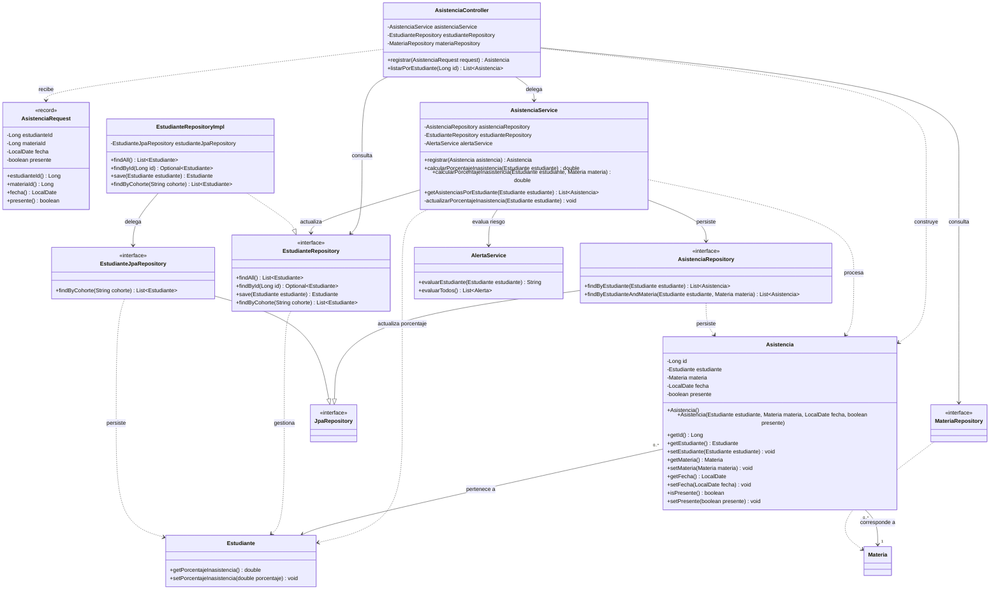
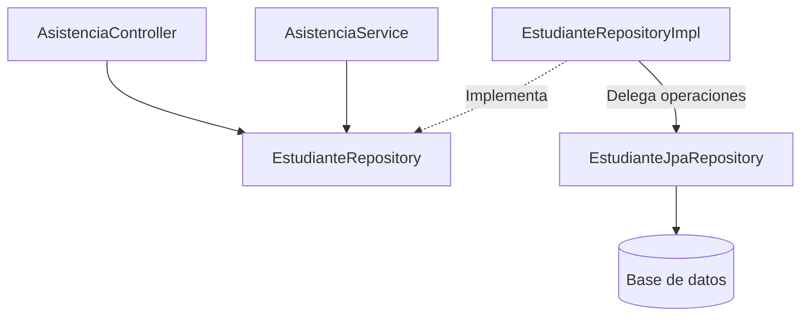
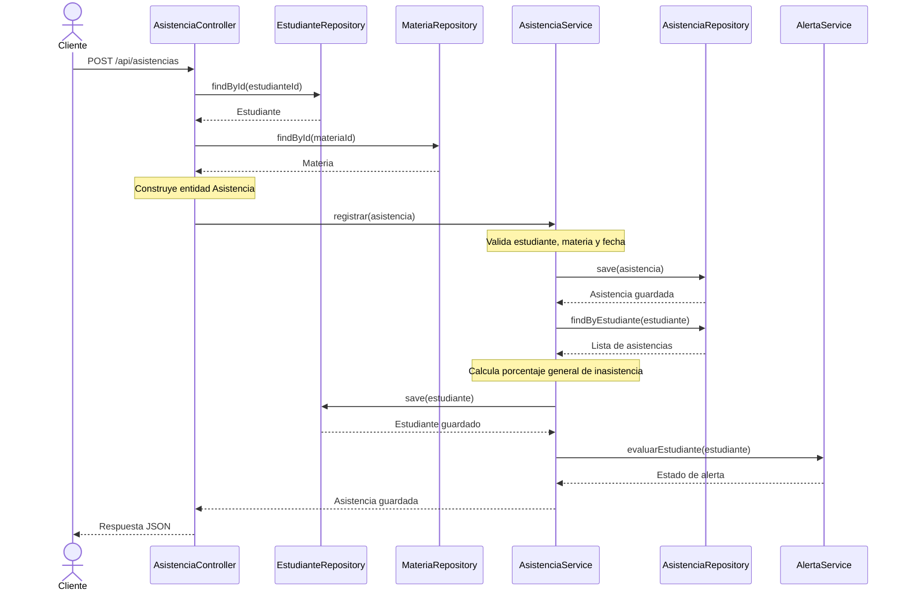
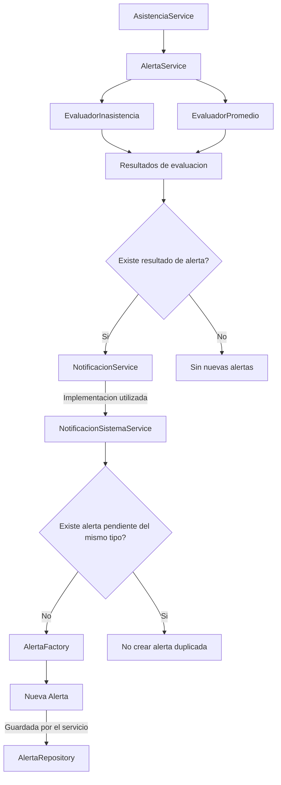
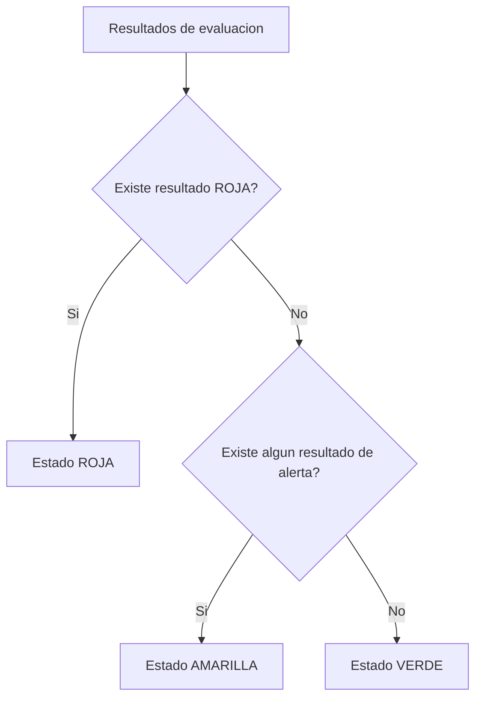

# Diagrama de clases UML — HU-04

## Sesión 13 — Arquitectura evolutiva

**Proyecto:** SATE-UNIAJC.

**Institución:** Institución Universitaria Antonio José Camacho.

**Asignatura:** Ingeniería de Software I.

**Fecha de actualización:** 27 de noviembre de 2026.

**Rama de desarrollo:** `Juan-sesion-13`.

---

## 1. Historia de usuario

**HU-04 — Registro de asistencia diaria**

Como docente, quiero registrar la asistencia diaria
de los estudiantes para llevar un control actualizado
de sus inasistencias.

---

## 2. Objetivo

Representar los componentes, atributos, métodos
y relaciones correspondientes al registro de asistencia
en SATE-UNIAJC.

El documento incorpora los cambios arquitectónicos
realizados durante la Sesión 13, especialmente la
reorganización del paquete persistence y la aplicación
del patrón Repository para la entidad Estudiante.

---

## 3. Alcance implementado

El sistema permite:

- Registrar asistencias mediante una API REST.
- Consultar estudiantes y materias por identificador.
- Validar los datos obligatorios del registro.
- Registrar la fecha y condición de asistencia.
- Consultar asistencias por estudiante.
- Calcular el porcentaje general de inasistencia.
- Calcular el porcentaje de inasistencia por materia.
- Actualizar el porcentaje general del estudiante.
- Solicitar la evaluación de condiciones de riesgo.
- Generar alertas mediante el motor de alertas.

El alcance descrito corresponde a las funcionalidades
identificadas en el código del backend.

La existencia de estas operaciones no implica que todos
los criterios de aceptación de la historia de usuario
hayan sido validados funcionalmente.

---

## 4. Organización de componentes

| Paquete | Componentes relacionados |
|---|---|
| controller | AsistenciaController, AsistenciaRequest |
| service | AsistenciaService, AlertaService |
| model | Asistencia, Estudiante, Materia, Alerta |
| persistence | AsistenciaRepository, MateriaRepository |
| persistence | EstudianteRepository, EstudianteRepositoryImpl, EstudianteJpaRepository |
| service/evaluacion | EvaluadorAlerta, EvaluadorInasistencia, EvaluadorPromedio |
| service/notificacion | NotificacionService, NotificacionSistemaService |
| service/factory | AlertaFactory |

Todos los componentes pertenecen al paquete base
`co.uniajc.sate`.

AsistenciaRequest es un record declarado dentro de
AsistenciaController.

---

## 5. Diagrama de clases UML



El diagrama representa los componentes principales
de HU-04 y sus relaciones.

Las clases Estudiante y Materia se presentan de forma
parcial para mantener el enfoque en la asistencia.

Los métodos heredados de Spring Data JPA, como save
y findById, no se declaran nuevamente cuando no forman
parte de la interfaz específica.

JpaRepository se representa de manera simplificada,
sin detallar sus parámetros genéricos.

---

## 6. Responsabilidades de los componentes

### 6.1. AsistenciaController

Recibe las solicitudes HTTP relacionadas con asistencia.

Sus responsabilidades actuales incluyen:

- Recibir los datos mediante AsistenciaRequest.
- Consultar el estudiante por identificador.
- Consultar la materia por identificador.
- Construir la entidad Asistencia.
- Delegar el registro a AsistenciaService.
- Consultar las asistencias de un estudiante.

El controlador conserva dependencias directas hacia
EstudianteRepository y MateriaRepository.

### 6.2. AsistenciaRequest

Record utilizado para recibir los datos del registro.

| Campo | Tipo |
|---|---|
| estudianteId | Long |
| materiaId | Long |
| fecha | LocalDate |
| presente | boolean |

Este record permite estructurar los datos recibidos
en la solicitud HTTP.

No contiene anotaciones de validación declarativa
en la implementación revisada.

### 6.3. AsistenciaService

Coordina las operaciones relacionadas con asistencia.

Sus responsabilidades incluyen:

- Validar estudiante, materia y fecha.
- Guardar el registro de asistencia.
- Consultar los registros existentes.
- Calcular el porcentaje de inasistencia.
- Actualizar el porcentaje general del estudiante.
- Solicitar la evaluación de alertas.

### 6.4. Asistencia

Entidad JPA que representa un registro de asistencia.

Se almacena en la tabla:

```text
asistencia_estudiante
```

| Atributo | Tipo | Descripción |
|---|---|---|
| id | Long | Identificador generado |
| estudiante | Estudiante | Estudiante asociado |
| materia | Materia | Materia asociada |
| fecha | LocalDate | Fecha del registro |
| presente | boolean | Condición de asistencia |

Las relaciones con Estudiante y Materia se encuentran
definidas mediante anotaciones ManyToOne.

Cada registro de asistencia está asociado a un
estudiante y una materia.

### 6.5. AsistenciaRepository

Interfaz de persistencia que extiende JpaRepository.

Permite utilizar las operaciones heredadas de Spring
Data JPA y las siguientes consultas específicas:

- findByEstudiante.
- findByEstudianteAndMateria.

### 6.6. EstudianteRepository

Contrato de persistencia utilizado por el controlador,
el servicio de asistencia y otros componentes del sistema.

Permite consultar y actualizar estudiantes sin depender
directamente de JpaRepository.

### 6.7. EstudianteRepositoryImpl

Implementación del contrato EstudianteRepository.

Delega las operaciones de persistencia hacia
EstudianteJpaRepository.

### 6.8. EstudianteJpaRepository

Interfaz especializada de Spring Data JPA para
la persistencia de estudiantes.

### 6.9. MateriaRepository

Repositorio utilizado por AsistenciaController
para consultar la materia asociada al registro.

### 6.10. AlertaService

Coordina la evaluación de condiciones de riesgo
académico después de actualizar el porcentaje
de inasistencia del estudiante.

---

## 7. Aplicación del patrón Repository

La Sesión 13 incorporó una separación entre el
contrato de persistencia de estudiantes y su
implementación basada en Spring Data JPA.



AsistenciaController y AsistenciaService utilizan
el contrato EstudianteRepository.

La implementación concreta se resuelve mediante
la inyección de dependencias de Spring.

AsistenciaRepository conserva su estructura basada
directamente en Spring Data JPA.

No se incorporó un contrato adicional para todos
los repositorios durante esta actividad.

---

## 8. Endpoints relacionados

| Método HTTP | Endpoint | Propósito |
|---|---|---|
| POST | /api/asistencias | Registrar una asistencia |
| GET | /api/asistencias/estudiante/{id} | Consultar asistencias de un estudiante |

### 8.1. Ejemplo de solicitud de registro

```json
{
  "estudianteId": 1,
  "materiaId": 1,
  "fecha": "2026-11-27",
  "presente": false
}
```

El ejemplo representa la estructura esperada
por AsistenciaRequest.

Los identificadores deben corresponder a registros
existentes en la base de datos.

### 8.2. Consulta de asistencias

```http
GET /api/asistencias/estudiante/1
```

El controlador consulta el estudiante y delega
la búsqueda de sus asistencias a AsistenciaService.

El ejemplo no constituye evidencia de una solicitud
HTTP ejecutada exitosamente.

---

## 9. Flujo del registro de asistencia



El diagrama representa el flujo principal exitoso.

No incluye todas las excepciones ni las operaciones
internas del motor de alertas.

### Descripción del proceso

1. El cliente envía los datos de asistencia.
2. AsistenciaController consulta el estudiante.
3. AsistenciaController consulta la materia.
4. El controlador construye la entidad Asistencia.
5. AsistenciaService valida los datos obligatorios.
6. AsistenciaRepository guarda la asistencia.
7. El servicio consulta las asistencias del estudiante.
8. Se calcula el porcentaje general de inasistencia.
9. Se actualiza y guarda el estudiante.
10. AlertaService evalúa las condiciones de riesgo.
11. El controlador devuelve la asistencia registrada.

---

## 10. Cálculo del porcentaje de inasistencia

### 10.1. Fórmula

```text
Porcentaje de inasistencia =
    (Cantidad de ausencias * 100.0) / Total de asistencias registradas
```

Una ausencia corresponde a un registro cuyo atributo
presente tiene el valor false.

### 10.2. Ejemplo

| Indicador | Valor |
|---|---:|
| Total de registros | 20 |
| Asistencias presentes | 16 |
| Ausencias | 4 |
| Porcentaje de inasistencia | 20 % |

```text
(4 * 100.0) / 20 = 20.0 %
```

En este ejemplo, el porcentaje supera el umbral
establecido para la alerta roja.

### 10.3. Cálculo general

Método:

```java
calcularPorcentajeInasistencia(Estudiante estudiante)
```

Consulta todos los registros de asistencia asociados
al estudiante.

El resultado se utiliza para actualizar el atributo
porcentajeInasistencia de la entidad Estudiante.

### 10.4. Cálculo por materia

Método:

```java
calcularPorcentajeInasistencia(
        Estudiante estudiante,
        Materia materia
)
```

Consulta los registros asociados al estudiante
y a una materia específica.

Este método valida que el estudiante y la materia
no sean nulos.

### 10.5. Ausencia de registros

Cuando la consulta no devuelve registros de asistencia,
el cálculo retorna 0.0.

Esto evita una división por cero.

### 10.6. Consideración arquitectónica

El porcentaje almacenado en Estudiante corresponde
al cálculo general de inasistencia.

El método de cálculo por materia existe en el servicio,
pero no se encuentra expuesto mediante un endpoint
específico en el controlador revisado.

---

## 11. Integración con el motor de alertas

Después de actualizar el porcentaje de inasistencia,
AsistenciaService invoca AlertaService.



El motor de alertas evalúa las reglas disponibles
para el estudiante.

NotificacionSistemaService comprueba la existencia
de alertas pendientes del mismo tipo.

Cuando corresponde crear una alerta, utiliza
AlertaFactory para construir la entidad.

La persistencia de la nueva alerta se realiza
mediante AlertaRepository.

AlertaFactory no es invocada directamente por
AsistenciaController ni AsistenciaService.

---

## 12. Relación con HU-06 y HU-07

### 12.1. HU-06 — Alerta roja

Se genera cuando el porcentaje de inasistencia
supera el 15 %.

| Porcentaje de inasistencia | Condicion de HU-06 |
|---:|---|
| 0 % | No cumple |
| 10 % | No cumple |
| 15 % | No cumple |
| 15.01 % | Cumple |
| 20 % | Cumple |
| 100 % | Cumple |

El umbral es estrictamente superior al 15 %.

### 12.2. HU-07 — Alerta amarilla

AlertaService también evalúa el promedio académico
del estudiante.

La condición de alerta amarilla corresponde a un
promedio inferior a 3.0.

Por tanto, el registro de asistencia puede desencadenar
la evaluación de ambas reglas de riesgo.

### 12.3. Prioridad del estado general



El estado general del estudiante se determina según
los resultados de la evaluación actual.

La existencia de un estado general ROJA no impide
que también exista una alerta amarilla independiente.

---

## 13. Validaciones implementadas

| Validación | Componente |
|---|---|
| Existencia del estudiante | AsistenciaController |
| Existencia de la materia | AsistenciaController |
| Estudiante obligatorio | AsistenciaService |
| Materia obligatoria | AsistenciaService |
| Fecha obligatoria | AsistenciaService |
| Prevención de división por cero | AsistenciaService |
| Estudiante y materia obligatorios en cálculo específico | AsistenciaService |
| Verificación de alerta pendiente del mismo tipo | NotificacionSistemaService |

Estas validaciones corresponden al comportamiento
identificado en los componentes revisados.

El controlador utiliza excepciones RuntimeException
cuando no encuentra el estudiante o la materia.

El servicio utiliza IllegalArgumentException para
los datos obligatorios que no están presentes.

La respuesta HTTP exacta ante estas excepciones
requiere una validación adicional.

---

## 14. Pruebas y escenarios de verificación

Los siguientes escenarios permiten verificar
el comportamiento esperado de HU-04.

| ID | Escenario | Resultado esperado |
|---|---|---|
| CP-HU04-01 | Registrar asistencia presente | Registro guardado |
| CP-HU04-02 | Registrar una ausencia | Registro guardado y porcentaje actualizado |
| CP-HU04-03 | Estudiante inexistente | Operación rechazada |
| CP-HU04-04 | Materia inexistente | Operación rechazada |
| CP-HU04-05 | Fecha nula | Operación rechazada |
| CP-HU04-06 | Estudiante sin registros | Porcentaje igual a 0.0 |
| CP-HU04-07 | Inasistencia igual al 15 % | No se cumple la regla de alerta roja |
| CP-HU04-08 | Inasistencia superior al 15 % | Se cumple la regla de alerta roja |
| CP-HU04-09 | Consulta por estudiante | Registros del estudiante |
| CP-HU04-10 | Cálculo por materia | Porcentaje de la materia seleccionada |
| CP-HU04-11 | Alerta pendiente del mismo tipo | No se crea una alerta duplicada |

Los escenarios anteriores constituyen una propuesta
de verificación funcional y técnica.

No se presentan como casos ejecutados individualmente
ni como evidencia de aprobación de todos los criterios
de aceptación.

La suite general del proyecto fue ampliada a 37 pruebas
automatizadas durante la Sesión 13.

La ejecución final debe verificarse mediante:

```bash
mvn clean test
```

Para consultar la planificación y evidencias:

[Plan de pruebas](../PLAN_PRUEBAS.md).

---

## 15. Evolución arquitectónica

| Aspecto | Situación anterior | Situación actual |
|---|---|---|
| Paquete de repositorios | repository | persistence |
| Persistencia de estudiantes | Repositorio JPA directo | Contrato e implementación separados |
| Creación de alertas | Construcción en el servicio de notificación | AlertaFactory |
| Diagrama de clases | Representación simplificada | Dependencias y métodos actualizados |
| Decisiones arquitectónicas | Sin ADR específico de MVC | ADR-0001 |

La actualización conserva las funcionalidades
existentes de asistencia.

La reestructuración permite que los componentes
consumidores utilicen el contrato EstudianteRepository.

---

## 16. Deuda técnica y oportunidades de mejora

La revisión del código permite identificar las
siguientes oportunidades de evolución:

- Evaluar el traslado de las consultas directas
  de AsistenciaController hacia la capa service.
- Incorporar validaciones declarativas en AsistenciaRequest.
- Revisar el manejo centralizado de excepciones.
- Evaluar la necesidad de prevenir registros duplicados
  de asistencia según las reglas del negocio.
- Revisar la atomicidad del registro de asistencia,
  actualización del estudiante y generación de alertas.
- Evaluar la exposición del cálculo por materia
  mediante la API, si los requisitos lo necesitan.
- Ampliar las pruebas de integración HTTP.
- Verificar los permisos de acceso correspondientes
  a la historia de usuario.
- Verificar la disponibilidad de las operaciones
  de asistencia desde la interfaz web.

Estas oportunidades no representan necesariamente
incumplimientos de los requisitos.

Su implementación debe evaluarse y priorizarse
mediante el Product Backlog oficial.

---

## 17. Responsable de HU-04

**Jeremy Andrey Agreda Rosero.**

La actualización del diagrama se realiza como parte
de la documentación arquitectónica de la Sesión 13.

La asignación y el estado vigente de la historia
deben consultarse en GitHub Issues y GitHub Projects.

---

## 18. Documentos relacionados

- [Arquitectura MVC](ARQUITECTURA_MVC.md).
- [Diagrama de clases HU-05](CLASES_HU05.md).
- [Documentación técnica](../DOCUMENTACION_TECNICA.md).
- [ADR-0001: Patrón MVC](../adr/0001-patron-mvc.md).
- [Análisis de deuda técnica](../DEUDA_TECNICA.md).
- [Plan de pruebas](../PLAN_PRUEBAS.md).
- [Diagrama de secuencia](../secuencia.md).
- [Índice de documentación](../README_DOCUMENTOS.md).
- [README principal](../../README.md).

---

## 19. Conclusiones

HU-04 integra el registro de asistencia con la
actualización del porcentaje de inasistencia
y la evaluación de condiciones de riesgo académico.

La reorganización del paquete persistence y la
incorporación del patrón Repository permiten
representar de manera más explícita las dependencias
de los componentes relacionados con estudiantes.

La integración indirecta con AlertaFactory centraliza
la construcción de alertas sin trasladar dicha
responsabilidad al servicio de asistencia.

El diagrama actualizado representa la implementación
revisada y documenta las oportunidades de evolución
sin introducir cambios adicionales en el código.

Los criterios de aceptación y el seguimiento oficial
de HU-04 permanecen en GitHub Issues y GitHub Projects.