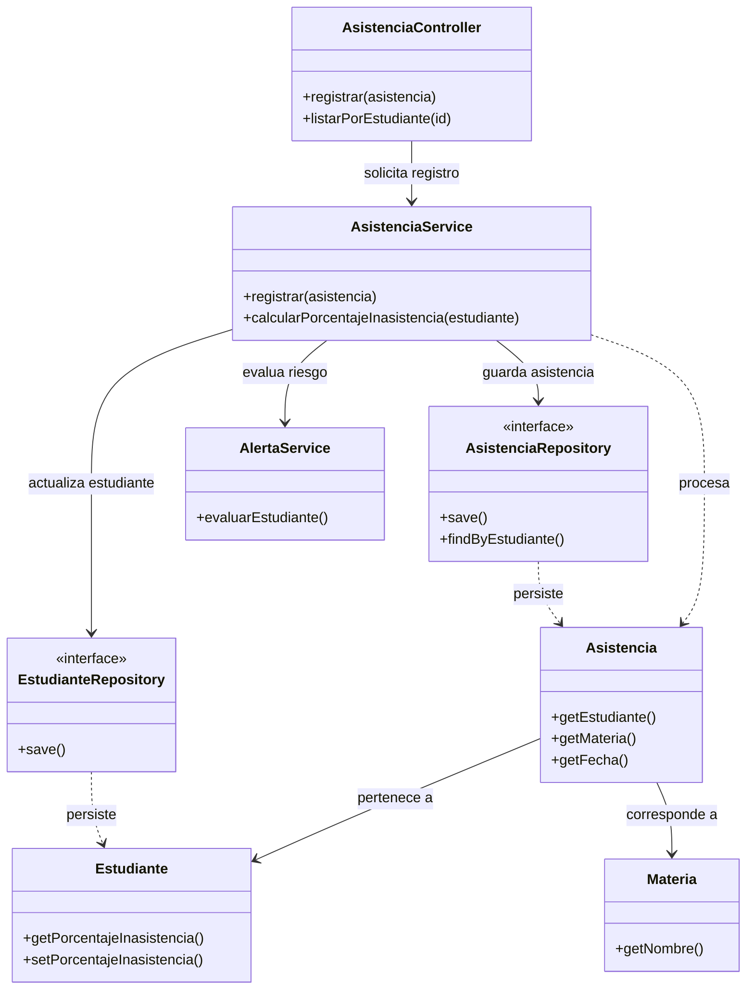

# Diagrama de clases UML — HU-04

## Historia de usuario

**HU-04 — Registro de asistencia diaria**

Como docente, quiero registrar la asistencia diaria de los estudiantes para llevar un control actualizado de sus inasistencias.

## Alcance implementado

El sistema permite registrar asistencias, validar los datos obligatorios y actualizar el porcentaje de inasistencia de los estudiantes.

El registro se integra con el motor de alertas para evaluar las condiciones de riesgo académico.

## Diagrama UML

## Descripción del proceso

1. El docente registra la asistencia de un estudiante.
2. `AsistenciaController` recibe la solicitud HTTP.
3. `AsistenciaService` valida que existan estudiante, materia y fecha.
4. El sistema guarda el registro mediante `AsistenciaRepository`.
5. Se calcula y actualiza el porcentaje de inasistencia.
6. `EstudianteRepository` guarda los cambios del estudiante.
7. `AlertaService` evalúa si existen condiciones de riesgo académico.

## Relación con HU-06

Si el porcentaje de inasistencia supera el 15 %, el motor de alertas genera una alerta ROJA.

## Responsable de HU-04

Jeremy Andrey Agreda Rosero.

## Consideraciones

Este diagrama representa los componentes principales identificados en el código de asistencia.

Los criterios de aceptación y el seguimiento de la historia están registrados en GitHub Issues y GitHub Projects.
