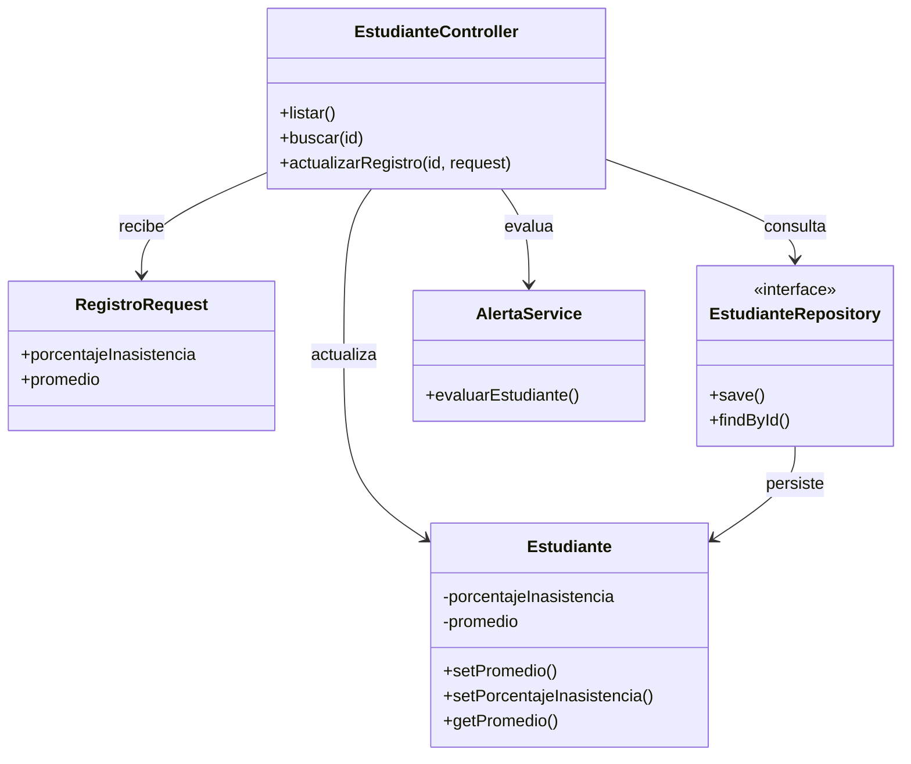

# Diagrama de clases UML — HU-05

## Historia de usuario

**HU-05 — Registro de calificaciones y actualización académica**

Como docente, quiero registrar las calificaciones parciales de los estudiantes para actualizar su rendimiento académico.

## Alcance implementado

El controlador actual permite actualizar el promedio académico y el porcentaje de inasistencia de un estudiante.

El registro independiente de cada calificación parcial no está representado en este diagrama porque no se identificó en el método revisado.

## Diagrama UML

## Descripción del proceso

1. El cliente envía una petición PUT a `/api/estudiantes/{id}/registro`.
2. El controlador consulta al estudiante.
3. Actualiza el promedio académico y el porcentaje de inasistencia.
4. Guarda la información mediante `EstudianteRepository`.
5. Invoca `AlertaService` para evaluar las condiciones de riesgo.
6. Devuelve la información del estudiante actualizado.

## Relación con HU-07

Cuando el promedio es inferior a 3.0, el motor de alertas puede generar una alerta AMARILLA.

## Responsable de HU-05

Jeremy Andrey Agreda Rosero.

## Observación

El diagrama representa las clases y dependencias identificadas en la implementación actual. Para cumplir íntegramente una historia de registro de notas parciales individuales, se requeriría verificar o ampliar ese comportamiento.
