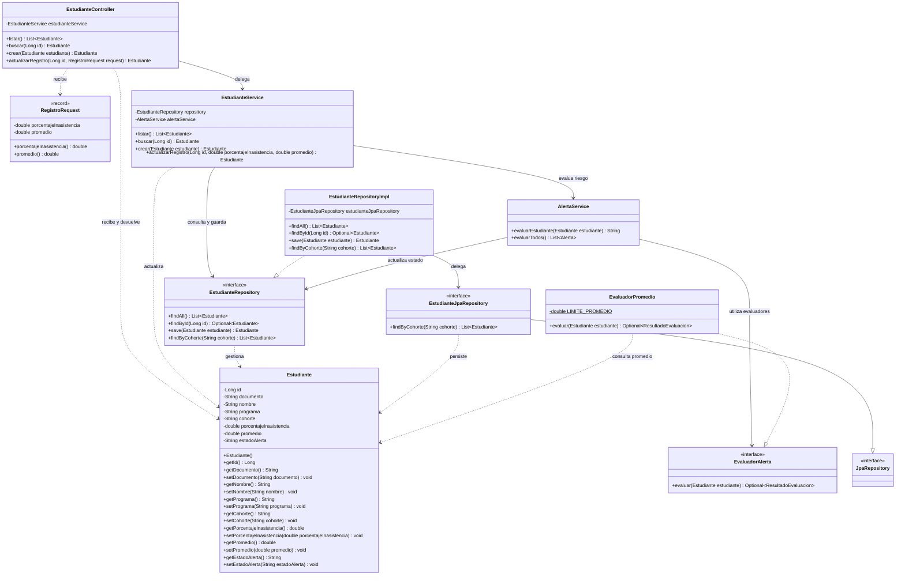
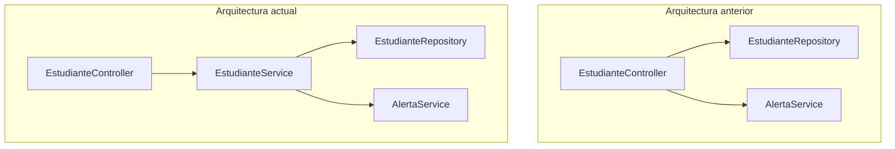
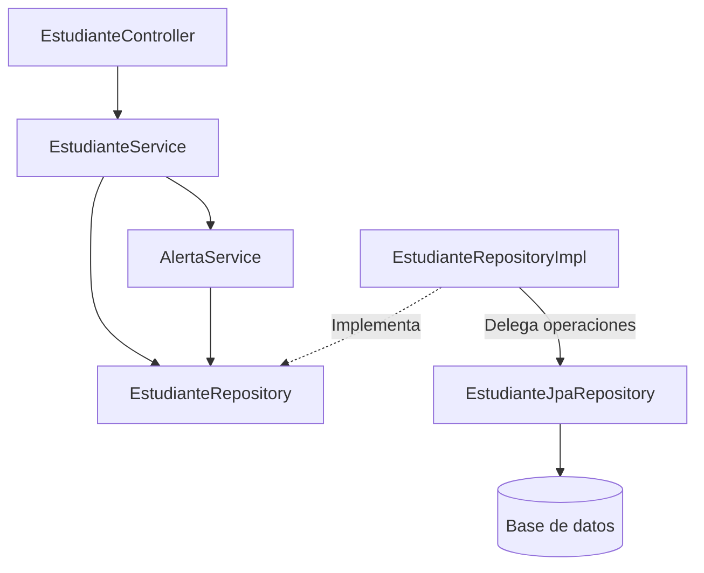
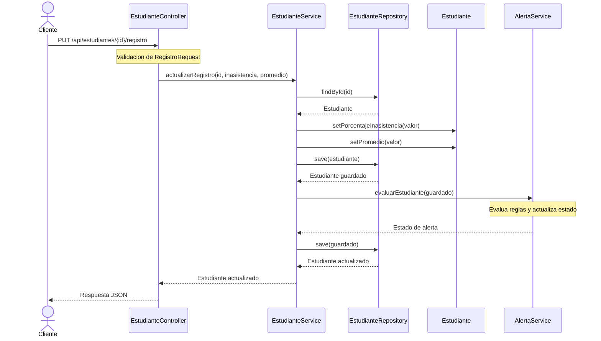
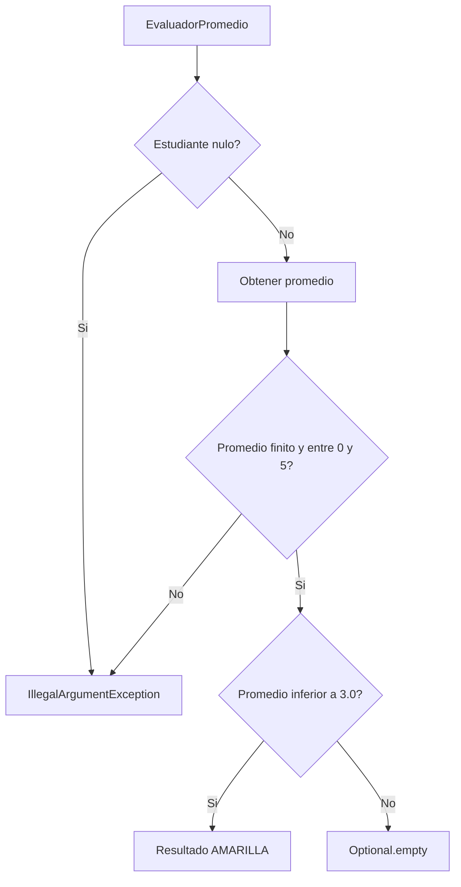
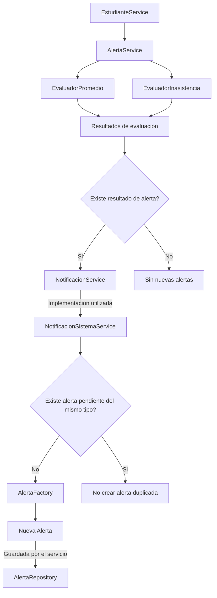

# Diagrama de clases UML — HU-05

## Sesión 13 — Arquitectura evolutiva

**Proyecto:** SATE-UNIAJC.

**Institución:** Institución Universitaria Antonio José Camacho.

**Asignatura:** Ingeniería de Software I.

**Fecha de actualización:** 27 de noviembre de 2026.

**Rama de desarrollo:** `Juan-sesion-13`.

---

## 1. Historia de usuario

**HU-05 — Registro de calificaciones y actualización académica**

Como docente, quiero registrar las calificaciones parciales
de los estudiantes para actualizar su rendimiento académico.

---

## 2. Objetivo

Representar los componentes, atributos, métodos y relaciones
correspondientes a la actualización del registro académico
de los estudiantes en SATE-UNIAJC.

El documento incorpora los cambios arquitectónicos
realizados durante la Sesión 13:

- Separación de responsabilidades mediante MVC.
- Incorporación de EstudianteService.
- Reorganización del paquete persistence.
- Implementación del patrón Repository.
- Integración indirecta con AlertaFactory.
- Fortalecimiento de las pruebas automatizadas.

---

## 3. Alcance implementado

La implementación actual permite:

- Consultar estudiantes.
- Buscar estudiantes por identificador.
- Crear estudiantes.
- Actualizar el promedio académico.
- Actualizar el porcentaje de inasistencia.
- Validar los rangos de los datos académicos.
- Guardar la información del estudiante.
- Evaluar condiciones de riesgo académico.
- Actualizar el estado general de alerta.
- Generar alertas cuando corresponda.

### 3.1. Limitación del alcance

La implementación revisada permite actualizar directamente
el promedio académico del estudiante.

No se identificó una entidad específica denominada
Calificacion o Nota dentro del paquete model.

Tampoco se identificó en los componentes revisados
una operación para registrar individualmente cada
calificación parcial y calcular automáticamente
el promedio a partir de dichas calificaciones.

Por tanto, este documento diferencia la historia
de usuario original del alcance actualmente implementado.

El cumplimiento integral de HU-05 debe verificarse
contra los criterios de aceptación oficiales.

---

## 4. Organización de componentes

| Paquete | Componentes relacionados |
|---|---|
| controller | EstudianteController, RegistroRequest |
| service | EstudianteService, AlertaService |
| model | Estudiante, Alerta |
| persistence | EstudianteRepository |
| persistence | EstudianteRepositoryImpl |
| persistence | EstudianteJpaRepository |
| persistence | AlertaRepository |
| service/evaluacion | EvaluadorAlerta, EvaluadorPromedio, EvaluadorInasistencia |
| service/notificacion | NotificacionService, NotificacionSistemaService |
| service/factory | AlertaFactory |

Todos los componentes pertenecen al paquete base
`co.uniajc.sate`.

RegistroRequest es un record declarado dentro
de EstudianteController.

---

## 5. Diagrama de clases UML



El diagrama representa los componentes principales
relacionados con HU-05.

Se omiten algunos constructores y componentes secundarios
para mantener la legibilidad.

JpaRepository se representa de manera simplificada,
sin detallar sus parámetros genéricos.

El símbolo de miembro estático en LIMITE_PROMEDIO
representa la constante utilizada por EvaluadorPromedio.

---

## 6. Responsabilidades de los componentes

### 6.1. EstudianteController

Controlador REST responsable de recibir solicitudes HTTP
relacionadas con la gestión de estudiantes.

Sus operaciones son:

- listar.
- buscar.
- crear.
- actualizarRegistro.

Después de la refactorización de la Sesión 13,
el controlador depende directamente de EstudianteService.

Ya no utiliza directamente EstudianteRepository
ni AlertaService.

### 6.2. RegistroRequest

Record utilizado para recibir los datos de actualización
del registro académico.

| Campo | Tipo | Rango permitido |
|---|---|---|
| porcentajeInasistencia | double | 0.0 a 100.0 |
| promedio | double | 0.0 a 5.0 |

Los campos utilizan las anotaciones DecimalMin
y DecimalMax de Jakarta Validation.

El controlador aplica la anotación Valid sobre
el cuerpo de la solicitud.

### 6.3. EstudianteService

Servicio responsable de coordinar la lógica
de gestión de estudiantes.

Sus responsabilidades incluyen:

- Consultar estudiantes.
- Buscar estudiantes por identificador.
- Guardar nuevos estudiantes.
- Actualizar los datos académicos.
- Solicitar la evaluación de alertas.
- Guardar el estudiante después de la evaluación.

El servicio utiliza EstudianteRepository como contrato
de persistencia.

### 6.4. Estudiante

Entidad JPA que representa a un estudiante.

Se almacena en la tabla:

```text
estudiantes
```

| Atributo | Tipo | Descripción |
|---|---|---|
| id | Long | Identificador generado |
| documento | String | Documento del estudiante |
| nombre | String | Nombre del estudiante |
| programa | String | Programa académico |
| cohorte | String | Cohorte académica |
| porcentajeInasistencia | double | Porcentaje general de inasistencia |
| promedio | double | Promedio académico |
| estadoAlerta | String | Estado general de riesgo |

Los campos documento, nombre, programa y cohorte
utilizan la anotación NotBlank.

Los campos numéricos utilizan las anotaciones
Min y Max.

### 6.5. EstudianteRepository

Contrato de persistencia utilizado por EstudianteService
y otros componentes del sistema.

Define las operaciones:

- findAll.
- findById.
- save.
- findByCohorte.

### 6.6. EstudianteRepositoryImpl

Implementación del contrato EstudianteRepository.

Delega las operaciones de persistencia hacia
EstudianteJpaRepository.

### 6.7. EstudianteJpaRepository

Interfaz especializada de Spring Data JPA
para la persistencia de estudiantes.

Extiende JpaRepository y declara la consulta
findByCohorte.

### 6.8. AlertaService

Coordina la evaluación de las condiciones de riesgo
académico de los estudiantes.

Es invocado por EstudianteService durante la creación
y actualización del registro académico.

### 6.9. EvaluadorPromedio

Componente encargado de evaluar la regla de HU-07.

Implementa la interfaz EvaluadorAlerta.

Valida que el estudiante no sea nulo y que el promedio
sea un número finito dentro del rango de 0 a 5.

Utiliza una constante denominada LIMITE_PROMEDIO
con valor 3.0.

Cuando el promedio es inferior a dicho límite,
retorna un resultado de evaluación AMARILLA.

En caso contrario, retorna Optional.empty().

---

## 7. Evolución de la arquitectura MVC

Antes de la Sesión 13, EstudianteController coordinaba
directamente operaciones de persistencia y evaluación
de alertas.

La refactorización trasladó estas responsabilidades
hacia EstudianteService.



La nueva estructura permite que el controlador
se concentre en recibir solicitudes y devolver
respuestas HTTP.

EstudianteService coordina las operaciones
del dominio y la persistencia.

Esta separación contribuye a la modularidad,
la modificabilidad y la capacidad de prueba.

---

## 8. Aplicación del patrón Repository

La persistencia de estudiantes se organiza mediante
un contrato independiente de la interfaz JPA.



EstudianteService depende del contrato
EstudianteRepository.

La implementación concreta se resuelve mediante
la inyección de dependencias de Spring.

EstudianteRepositoryImpl adapta las operaciones
del contrato a Spring Data JPA.

Esta separación permite utilizar implementaciones
simuladas del repositorio durante las pruebas unitarias.

---

## 9. Endpoints relacionados

| Método HTTP | Endpoint | Propósito |
|---|---|---|
| GET | /api/estudiantes | Listar estudiantes |
| GET | /api/estudiantes/{id} | Consultar un estudiante |
| POST | /api/estudiantes | Crear un estudiante |
| PUT | /api/estudiantes/{id}/registro | Actualizar el registro académico |

El endpoint de creación utiliza el estado HTTP
201 Created cuando la operación finaliza correctamente.

### 9.1. Actualización del registro académico

```http
PUT /api/estudiantes/1/registro
Content-Type: application/json
```

Ejemplo de cuerpo de la solicitud:

```json
{
  "porcentajeInasistencia": 10.0,
  "promedio": 2.8
}
```

La solicitud actualiza ambos valores del registro
académico del estudiante.

El identificador debe corresponder a un estudiante
existente en la base de datos.

### 9.2. Consideraciones

La solicitud anterior es un ejemplo de la estructura
esperada por el controlador.

No constituye evidencia de una solicitud HTTP
ejecutada exitosamente.

La operación no representa el registro individual
de una calificación parcial.

---

## 10. Flujo de actualización académica



El diagrama representa el flujo principal exitoso.

No incluye todas las excepciones ni las operaciones
internas de AlertaService.

### Descripción del proceso

1. El cliente envía la solicitud PUT.
2. El controlador recibe y valida RegistroRequest.
3. El controlador delega la operación a EstudianteService.
4. El servicio consulta al estudiante mediante el repositorio.
5. Se actualiza el porcentaje de inasistencia.
6. Se actualiza el promedio académico.
7. El repositorio guarda el estudiante.
8. AlertaService evalúa las condiciones de riesgo.
9. El servicio realiza una operación final de guardado.
10. El controlador devuelve el estudiante actualizado.

La implementación actual realiza dos llamadas directas
a save desde EstudianteService durante la actualización.

AlertaService también guarda el estado general
del estudiante como parte de su procesamiento interno.

La posible redundancia de estas operaciones debe
evaluarse posteriormente como deuda técnica.

---

## 11. Validación del registro académico

### 11.1. Validaciones de RegistroRequest

| Campo | Validación mínima | Validación máxima |
|---|---|---|
| porcentajeInasistencia | DecimalMin 0.0 | DecimalMax 100.0 |
| promedio | DecimalMin 0.0 | DecimalMax 5.0 |

Los límites se consideran inclusivos.

### 11.2. Validaciones de Estudiante

| Campo | Restricción declarada |
|---|---|
| documento | NotBlank |
| nombre | NotBlank |
| programa | NotBlank |
| cohorte | NotBlank |
| porcentajeInasistencia | Min 0 y Max 100 |
| promedio | Min 0 y Max 5 |

Estas restricciones corresponden a las anotaciones
presentes en la entidad.

### 11.3. Validaciones de EvaluadorPromedio

EvaluadorPromedio verifica explícitamente:

- Que el estudiante no sea nulo.
- Que el promedio sea un número finito.
- Que el promedio no sea inferior a 0.
- Que el promedio no sea superior a 5.

Si alguna de estas condiciones no se cumple,
el evaluador genera IllegalArgumentException.

### 11.4. Estudiante inexistente

EstudianteService utiliza findById para buscar
al estudiante.

Cuando no encuentra el registro, genera una
RuntimeException con el mensaje:

```text
Estudiante no encontrado
```

La respuesta HTTP exacta ante esta excepción
debe verificarse mediante pruebas de integración.

### 11.5. Consideraciones adicionales

RegistroRequest utiliza campos primitivos de tipo double.

Debe verificarse el comportamiento de la API cuando
se omite alguno de los campos de la solicitud.

EstudianteService no contiene una validación explícita
de rangos dentro del método actualizarRegistro.

Por tanto, las validaciones de entrada del controlador
y las del dominio no deben considerarse equivalentes
a una validación completa de todas las posibles
invocaciones directas al servicio.

---

## 12. Relación con HU-07 — Alerta amarilla

La regla de HU-07 establece que se genera un resultado
de alerta AMARILLA cuando el promedio académico
es inferior a 3.0.

### 12.1. Regla de evaluación

```java
if (promedio < LIMITE_PROMEDIO) {
    return Optional.of(new ResultadoEvaluacion(
            "AMARILLA",
            "Promedio inferior a 3.0"
    ));
}

return Optional.empty();
```

El valor de LIMITE_PROMEDIO es 3.0.

### 12.2. Diagrama de evaluación



### 12.3. Valores de frontera

| Promedio | Resultado esperado de EvaluadorPromedio |
|---:|---|
| -0.01 | IllegalArgumentException |
| 0.0 | Resultado AMARILLA |
| 2.5 | Resultado AMARILLA |
| 2.99 | Resultado AMARILLA |
| 3.0 | Optional.empty() |
| 3.01 | Optional.empty() |
| 4.5 | Optional.empty() |
| 5.0 | Optional.empty() |
| 5.01 | IllegalArgumentException |

Los valores NaN e infinitos también son rechazados
por la validación de números finitos.

Estos resultados corresponden al comportamiento
esperado según el código revisado.

No constituyen por sí mismos evidencias de pruebas
ejecutadas individualmente.

---

## 13. Integración con el motor de alertas

EstudianteService invoca AlertaService después
de guardar los datos académicos.

El motor evalúa las reglas disponibles para
el estudiante.



El diagrama representa de manera simplificada
la generación de nuevas alertas.

NotificacionSistemaService verifica si existe
una alerta pendiente del mismo tipo para el estudiante.

Cuando corresponde crear una nueva alerta,
utiliza AlertaFactory para construir la entidad.

La persistencia de la alerta se realiza mediante
AlertaRepository.

EstudianteController y EstudianteService no invocan
directamente AlertaFactory.

---

## 14. Relación con HU-04 y HU-06

El registro académico permite actualizar tanto
el promedio como el porcentaje de inasistencia.

Por tanto, la evaluación posterior puede identificar
condiciones relacionadas con HU-06 y HU-07.

### 14.1. Reglas de riesgo

| Historia | Condición |
|---|---|
| HU-06 | Inasistencia superior al 15 % |
| HU-07 | Promedio inferior a 3.0 |

### 14.2. Prioridad del estado general

| Inasistencia | Promedio | Estado general esperado |
|---:|---:|---|
| 10 % | 4.0 | VERDE |
| 10 % | 2.8 | AMARILLA |
| 20 % | 4.0 | ROJA |
| 20 % | 2.8 | ROJA |
| 15 % | 3.0 | VERDE |

Cuando ambas condiciones se cumplen, el estado
general del estudiante tiene prioridad ROJA.

Las alertas roja y amarilla pueden existir
de manera independiente para un mismo estudiante.

Los estados de la tabla corresponden a los resultados
de una evaluación actual de las dos reglas.

No representan necesariamente el conjunto de alertas
pendientes almacenadas previamente.

### 14.3. Consistencia con HU-04

AsistenciaService calcula el porcentaje general
de inasistencia a partir de los registros de asistencia.

EstudianteService permite actualizar directamente
ese mismo porcentaje mediante el registro académico.

Debe revisarse la consistencia entre ambos mecanismos
para evitar discrepancias entre el porcentaje almacenado
y los registros de asistencia existentes.

Esta revisión se considera una oportunidad
de evolución del sistema.

---

## 15. Pruebas y escenarios de verificación

Los siguientes escenarios permiten verificar
el comportamiento esperado de HU-05 y su integración
con el motor de alertas.

| ID | Escenario | Resultado esperado |
|---|---|---|
| CP-HU05-01 | Actualizar un estudiante existente | Registro actualizado |
| CP-HU05-02 | Consultar un estudiante inexistente | Operación rechazada |
| CP-HU05-03 | Promedio igual a 0.0 | Valor válido |
| CP-HU05-04 | Promedio igual a 5.0 | Valor válido |
| CP-HU05-05 | Promedio inferior a 0.0 | Solicitud inválida |
| CP-HU05-06 | Promedio superior a 5.0 | Solicitud inválida |
| CP-HU05-07 | Inasistencia inferior a 0 % | Solicitud inválida |
| CP-HU05-08 | Inasistencia superior a 100 % | Solicitud inválida |
| CP-HU05-09 | Promedio inferior a 3.0 | Resultado AMARILLA |
| CP-HU05-10 | Promedio igual a 3.0 | Sin resultado AMARILLA |
| CP-HU05-11 | Promedio bajo e inasistencia alta | Estado general ROJA |
| CP-HU05-12 | Alerta pendiente del mismo tipo | No crear una alerta duplicada |
| CP-HU05-13 | Evaluar un promedio no finito | IllegalArgumentException |

Los escenarios de solicitudes inválidas corresponden
a la validación esperada de la API.

Los escenarios de evaluación corresponden al
comportamiento esperado del motor de alertas.

La tabla constituye una propuesta de verificación
y no una relación de pruebas ejecutadas individualmente.

### 15.1. Pruebas automatizadas relacionadas

Durante la Sesión 13 se incorporaron pruebas unitarias
de EstudianteService y EstudianteRepositoryImpl.

También se incorporaron pruebas de AlertaFactory
y NotificacionSistemaService.

| Clase de prueba | Casos reportados |
|---|---:|
| EstudianteServiceTest | 6 |
| EstudianteRepositoryImplTest | 5 |
| AlertaFactoryTest | 2 |
| NotificacionSistemaServiceTest | 2 |

Estas clases forman parte de la suite general
de 37 pruebas automatizadas reportadas.

La cantidad de casos no constituye una medición
de cobertura de código.

### 15.2. Ejecución de pruebas

Desde la raíz del proyecto:

```bash
mvn clean test
```

La ejecución final de la rama y la validación
mediante GitHub Actions permanecen pendientes
de confirmación.

Consultar:

[Plan de pruebas](../PLAN_PRUEBAS.md).

---

## 16. Evolución arquitectónica y deuda técnica

### 16.1. Comparación arquitectónica

| Aspecto | Situación anterior | Situación actual |
|---|---|---|
| Controlador | Coordinaba lógica de negocio | Delega a EstudianteService |
| Servicio de estudiantes | Sin capa específica | EstudianteService |
| Persistencia | Repositorio JPA directo | Contrato e implementación |
| Paquete de persistencia | repository | persistence |
| Creación de alertas | Construcción en el servicio de notificación | AlertaFactory |
| Decisiones arquitectónicas | Sin ADR específico de MVC | ADR-0001 |
| Pruebas | Suite inicial | Suite ampliada |

### 16.2. Oportunidades de mejora

La revisión permite identificar las siguientes
oportunidades de evolución:

- Verificar los criterios de aceptación de HU-05
  relacionados con calificaciones parciales individuales.
- Evaluar un modelo específico de calificaciones
  si los requisitos oficiales lo necesitan.
- Evaluar el cálculo automático del promedio académico
  a partir de calificaciones individuales.
- Revisar la consistencia entre el porcentaje calculado
  por HU-04 y el actualizado mediante HU-05.
- Revisar las operaciones repetidas de guardado
  durante la actualización académica.
- Evaluar la atomicidad de la actualización
  y la generación de alertas.
- Revisar el manejo centralizado de excepciones.
- Verificar el comportamiento ante campos omitidos
  en RegistroRequest.
- Ampliar las pruebas de integración HTTP.
- Verificar los permisos correspondientes a la historia.
- Verificar la disponibilidad de las operaciones
  desde la interfaz web.

Estas oportunidades deben evaluarse según los
requisitos y prioridades oficiales del proyecto.

No se incorporan nuevas funcionalidades como parte
de esta actualización documental.

---

## 17. Responsable de HU-05

**Jeremy Andrey Agreda Rosero.**

La actualización del diagrama se realiza como parte
de la documentación arquitectónica de la Sesión 13.

La asignación y el estado vigente de la historia
deben consultarse en GitHub Issues y GitHub Projects.

---

## 18. Documentos relacionados

- [Arquitectura MVC](ARQUITECTURA_MVC.md).
- [Diagrama de clases HU-04](CLASES_HU04.md).
- [Documentación técnica](../DOCUMENTACION_TECNICA.md).
- [ADR-0001: Patrón MVC](../adr/0001-patron-mvc.md).
- [Análisis de deuda técnica](../DEUDA_TECNICA.md).
- [Plan de pruebas](../PLAN_PRUEBAS.md).
- [Diagrama de secuencia](../secuencia.md).
- [Índice de documentación](../README_DOCUMENTOS.md).
- [README principal](../../README.md).

---

## 19. Conclusiones

La actualización del registro académico de los estudiantes
se organiza mediante EstudianteController,
EstudianteService y EstudianteRepository.

La refactorización realizada durante la Sesión 13
fortalece la separación de responsabilidades
y reduce el acoplamiento directo del controlador
con los componentes de persistencia y evaluación.

El patrón Repository permite separar el contrato
de acceso a datos de su implementación basada
en Spring Data JPA.

La integración indirecta con AlertaFactory centraliza
la construcción de nuevas alertas.

EvaluadorPromedio conserva la regla de HU-07,
correspondiente a un promedio inferior a 3.0.

La implementación revisada permite actualizar
directamente el promedio académico.

El registro independiente de calificaciones parciales
debe verificarse frente a los criterios de aceptación
oficiales antes de declarar el cumplimiento integral
de HU-05.

Los criterios de aceptación y el seguimiento oficial
permanecen en GitHub Issues y GitHub Projects.