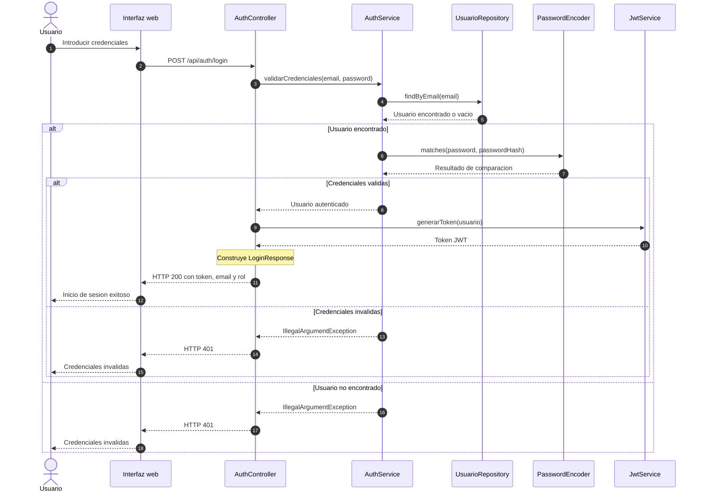
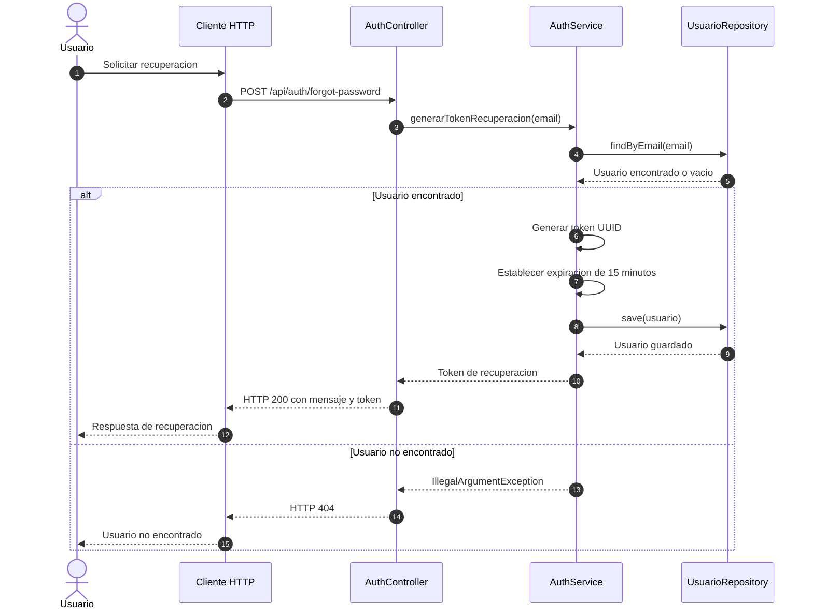
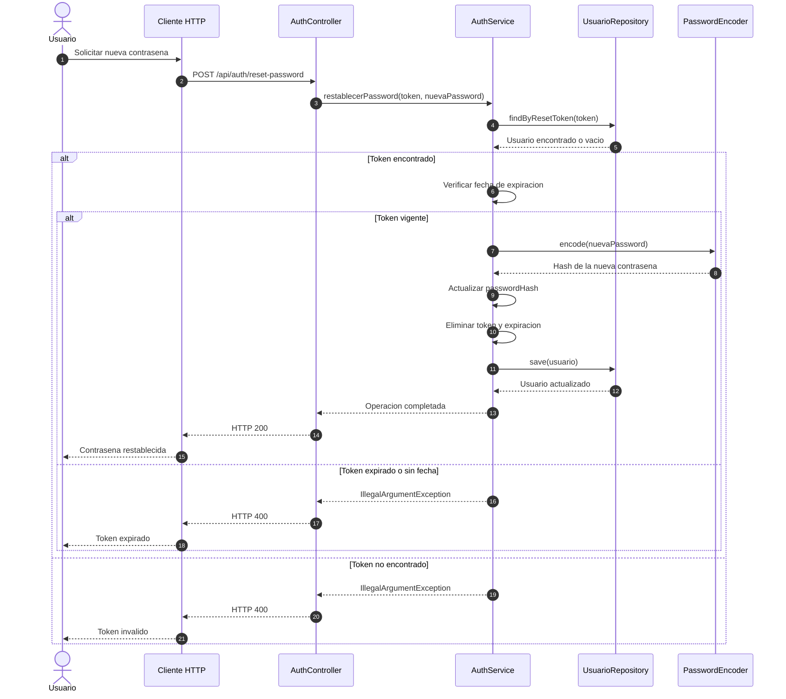
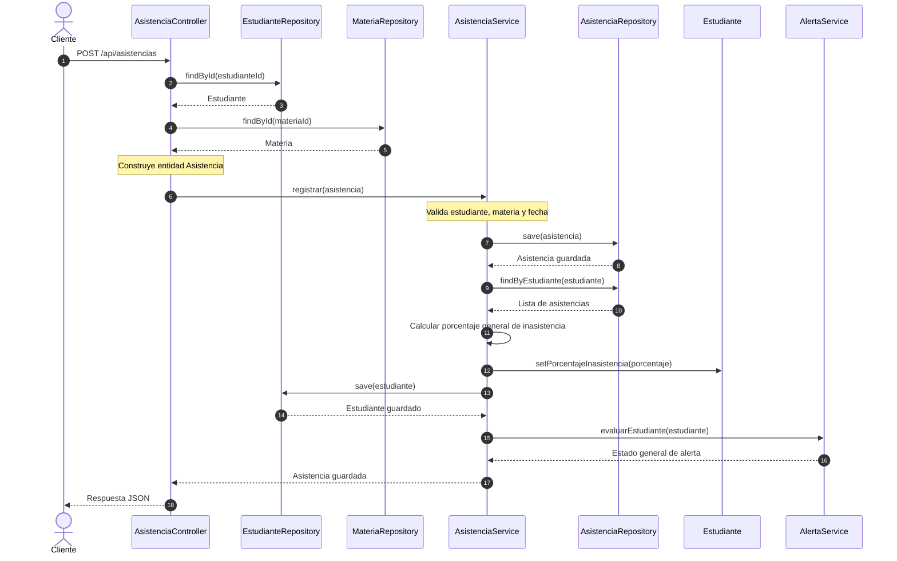
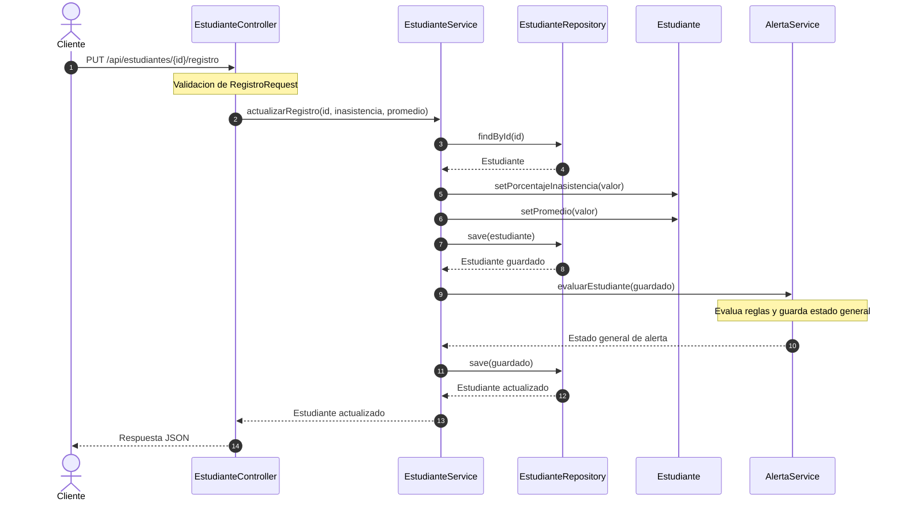
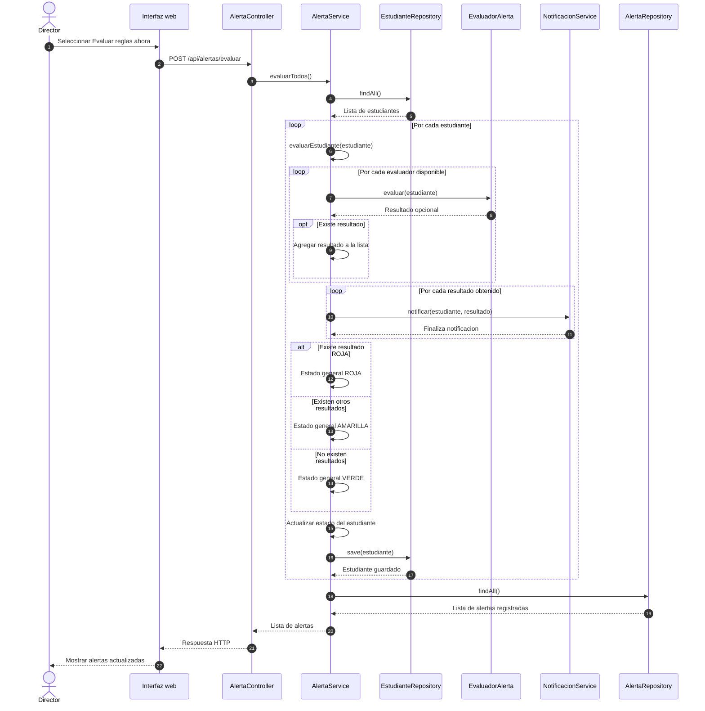
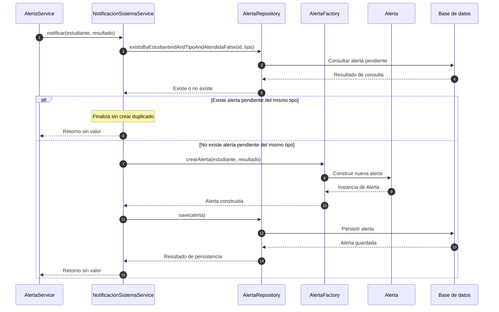
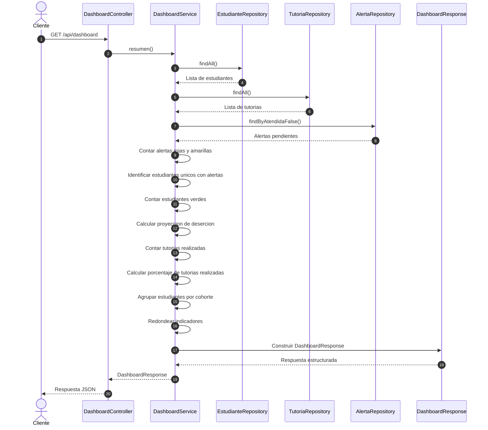
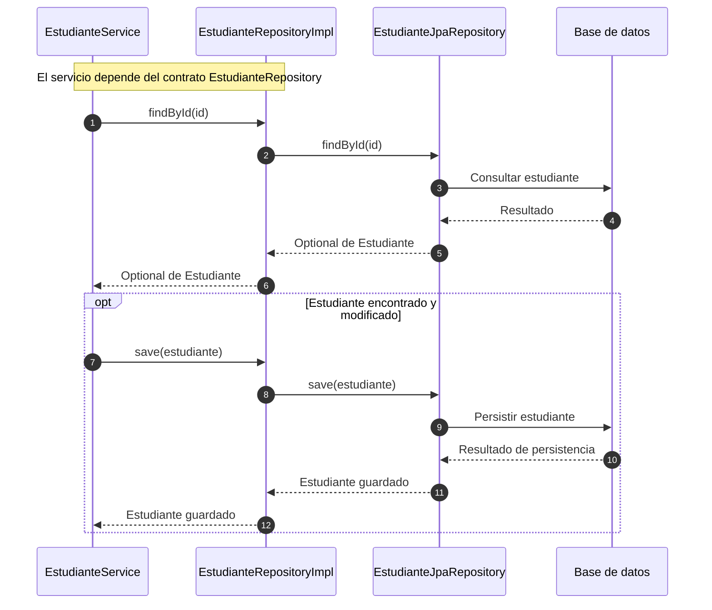

# Diagramas de secuencia UML — SATE-UNIAJC

## Sesión 13 — Arquitectura evolutiva

**Proyecto:** SATE-UNIAJC — Sistema de Alertas Tempranas
y Acompañamiento Estudiantil.

**Institución:** Institución Universitaria Antonio José Camacho.

**Asignatura:** Ingeniería de Software I.

**Fecha de actualización:** 27 de noviembre de 2026.

**Rama de desarrollo:** `Juan-sesion-13`.

---

## 1. Objetivo

Representar las interacciones entre los componentes
principales de SATE-UNIAJC durante la ejecución
de sus operaciones.

La actualización incorpora los cambios arquitectónicos
realizados durante la Sesión 13:

- Reorganización del paquete persistence.
- Implementación del patrón Repository.
- Separación de responsabilidades mediante MVC.
- Incorporación de EstudianteService.
- Incorporación de DashboardService.
- Incorporación de DashboardResponse.
- Implementación de AlertaFactory.
- Documentación de decisiones arquitectónicas.
- Identificación de oportunidades de mejora.

Se conserva el flujo del motor de alertas documentado
durante la Sesión 12 y se amplía su representación
según la implementación actual.

---

## 2. Alcance de los diagramas

| Historia o componente | Proceso representado |
|---|---|
| HU-01 | Inicio de sesión |
| HU-02 | Recuperación y restablecimiento de contraseña |
| HU-03 | Información del rol durante la autenticación |
| HU-04 | Registro de asistencia |
| HU-05 | Actualización del registro académico |
| HU-06 | Evaluación de inasistencia |
| HU-07 | Evaluación del promedio académico |
| Dashboard | Consulta de indicadores |
| Repository | Persistencia de estudiantes |
| Factory | Construcción de alertas |

Los diagramas representan los flujos principales
identificados en el código fuente.

No constituyen por sí mismos evidencia de ejecución
exitosa de todos los criterios de aceptación.

La representación de HU-05 corresponde a la actualización
directa del promedio académico, no al registro individual
de calificaciones parciales.

La representación de HU-03 se limita a la información
del rol durante la autenticación.

La autorización efectiva de cada operación requiere
una revisión específica de la configuración de seguridad
y sus pruebas de integración.

---

## 3. Componentes participantes

| Capa o paquete | Componentes principales |
|---|---|
| Interfaz web | HTML, CSS y JavaScript |
| controller | AuthController |
| controller | EstudianteController |
| controller | AsistenciaController |
| controller | AlertaController |
| controller | DashboardController |
| service | AuthService, JwtService |
| service | EstudianteService |
| service | AsistenciaService |
| service | AlertaService |
| service | DashboardService |
| persistence | UsuarioRepository |
| persistence | EstudianteRepository |
| persistence | EstudianteRepositoryImpl |
| persistence | EstudianteJpaRepository |
| persistence | AsistenciaRepository, MateriaRepository |
| persistence | AlertaRepository, TutoriaRepository |
| service/evaluacion | EvaluadorAlerta |
| service/evaluacion | EvaluadorInasistencia, EvaluadorPromedio |
| service/notificacion | NotificacionService |
| service/notificacion | NotificacionSistemaService |
| service/factory | AlertaFactory |
| view | DashboardResponse |
| model | Usuario, Estudiante, Asistencia, Alerta, Materia, Tutoria |

El paquete base de la aplicación es:

```text
co.uniajc.sate
```

Los diagramas utilizan participantes simplificados
para facilitar la comprensión de las interacciones.

---

## 4. Inicio de sesión — HU-01

### 4.1. Diagrama de secuencia



### 4.2. Descripción del proceso

1. El cliente proporciona su correo y contraseña.
2. AuthController recibe la solicitud.
3. AuthService consulta el usuario por correo.
4. PasswordEncoder compara la contraseña recibida
   con el hash almacenado.
5. Si las credenciales son válidas, JwtService
   genera un token.
6. El controlador construye LoginResponse.
7. La respuesta incluye el token, correo y rol.
8. Si las credenciales son inválidas, el controlador
   devuelve HTTP 401.

### 4.3. Endpoint

```http
POST /api/auth/login
```

### 4.4. Relación con HU-03

La respuesta de autenticación incluye el nombre
del rol asociado al usuario.

Esta información puede utilizarse en la interfaz
para adaptar las opciones disponibles.

La presencia del rol en la respuesta no demuestra
por sí sola que todos los permisos estén correctamente
aplicados en el backend.

El funcionamiento interno de JwtService y del filtro
de autenticación no se desarrolla en este diagrama.

---

## 5. Recuperación de contraseña — HU-02

### 5.1. Generación del token de recuperación



### 5.2. Comportamiento implementado

AuthService genera un token mediante UUID.

El token se almacena en el usuario junto con
una fecha de expiración calculada a partir
del momento de generación más 15 minutos.

AuthController devuelve el token mediante
RecoveryTokenResponse.

No se identificó un mecanismo de envío de correo
electrónico en los componentes revisados.

### 5.3. Restablecimiento de contraseña



### 5.4. Endpoints relacionados

| Método | Endpoint |
|---|---|
| POST | /api/auth/forgot-password |
| POST | /api/auth/reset-password |

### 5.5. Consideraciones de seguridad

La implementación revisada devuelve directamente
el token de recuperación en la respuesta HTTP.

También diferencia las respuestas según la existencia
del correo electrónico.

Estos comportamientos deben revisarse antes
de utilizar el sistema en un entorno productivo.

Se recomienda evaluar:

- Un mecanismo seguro de entrega del token.
- Respuestas uniformes de recuperación.
- Protección contra solicitudes repetidas.
- Validación de las nuevas contraseñas.
- Pruebas de integración de autenticación.

Estas recomendaciones se documentan como oportunidades
de mejora y no como funcionalidades implementadas.

---

## 6. Registro de asistencia — HU-04

### 6.1. Diagrama de secuencia



### 6.2. Descripción del proceso

1. El controlador recibe los datos de asistencia.
2. Consulta el estudiante mediante EstudianteRepository.
3. Consulta la materia mediante MateriaRepository.
4. Construye la entidad Asistencia.
5. AsistenciaService valida los datos obligatorios.
6. Guarda el registro mediante AsistenciaRepository.
7. Consulta las asistencias existentes.
8. Calcula el porcentaje general de inasistencia.
9. Actualiza y guarda el estudiante.
10. Solicita la evaluación de condiciones de riesgo.
11. Devuelve la asistencia registrada.

### 6.3. Cálculo de inasistencia

```text
Porcentaje de inasistencia =
    (Cantidad de ausencias * 100.0) / Total de registros
```

Cuando no existen registros, el cálculo retorna 0.0.

AsistenciaService también permite calcular el porcentaje
de inasistencia por materia.

Sin embargo, el porcentaje almacenado en Estudiante
corresponde al cálculo general.

### 6.4. Consideración arquitectónica

AsistenciaController conserva dependencias directas
hacia EstudianteRepository y MateriaRepository.

El diagrama representa esta situación real.

El traslado de estas consultas hacia la capa service
se considera una posible evolución posterior.

### 6.5. Documento relacionado

[Diagrama de clases HU-04](diagramas/CLASES_HU04.md).

---

## 7. Actualización del registro académico — HU-05

### 7.1. Diagrama de secuencia



### 7.2. Descripción del proceso

1. El controlador recibe la solicitud de actualización.
2. Jakarta Validation comprueba los rangos declarados.
3. El controlador delega la operación a EstudianteService.
4. El servicio consulta al estudiante.
5. Actualiza el porcentaje de inasistencia.
6. Actualiza el promedio académico.
7. Guarda los datos del estudiante.
8. Solicita la evaluación de alertas.
9. Realiza una operación final de guardado.
10. Devuelve el estudiante actualizado.

### 7.3. Validaciones declaradas

| Campo | Valor mínimo | Valor máximo |
|---|---:|---:|
| porcentajeInasistencia | 0.0 | 100.0 |
| promedio | 0.0 | 5.0 |

Los límites son inclusivos.

### 7.4. Evolución arquitectónica

EstudianteController ya no depende directamente
de EstudianteRepository ni de AlertaService.

Estas responsabilidades se trasladaron
a EstudianteService durante la Sesión 13.

### 7.5. Consideraciones

EstudianteService realiza dos llamadas directas
a save durante la actualización del registro.

AlertaService también guarda el estado general
del estudiante durante su procesamiento.

La necesidad de estas operaciones repetidas
debe evaluarse posteriormente.

El proceso representa la actualización directa
del promedio académico.

No representa el almacenamiento individual
de calificaciones parciales.

### 7.6. Documento relacionado

[Diagrama de clases HU-05](diagramas/CLASES_HU05.md).

---

## 8. Evaluación del motor de alertas — HU-06 y HU-07

### 8.1. Diagrama de secuencia actualizado



### 8.2. Descripción del proceso

AlertaService recibe mediante inyección de dependencias
una lista de implementaciones de EvaluadorAlerta.

La implementación utiliza dos ciclos independientes.

Primer ciclo:

- Ejecutar cada evaluador disponible.
- Recopilar los resultados presentes.

Segundo ciclo:

- Recorrer los resultados recopilados.
- Solicitar una notificación por cada resultado.

Después de procesar las notificaciones, el servicio
determina el estado general del estudiante.

Finalmente, guarda el estudiante actualizado.

### 8.3. Evaluadores disponibles

| Evaluador | Regla |
|---|---|
| EvaluadorInasistencia | Inasistencia superior al 15 % |
| EvaluadorPromedio | Promedio inferior a 3.0 |

El diagrama utiliza EvaluadorAlerta como abstracción.

No establece un orden fijo entre los evaluadores,
porque AlertaService recorre la lista recibida
mediante inyección de dependencias.

### 8.4. Prioridad del estado general

| Resultado de evaluación | Estado general |
|---|---|
| Existe resultado ROJA | ROJA |
| No existe ROJA, pero existen otros resultados | AMARILLA |
| No existen resultados | VERDE |

El estado general corresponde a la evaluación actual.

Las alertas pendientes almacenadas anteriormente
pueden conservarse hasta que sean atendidas.

### 8.5. Reutilización del motor de alertas

El método evaluarEstudiante también es utilizado por:

- EstudianteService durante la creación de estudiantes.
- EstudianteService durante la actualización académica.
- AsistenciaService después de actualizar la inasistencia.

Esto permite reutilizar las mismas reglas de evaluación
en diferentes operaciones del sistema.

### 8.6. Endpoint

```http
POST /api/alertas/evaluar
```

La operación evaluarTodos devuelve todas las alertas
obtenidas mediante AlertaRepository.findAll().

No se limita exclusivamente a las alertas pendientes.

---

## 9. Notificación y creación de alertas — Factory

### 9.1. Diagrama de secuencia



### 9.2. Prevención de duplicados

NotificacionSistemaService consulta si existe
una alerta pendiente para el mismo estudiante
y el mismo tipo de alerta.

La consulta utiliza:

```java
existsByEstudianteIdAndTipoAndAtendidaFalse(
    estudiante.getId(),
    resultado.tipo()
)
```

Si existe una alerta pendiente, el método finaliza
sin crear una nueva.

Si no existe, solicita la construcción de la alerta
mediante AlertaFactory.

### 9.3. Responsabilidad de AlertaFactory

AlertaFactory centraliza la construcción
de la entidad Alerta.

La nueva alerta contiene:

| Dato | Origen |
|---|---|
| Identificador del estudiante | estudiante.getId() |
| Nombre del estudiante | estudiante.getNombre() |
| Tipo de alerta | resultado.tipo() |
| Motivo | resultado.motivo() |
| Fecha | LocalDateTime.now() |
| Atendida | false |

La Factory no realiza operaciones de persistencia.

NotificacionSistemaService es responsable de guardar
la alerta mediante AlertaRepository.

### 9.4. Clasificación del patrón

La implementación corresponde a una Factory simple
encargada de centralizar la creación de objetos Alerta.

No se presenta como una implementación estricta
del patrón Factory Method de GoF.

### 9.5. Beneficios arquitectónicos

- Separación entre construcción y persistencia.
- Reducción de responsabilidades del notificador.
- Centralización de los valores iniciales de Alerta.
- Facilidad para probar la construcción de alertas.
- Mayor claridad en las responsabilidades.

La comprobación de duplicados representa el mecanismo
actual del servicio.

No demuestra por sí sola que exista protección
contra duplicados bajo solicitudes concurrentes.

---

## 10. Consulta del dashboard

### 10.1. Diagrama de secuencia



### 10.2. Responsabilidades

DashboardController recibe la solicitud HTTP
y delega el procesamiento a DashboardService.

DashboardService consulta los repositorios
y calcula los indicadores.

DashboardResponse estructura los datos devueltos
por el servicio.

La interfaz web puede consumir la respuesta JSON
para representar los indicadores.

### 10.3. Datos de DashboardResponse

| Campo | Descripción |
|---|---|
| totalEstudiantes | Cantidad total de estudiantes |
| alertasRojas | Cantidad de alertas rojas pendientes |
| alertasAmarillas | Cantidad de alertas amarillas pendientes |
| estudiantesVerdes | Estudiantes con estado VERDE |
| proyeccionDesercion | Indicador heurístico de riesgo |
| totalTutorias | Cantidad total de tutorías |
| tutoriasRealizadas | Cantidad de tutorías realizadas |
| efectividadTutorias | Porcentaje de tutorías realizadas |
| estudiantesPorCohorte | Agrupación de estudiantes por cohorte |

### 10.4. Proyección de deserción

La implementación utiliza la siguiente fórmula:

```text
Proyeccion =
    (
        (Estudiantes unicos con alertas pendientes * 0.80)
        +
        (Estudiantes verdes * 0.10)
    )
    / Total de estudiantes
    * 100
```

Cuando no existen estudiantes, retorna 0.

La utilización de un conjunto de identificadores
evita contar varias veces al mismo estudiante
dentro del grupo con alertas pendientes.

Sin embargo, un estudiante con estado VERDE
podría conservar alertas pendientes anteriores.

Por tanto, los dos grupos de la fórmula
no necesariamente son excluyentes.

Este indicador corresponde a una heurística
implementada en el sistema.

No constituye una predicción estadística validada
de la deserción estudiantil.

### 10.5. Indicador de tutorías

```text
Efectividad =
    (Tutorias realizadas / Total de tutorias) * 100
```

Cuando no existen tutorías, retorna 0.

Aunque el campo se denomina efectividadTutorias,
la fórmula mide el porcentaje de tutorías realizadas.

No mide directamente su impacto sobre el rendimiento
académico de los estudiantes.

### 10.6. Endpoint

```http
GET /api/dashboard
```

### 10.7. Evolución arquitectónica

El cálculo de indicadores se encuentra centralizado
en DashboardService.

DashboardController conserva únicamente la responsabilidad
de recibir la solicitud y devolver la respuesta.

DashboardResponse representa el contrato de datos
utilizado por el endpoint.

---

## 11. Persistencia mediante el patrón Repository

### 11.1. Diagrama de secuencia



### 11.2. Contrato de persistencia

EstudianteRepository define las operaciones:

- findAll.
- findById.
- save.
- findByCohorte.

EstudianteRepositoryImpl implementa este contrato.

EstudianteJpaRepository extiende JpaRepository
y proporciona las operaciones de Spring Data JPA.

### 11.3. Inyección de dependencias

Los servicios declaran sus dependencias mediante
el contrato EstudianteRepository.

Spring resuelve la implementación concreta
EstudianteRepositoryImpl.

La implementación delega las operaciones hacia
EstudianteJpaRepository.

El contrato no representa un objeto adicional
que reciba y reenvíe llamadas durante la ejecución.

Por esta razón, el diagrama representa directamente
la implementación que recibe las llamadas del servicio.

### 11.4. Consideraciones

Las operaciones de acceso a la base de datos
se representan de manera conceptual.

No se pretende describir el momento exacto
de ejecución de las sentencias SQL ni los límites
de las transacciones de JPA.

---

## 12. Reglas de negocio consolidadas

| Condición | Comportamiento esperado |
|---|---|
| Inasistencia superior al 15 % | Resultado ROJA |
| Inasistencia igual al 15 % | No cumple la regla ROJA |
| Promedio inferior a 3.0 | Resultado AMARILLA |
| Promedio igual a 3.0 | No cumple la regla AMARILLA |
| Ambas condiciones de riesgo | Dos resultados de evaluación |
| Ambas condiciones de riesgo | Estado general ROJA |
| Sin condiciones de riesgo | Estado general VERDE |
| Alerta pendiente del mismo tipo | No crear otra alerta en esa ejecución |
| Promedio fuera del rango de 0 a 5 | Valor inválido |
| Promedio no finito | IllegalArgumentException |
| Sin registros de asistencia | Inasistencia igual a 0.0 |
| Sin estudiantes en dashboard | Proyección igual a 0 |
| Sin tutorías en dashboard | Indicador de tutorías igual a 0 |
| Credenciales inválidas | HTTP 401 |
| Usuario no encontrado en recuperación | HTTP 404 |
| Token de recuperación inválido o expirado | HTTP 400 |

Las reglas se describen según el comportamiento
identificado en los componentes revisados.

No todas las condiciones de la tabla han sido
verificadas individualmente mediante solicitudes HTTP.

---

## 13. Relación con los principios de diseño

### 13.1. SRP — Responsabilidad única

La separación entre controladores, servicios,
evaluadores, repositorios y Factory contribuye
a delimitar las responsabilidades.

Ejemplos:

- EstudianteController recibe solicitudes HTTP.
- EstudianteService coordina la lógica de estudiantes.
- EvaluadorPromedio comprueba la regla académica.
- AlertaFactory construye nuevas alertas.
- DashboardService calcula los indicadores.

### 13.2. OCP — Abierto a extensión

AlertaService utiliza una lista de implementaciones
de EvaluadorAlerta.

Esto facilita incorporar nuevos evaluadores
sin modificar el ciclo principal de evaluación.

La lógica de clasificación del estado general
podría requerir cambios si se incorporan nuevos
tipos de riesgo diferentes de los actuales.

### 13.3. DIP — Inversión de dependencias

Los servicios utilizan abstracciones como:

- EstudianteRepository.
- EvaluadorAlerta.
- NotificacionService.

La inyección de dependencias facilita la sustitución
de componentes durante las pruebas.

### 13.4. KISS — Mantener la simplicidad

Las reglas de evaluación utilizan condiciones
directas y comprensibles.

La reorganización conserva el funcionamiento
existente sin introducir infraestructura innecesaria.

### 13.5. DRY — Evitar duplicación

El motor de alertas se reutiliza durante
diferentes operaciones académicas.

AlertaFactory centraliza la construcción
de las entidades Alerta.

### 13.6. YAGNI — Evitar funcionalidades innecesarias

La actividad se concentra en la arquitectura
y las funcionalidades actualmente requeridas.

Las posibles ampliaciones deben evaluarse
mediante los requisitos y prioridades oficiales.

### 13.7. Consideración general

La aplicación de estos principios representa
una mejora arquitectónica.

No implica que toda la aplicación cumpla
completamente todos los principios SOLID.

---

## 14. Pruebas y validación

Durante la Sesión 13 se amplió la suite
de pruebas automatizadas del proyecto.

### 14.1. Comparación de pruebas

| Indicador | Situación inicial | Sesión 13 |
|---|---:|---:|
| Pruebas automatizadas reportadas | 18 | 37 |
| Incremento de pruebas | 0 | 19 |

El incremento en la cantidad de pruebas
corresponde aproximadamente al 105.6 %.

Esta cifra no representa un porcentaje
de cobertura de código.

### 14.2. Clases de prueba reportadas

| Clase | Casos |
|---|---:|
| SateUniajcApplicationTests | 16 |
| EstudianteRepositoryImplTest | 5 |
| EstudianteServiceTest | 6 |
| DashboardServiceTest | 6 |
| AlertaFactoryTest | 2 |
| NotificacionSistemaServiceTest | 2 |
| Total | 37 |

### 14.3. Escenarios de verificación

| ID | Escenario | Resultado esperado |
|---|---|---|
| CP-SEC-01 | Inicio de sesión válido | Respuesta con JWT |
| CP-SEC-02 | Credenciales inválidas | HTTP 401 |
| CP-SEC-03 | Token de recuperación válido | Contraseña restablecida |
| CP-SEC-04 | Token expirado | HTTP 400 |
| CP-SEC-05 | Registrar asistencia | Registro guardado |
| CP-SEC-06 | Actualizar promedio | Estudiante actualizado |
| CP-SEC-07 | Inasistencia superior al 15 % | Resultado ROJA |
| CP-SEC-08 | Promedio inferior a 3.0 | Resultado AMARILLA |
| CP-SEC-09 | Ambas condiciones de riesgo | Estado general ROJA |
| CP-SEC-10 | Alerta pendiente del mismo tipo | No crear duplicado |
| CP-SEC-11 | Crear alerta mediante Factory | Entidad construida |
| CP-SEC-12 | Consultar dashboard | Respuesta estructurada |
| CP-SEC-13 | Dashboard sin estudiantes | Proyección igual a 0 |
| CP-SEC-14 | Dashboard sin tutorías | Indicador igual a 0 |
| CP-SEC-15 | Consultar estudiante mediante Repository | Operación delegada |

Los escenarios anteriores constituyen una propuesta
de verificación de los flujos documentados.

No se presentan como pruebas ejecutadas individualmente.

### 14.4. Ejecución final

Desde la raíz del proyecto:

```bash
mvn clean test
```

La ejecución final de la rama debe verificarse
antes de integrar los cambios en master.

También debe comprobarse la ejecución de los workflows
de GitHub Actions correspondientes.

Consultar:

[Plan de pruebas](PLAN_PRUEBAS.md).

---

## 15. Deuda técnica y oportunidades de mejora

La revisión de los diagramas y componentes permite
identificar las siguientes oportunidades.

| Área | Hallazgo | Mejora propuesta |
|---|---|---|
| Autenticación | Token de recuperación devuelto directamente | Evaluar entrega segura |
| Autenticación | Respuestas diferentes según existencia del usuario | Evaluar respuestas uniformes |
| Seguridad | Permisos no verificados integralmente | Ampliar pruebas de autorización |
| MVC | AsistenciaController consulta repositorios directamente | Evaluar traslado al servicio |
| Persistencia | Operaciones repetidas de guardado | Revisar su necesidad |
| Persistencia | Operaciones relacionadas sin límites transaccionales explícitos en los métodos revisados | Evaluar atomicidad |
| HU-04 | Posibles registros repetidos de asistencia | Verificar reglas de unicidad |
| HU-05 | Actualización directa del promedio | Verificar requisitos de notas parciales |
| HU-04 y HU-05 | Dos mecanismos de actualización de inasistencia | Revisar consistencia |
| Validación | Campos primitivos en solicitudes | Verificar campos omitidos |
| Alertas | Comprobación previa de duplicados | Evaluar concurrencia |
| Dashboard | Proyección basada en una heurística | Validar el indicador |
| Dashboard | Efectividad basada en tutorías realizadas | Revisar interpretación |
| Pruebas | Validación HTTP integral pendiente | Ampliar pruebas de integración |
| Documentación | Diagramas Mermaid actualizados | Verificar renderización |

Estas oportunidades no representan necesariamente
incumplimientos confirmados de los requisitos.

Su implementación debe evaluarse y priorizarse
mediante el Product Backlog oficial.

No se introducen modificaciones adicionales
en el código Java como parte de este documento.

Consultar:

[Análisis de deuda técnica](DEUDA_TECNICA.md).

---

## 16. Documentos relacionados y conclusiones

### 16.1. Documentos relacionados

- [Arquitectura MVC](diagramas/ARQUITECTURA_MVC.md).
- [Diagrama de clases HU-04](diagramas/CLASES_HU04.md).
- [Diagrama de clases HU-05](diagramas/CLASES_HU05.md).
- [Documentación técnica](DOCUMENTACION_TECNICA.md).
- [ADR-0001: Patrón MVC](adr/0001-patron-mvc.md).
- [Análisis de deuda técnica](DEUDA_TECNICA.md).
- [Revisión YAGNI, KISS y DRY](REVISION_YAGNI_KISS_DRY.md).
- [Plan de pruebas](PLAN_PRUEBAS.md).
- [Diagrama de despliegue](despliegue.md).
- [Índice de documentación](README_DOCUMENTOS.md).
- [README principal](../README.md).

### 16.2. Repositorio

https://github.com/darwinvf2765/SATE-UNIAJC

### 16.3. Gestión del proyecto

El Product Backlog, las historias de usuario,
los criterios de aceptación y las tareas se gestionan
mediante GitHub Issues y GitHub Projects.

Repositorio de Issues:

https://github.com/darwinvf2765/SATE-UNIAJC/issues

Los estados y responsables vigentes deben consultarse
en las herramientas oficiales de gestión del equipo.

### 16.4. Conclusiones

Los diagramas de secuencia actualizados representan
las principales interacciones de SATE-UNIAJC
según la arquitectura de la Sesión 13.

La incorporación de EstudianteService y DashboardService
fortalece la separación de responsabilidades.

El patrón Repository permite separar el contrato
de persistencia de su implementación basada en JPA.

AlertaFactory centraliza la construcción de alertas
sin asumir responsabilidades de almacenamiento.

El motor de alertas conserva las reglas de evaluación
correspondientes a HU-06 y HU-07.

La documentación mantiene la distinción entre
las funcionalidades implementadas, los escenarios
propuestos de prueba y las oportunidades de mejora.

La validación final mediante Maven, la revisión funcional
y la ejecución de GitHub Actions permitirán comprobar
el estado de la rama antes de su integración.