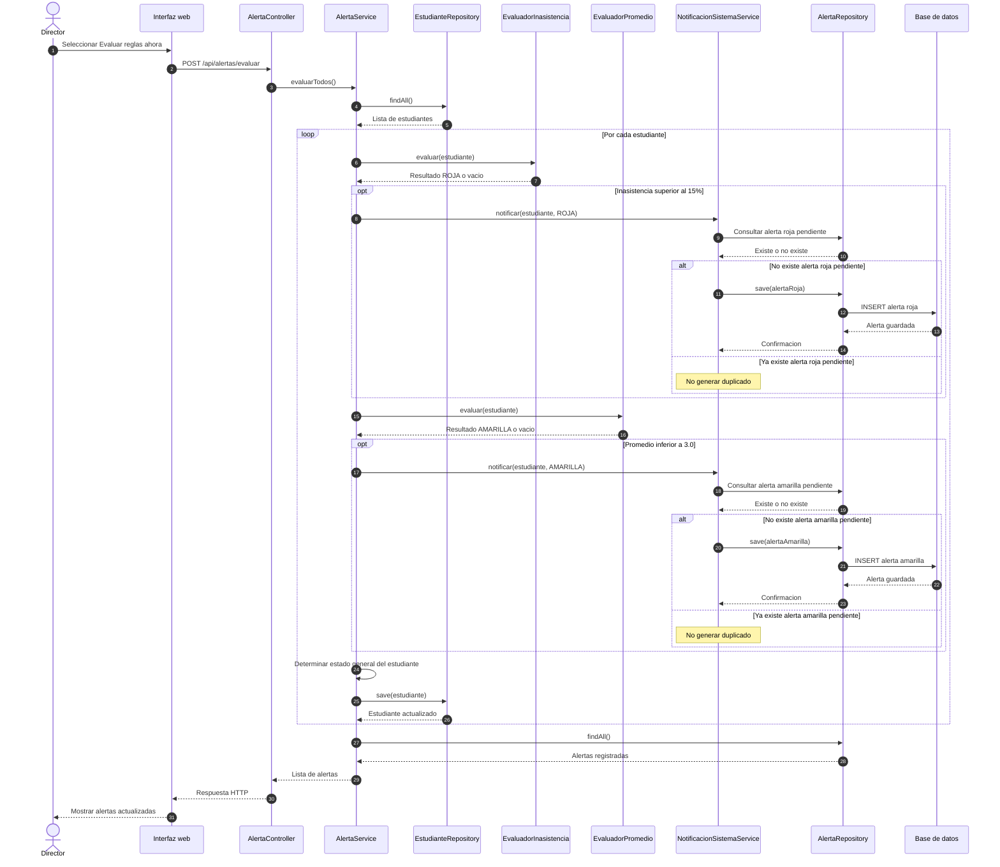

# Diagrama de Secuencia UML — SATE-UNIAJC

## Sesión 12 — Ingeniería de Software I

**Proyecto:** SATE-UNIAJC — Sistema de Alertas Tempranas y Acompañamiento Estudiantil.

**Historias relacionadas:** HU-06 (alerta roja) y HU-07 (alerta amarilla).

## Objetivo

Representar la secuencia de interacciones entre el director, el controlador REST, el motor de alertas, los evaluadores y el servicio de notificaciones.

El diagrama incluye el almacenamiento de la alerta mediante `AlertaRepository`, tal como solicita la guía de la Sesión 12.

## Diagrama de secuencia

## Descripción del proceso

1. El director solicita ejecutar el motor de alertas desde la interfaz.
2. `AlertaController` recibe la petición HTTP.
3. `AlertaService` consulta los estudiantes.
4. `EvaluadorInasistencia` comprueba si la inasistencia supera el 15 %.
5. `EvaluadorPromedio` comprueba si el promedio es inferior a 3.0.
6. Cuando un evaluador identifica riesgo, `AlertaService` solicita una notificación.
7. `NotificacionSistemaService` verifica que no exista otra alerta pendiente del mismo tipo para el estudiante.
8. Si no existe, almacena la alerta mediante `AlertaRepository.save()`.
9. El servicio actualiza el estado general del estudiante.
10. El controlador devuelve la información para actualizar la interfaz.

## Reglas de negocio

| Condición | Resultado |
|---|---|
| Inasistencia superior al 15 % | Alerta ROJA |
| Inasistencia igual o inferior al 15 % | No genera alerta roja |
| Promedio inferior a 3.0 | Alerta AMARILLA |
| Promedio igual o superior a 3.0 | No genera alerta amarilla |
| Ambas condiciones | Dos alertas independientes |
| Alerta pendiente del mismo tipo | No genera duplicado |

## Relación con los principios de diseño

**SRP:** cada evaluador comprueba una única condición académica.

**OCP:** pueden añadirse nuevos evaluadores utilizando la interfaz `EvaluadorAlerta`.

**DIP:** `AlertaService` utiliza las abstracciones `EvaluadorAlerta` y `NotificacionService`.

**KISS:** las condiciones académicas se evalúan mediante reglas simples.

**DRY:** se reutiliza el mecanismo de notificación para distintos tipos de alerta.

**YAGNI:** no se incorporan funciones adicionales que no sean necesarias para las historias actuales.

## Evidencia

Código fuente:
https://github.com/darwinvf2765/SATE-UNIAJC

Tablero Kanban:
https://github.com/users/darwinvf2765/projects/1

Este diagrama representa el flujo principal del motor de alertas implementado en el proyecto.
